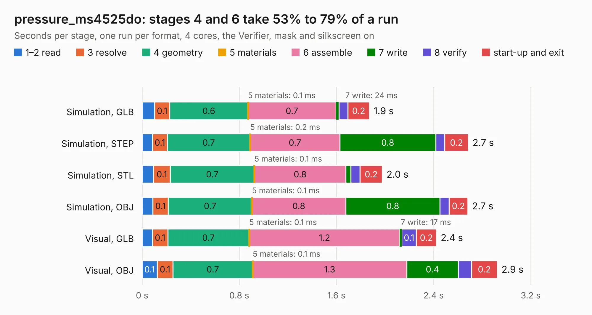

# 2366. pressure_ms4525do

Board 2,366 of the 3,125 of [Corpus Testing](../Corpus-Testing.md), on [Corpus Page 22](../CorpusTestingPages/Corpus-Testing-22.md#2366-pressure_ms4525do).

| Mode and format | 1–2 read | 3 resolve | 4 geometry | 5 materials | 6 assemble | 7 write | 8 verify | start-up and exit | Total |
|---|---:|---:|---:|---:|---:|---:|---:|---:|---:|
| Simulation, GLB | 0.1 | 0.1 | 0.6 | 0.1&nbsp;ms | 0.7 | 24&nbsp;ms | 74&nbsp;ms | 0.2 | 1.9 |
| Simulation, STEP | 86&nbsp;ms | 0.1 | 0.7 | 0.2&nbsp;ms | 0.7 | 0.8 | 74&nbsp;ms | 0.2 | 2.7 |
| Simulation, STL | 94&nbsp;ms | 0.1 | 0.7 | 0.1&nbsp;ms | 0.8 | 41&nbsp;ms | 76&nbsp;ms | 0.2 | 2.0 |
| Simulation, OBJ | 88&nbsp;ms | 0.1 | 0.7 | 0.1&nbsp;ms | 0.8 | 0.8 | 75&nbsp;ms | 0.2 | 2.7 |
| Visual, GLB | 85&nbsp;ms | 0.1 | 0.7 | 0.1&nbsp;ms | 1.2 | 17&nbsp;ms | 0.1 | 0.2 | 2.4 |
| Visual, OBJ | 0.1 | 0.1 | 0.7 | 0.1&nbsp;ms | 1.3 | 0.4 | 0.1 | 0.2 | 2.9 |

<table align="center"><tr><td valign="top">

| Board | Repo: [respiraworks/ventilator](https://github.com/respiraworks/ventilator) Board: `pressure_ms4525do.kicad_pcb` |
|---|---|
| Folder | pcb / sensor-daughterboards / pressure_ms4525do |
| Complexity | 138&nbsp;/&nbsp;1000 (size&nbsp;93, features&nbsp;45) |
| KESE&nbsp;features | through vias, rounded, trapezoid or chamfered pads, filled zones |
| Tested | 9th November 2026 |
| Copper&nbsp;layers | 2 |
| File&nbsp;format | KiCad 5 (20171130) |
| Parts,&nbsp;tracks,&nbsp;vias | 8, 15, 3 |
| Triangles,&nbsp;simulation | 193,984 in 23 parts |
| Verifier | PASS in all six runs |

</td><td valign="top">

<table>
<tr><th>File type</th><th>File size</th><th>Peak memory used</th></tr>
<tr><th colspan="3" align="left">Simulation</th></tr>
<tr><td>GLB</td><td align="right">6.3&nbsp;MB</td><td align="right">200&nbsp;MB</td></tr>
<tr><td>STEP</td><td align="right">23&nbsp;MB</td><td align="right">218&nbsp;MB</td></tr>
<tr><td>STL</td><td align="right">9.7&nbsp;MB</td><td align="right">202&nbsp;MB</td></tr>
<tr><td>OBJ</td><td align="right">19&nbsp;MB</td><td align="right">200&nbsp;MB</td></tr>
<tr><th colspan="3" align="left">Visual</th></tr>
<tr><td>GLB</td><td align="right">3.7&nbsp;MB</td><td align="right">176&nbsp;MB</td></tr>
<tr><td>OBJ</td><td align="right">11&nbsp;MB</td><td align="right">168&nbsp;MB</td></tr>
</table>

</td></tr></table>

| Previous | Next |
|:---|---:|
| [2365. pressure_mpxv5010dp](b2365b_ventilator_pressure-mpxv5010dp.md) | [2367. pressure_XGZP6897A](b2367b_ventilator_pressure-XGZP6897A.md) |
