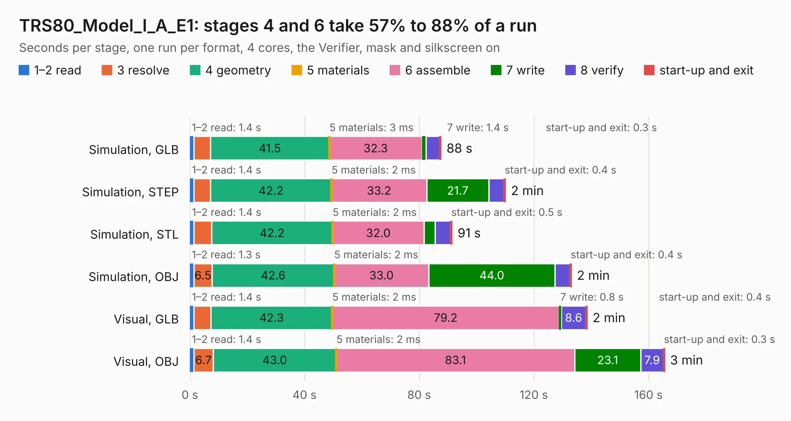

# 2368. TRS80_Model_I_A_E1

Board 2,368 of the 3,122 of [Corpus Testing](../Corpus-Testing.md), on [Corpus Page 22](../CorpusTestingPages/Corpus-Testing-22.md#2368-trs80_model_i_a_e1).

| Mode and format | 1–2 read | 3 resolve | 4 geometry | 5 materials | 6 assemble | 7 write | 8 verify | start-up and exit | Total |
|---|---:|---:|---:|---:|---:|---:|---:|---:|---:|
| Simulation, GLB | 1.4 | 5.8 | 41.5 | 3&nbsp;ms | 32.3 | 1.4 | 4.8 | 0.3 | 87.6 |
| Simulation, STEP | 1.4 | 5.8 | 42.2 | 2&nbsp;ms | 33.2 | 21.7 | 5.3 | 0.4 | 110.0 |
| Simulation, STL | 1.4 | 6.2 | 42.2 | 2&nbsp;ms | 32.0 | 3.8 | 5.4 | 0.5 | 91.4 |
| Simulation, OBJ | 1.3 | 6.5 | 42.6 | 2&nbsp;ms | 33.0 | 44.0 | 5.3 | 0.4 | 133.1 |
| Visual, GLB | 1.4 | 5.9 | 42.3 | 2&nbsp;ms | 79.2 | 0.8 | 8.6 | 0.4 | 138.5 |
| Visual, OBJ | 1.4 | 6.7 | 43.0 | 2&nbsp;ms | 83.1 | 23.1 | 7.9 | 0.3 | 165.6 |

<table align="center"><tr><td valign="top">

| Board | Repo: [RetroStack/TRS-80-Model-I-A-E1](https://github.com/RetroStack/TRS-80-Model-I-A-E1) Board: `TRS80_Model_I_A_E1.kicad_pcb` |
|---|---|
| Folder | KiCAD |
| Complexity | 355&nbsp;/&nbsp;1000 (size&nbsp;225, features&nbsp;130) |
| KESE&nbsp;features | through vias, rounded, trapezoid or chamfered pads, drill offsets, filled zones, copper drawings, copper text, curved board outline, stack-up, dielectric εr and tanδ, copper finish |
| Tested | 9th November 2026 |
| Copper&nbsp;layers | 2 |
| File&nbsp;format | KiCad 9 (20241229) |
| Parts,&nbsp;tracks,&nbsp;vias | 221, 8,286, 335 |
| Triangles,&nbsp;simulation | 9,233,510 in 387 parts |
| Verifier | PASS in all six runs |

</td><td valign="top">

<table>
<tr><th>File type</th><th>File size</th><th>Peak memory used</th></tr>
<tr><th colspan="3" align="left">Simulation</th></tr>
<tr><td>GLB</td><td align="right">314&nbsp;MB</td><td align="right">2.8&nbsp;GB</td></tr>
<tr><td>STEP</td><td align="right">1.6&nbsp;GB</td><td align="right">3.3&nbsp;GB</td></tr>
<tr><td>STL</td><td align="right">462&nbsp;MB</td><td align="right">2.4&nbsp;GB</td></tr>
<tr><td>OBJ</td><td align="right">988&nbsp;MB</td><td align="right">5.7&nbsp;GB</td></tr>
<tr><th colspan="3" align="left">Visual</th></tr>
<tr><td>GLB</td><td align="right">176&nbsp;MB</td><td align="right">2.7&nbsp;GB</td></tr>
<tr><td>OBJ</td><td align="right">562&nbsp;MB</td><td align="right">3.5&nbsp;GB</td></tr>
</table>

</td></tr></table>

| Previous | Next |
|:---|---:|
| [2367. DigiTrainer](b2367b_BitStack-DigiTrainer_DigiTrainer.md) | [2369. TRS80_Model_I_D_E1](b2369b_TRS-80-Model-I-D-E1_TRS80-Model-I-D-E1.md) |
