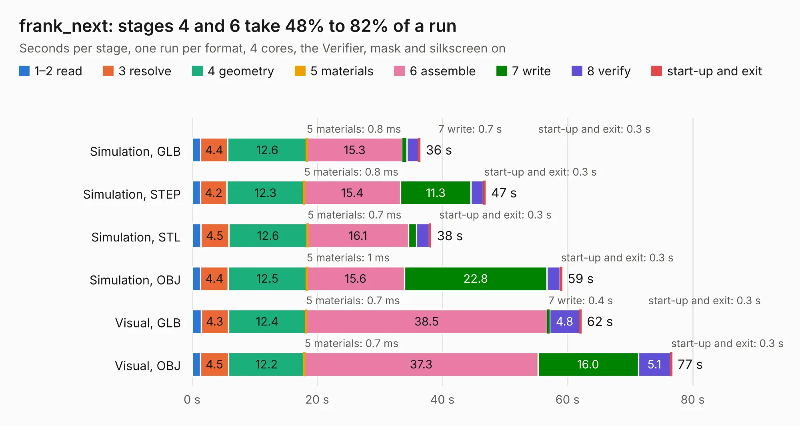

# 2369. frank_next

Board 2,369 of the 3,110 of [Corpus Testing](../Corpus-Testing.md), on [Corpus Page 22](../CorpusTestingPages/Corpus-Testing-22.md#2369-frank_next).

| Mode and format | 1–2 read | 3 resolve | 4 geometry | 5 materials | 6 assemble | 7 write | 8 verify | start-up and exit | Total |
|---|---:|---:|---:|---:|---:|---:|---:|---:|---:|
| Simulation, GLB | 1.4 | 4.4 | 12.6 | 0.8&nbsp;ms | 15.3 | 0.7 | 1.8 | 0.3 | 36.5 |
| Simulation, STEP | 1.3 | 4.2 | 12.3 | 0.8&nbsp;ms | 15.4 | 11.3 | 2.0 | 0.3 | 46.9 |
| Simulation, STL | 1.4 | 4.5 | 12.6 | 0.7&nbsp;ms | 16.1 | 1.3 | 2.1 | 0.3 | 38.2 |
| Simulation, OBJ | 1.4 | 4.4 | 12.5 | 1&nbsp;ms | 15.6 | 22.8 | 2.1 | 0.3 | 59.1 |
| Visual, GLB | 1.4 | 4.3 | 12.4 | 0.7&nbsp;ms | 38.5 | 0.4 | 4.8 | 0.3 | 62.2 |
| Visual, OBJ | 1.4 | 4.5 | 12.2 | 0.7&nbsp;ms | 37.3 | 16.0 | 5.1 | 0.3 | 76.7 |

<table align="center"><tr><td valign="top">

| Board | Repo: [rh1tech/frank](https://github.com/rh1tech/frank) Board: `frank_next.kicad_pcb` |
|---|---|
| Folder | hardware / frank_next |
| Complexity | 415&nbsp;/&nbsp;1000 (size&nbsp;280, features&nbsp;135) |
| KESE&nbsp;features | through vias, slotted holes, custom pads, rounded, trapezoid or chamfered pads, filled zones, copper drawings, curved board outline, TrueType text, stack-up, dielectric εr and tanδ |
| Tested | 9th November 2026 |
| Copper&nbsp;layers | 4 |
| File&nbsp;format | KiCad 10 (20260206) |
| Parts,&nbsp;tracks,&nbsp;vias | 253, 2,543, 481 |
| Triangles,&nbsp;simulation | 4,053,814 in 277 parts |
| Verifier | PASS in all six runs |

</td><td valign="top">

<table>
<tr><th>File type</th><th>File size</th><th>Peak memory used</th></tr>
<tr><th colspan="3" align="left">Simulation</th></tr>
<tr><td>GLB</td><td align="right">138&nbsp;MB</td><td align="right">1.5&nbsp;GB</td></tr>
<tr><td>STEP</td><td align="right">643&nbsp;MB</td><td align="right">1.6&nbsp;GB</td></tr>
<tr><td>STL</td><td align="right">203&nbsp;MB</td><td align="right">1.4&nbsp;GB</td></tr>
<tr><td>OBJ</td><td align="right">428&nbsp;MB</td><td align="right">2.6&nbsp;GB</td></tr>
<tr><th colspan="3" align="left">Visual</th></tr>
<tr><td>GLB</td><td align="right">95&nbsp;MB</td><td align="right">1.7&nbsp;GB</td></tr>
<tr><td>OBJ</td><td align="right">304&nbsp;MB</td><td align="right">2.0&nbsp;GB</td></tr>
</table>

</td></tr></table>

| Previous | Next |
|:---|---:|
| [2368. frank_core2u](b2368b_frank_frank-core2u.md) | [2370. frank_pga](b2370b_frank_frank-pga.md) |
