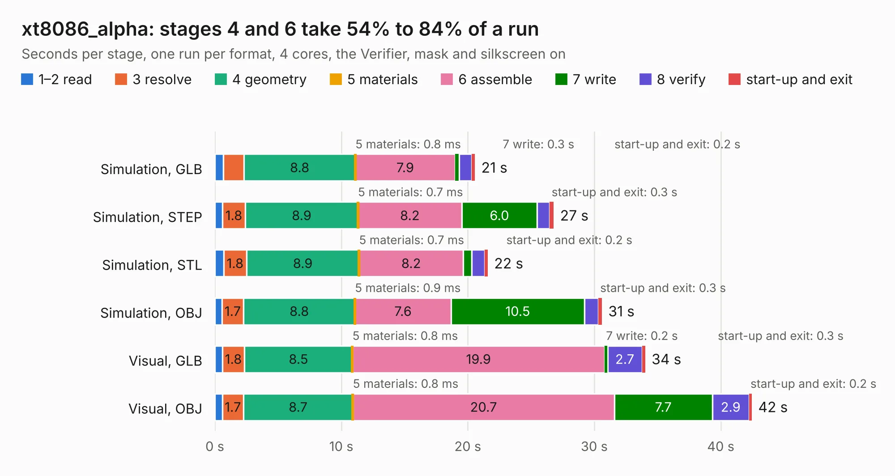

# 2369. xt8086_alpha

Board 2,369 of the 3,101 of [Corpus Testing](../Corpus-Testing.md), on [Corpus Page 22](../CorpusTestingPages/Corpus-Testing-22.md#2369-xt8086_alpha).

| Mode and format | 1–2 read | 3 resolve | 4 geometry | 5 materials | 6 assemble | 7 write | 8 verify | start-up and exit | Total |
|---|---:|---:|---:|---:|---:|---:|---:|---:|---:|
| Simulation, GLB | 0.7 | 1.6 | 8.8 | 0.8&nbsp;ms | 7.9 | 0.3 | 1.0 | 0.2 | 20.6 |
| Simulation, STEP | 0.6 | 1.8 | 8.9 | 0.7&nbsp;ms | 8.2 | 6.0 | 1.0 | 0.3 | 26.8 |
| Simulation, STL | 0.7 | 1.8 | 8.9 | 0.7&nbsp;ms | 8.2 | 0.7 | 1.0 | 0.2 | 21.6 |
| Simulation, OBJ | 0.6 | 1.7 | 8.8 | 0.9&nbsp;ms | 7.6 | 10.5 | 1.1 | 0.3 | 30.6 |
| Visual, GLB | 0.6 | 1.8 | 8.5 | 0.8&nbsp;ms | 19.9 | 0.2 | 2.7 | 0.3 | 34.0 |
| Visual, OBJ | 0.6 | 1.7 | 8.7 | 0.8&nbsp;ms | 20.7 | 7.7 | 2.9 | 0.2 | 42.5 |

<table align="center"><tr><td valign="top">

| Board | Repo: [rh1tech/frank](https://github.com/rh1tech/frank) Board: `xt8086_alpha.kicad_pcb` |
|---|---|
| Folder | hardware / xt8086_alpha |
| Complexity | 309&nbsp;/&nbsp;1000 (size&nbsp;184, features&nbsp;125) |
| KESE&nbsp;features | through vias, slotted holes, rounded, trapezoid or chamfered pads, filled zones, curved board outline, knockout text, TrueType text, stack-up, dielectric εr and tanδ |
| Tested | 9th November 2026 |
| Copper&nbsp;layers | 2 |
| File&nbsp;format | KiCad 10 (20260206) |
| Parts,&nbsp;tracks,&nbsp;vias | 80, 1,055, 142 |
| Triangles,&nbsp;simulation | 2,338,914 in 151 parts |
| Verifier | PASS in all six runs |

</td><td valign="top">

<table>
<tr><th>File type</th><th>File size</th><th>Peak memory used</th></tr>
<tr><th colspan="3" align="left">Simulation</th></tr>
<tr><td>GLB</td><td align="right">79&nbsp;MB</td><td align="right">953&nbsp;MB</td></tr>
<tr><td>STEP</td><td align="right">375&nbsp;MB</td><td align="right">1.0&nbsp;GB</td></tr>
<tr><td>STL</td><td align="right">117&nbsp;MB</td><td align="right">964&nbsp;MB</td></tr>
<tr><td>OBJ</td><td align="right">243&nbsp;MB</td><td align="right">1.5&nbsp;GB</td></tr>
<tr><th colspan="3" align="left">Visual</th></tr>
<tr><td>GLB</td><td align="right">58&nbsp;MB</td><td align="right">1.0&nbsp;GB</td></tr>
<tr><td>OBJ</td><td align="right">178&nbsp;MB</td><td align="right">1.2&nbsp;GB</td></tr>
</table>

</td></tr></table>

| Previous | Next |
|:---|---:|
| [2368. turbosound](b2368b_frank_turbosound.md) | [2370. zerofrank](b2370b_frank_zerofrank.md) |
