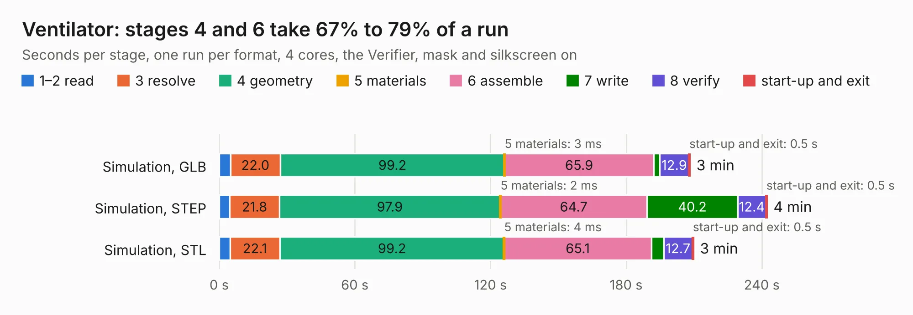

# 2369. Ventilator

Board 2,369 of the 3,127 of [Corpus Testing](../Corpus-Testing.md), on [Corpus Page 22](../CorpusTestingPages/Corpus-Testing-22.md#2369-ventilator).

| Mode and format | 1–2 read | 3 resolve | 4 geometry | 5 materials | 6 assemble | 7 write | 8 verify | start-up and exit | Total |
|---|---:|---:|---:|---:|---:|---:|---:|---:|---:|
| Simulation, GLB | 5.0 | 22.0 | 99.2 | 3&nbsp;ms | 65.9 | 2.6 | 12.9 | 0.5 | 208.2 |
| Simulation, STEP | 4.7 | 21.8 | 97.9 | 2&nbsp;ms | 64.7 | 40.2 | 12.4 | 0.5 | 242.3 |
| Simulation, STL | 4.8 | 22.1 | 99.2 | 4&nbsp;ms | 65.1 | 5.5 | 12.7 | 0.5 | 209.8 |
| Simulation, OBJ | 4.8 | 22.2 | 97.4 | 2&nbsp;ms | 62.9 | 84.7 | 12.7 | 0.5 | 285.2 |
| Visual, GLB | 4.8 | 21.5 | 97.6 | 3&nbsp;ms | 142.0 | 1.7 | 13.4 | 0.4 | 281.4 |
| Visual, OBJ | 4.8 | 21.7 | 99.1 | 3&nbsp;ms | 144.5 | 54.0 | 13.7 | 0.4 | 338.3 |

<table align="center"><tr><td valign="top">

| Board | Repo: [respiraworks/ventilator](https://github.com/respiraworks/ventilator) Board: `Ventilator.kicad_pcb` |
|---|---|
| Folder | pcb |
| Complexity | 386&nbsp;/&nbsp;1000 (size&nbsp;306, features&nbsp;80) |
| KESE&nbsp;features | through vias, slotted holes, custom pads, rounded, trapezoid or chamfered pads, filled zones, copper drawings |
| Tested | 9th November 2026 |
| Copper&nbsp;layers | 4 |
| File&nbsp;format | KiCad 5 (20171130) |
| Parts,&nbsp;tracks,&nbsp;vias | 651, 5,225, 1,196 |
| Triangles,&nbsp;simulation | 12,721,758 in 554 parts |
| Verifier | PASS in all six runs |

</td><td valign="top">

<table>
<tr><th>File type</th><th>File size</th><th>Peak memory used</th></tr>
<tr><th colspan="3" align="left">Simulation</th></tr>
<tr><td>GLB</td><td align="right">433&nbsp;MB</td><td align="right">3.3&nbsp;GB</td></tr>
<tr><td>STEP</td><td align="right">1.7&nbsp;GB</td><td align="right">4.8&nbsp;GB</td></tr>
<tr><td>STL</td><td align="right">636&nbsp;MB</td><td align="right">3.3&nbsp;GB</td></tr>
<tr><td>OBJ</td><td align="right">1.4&nbsp;GB</td><td align="right">8.0&nbsp;GB</td></tr>
<tr><th colspan="3" align="left">Visual</th></tr>
<tr><td>GLB</td><td align="right">291&nbsp;MB</td><td align="right">4.4&nbsp;GB</td></tr>
<tr><td>OBJ</td><td align="right">932&nbsp;MB</td><td align="right">5.7&nbsp;GB</td></tr>
</table>

</td></tr></table>

| Previous | Next |
|:---|---:|
| [2368. pressure_XGZP6897A](b2368b_ventilator_pressure-XGZP6897A.md) | [2370. DigiTrainer](b2370b_BitStack-DigiTrainer_DigiTrainer.md) |
