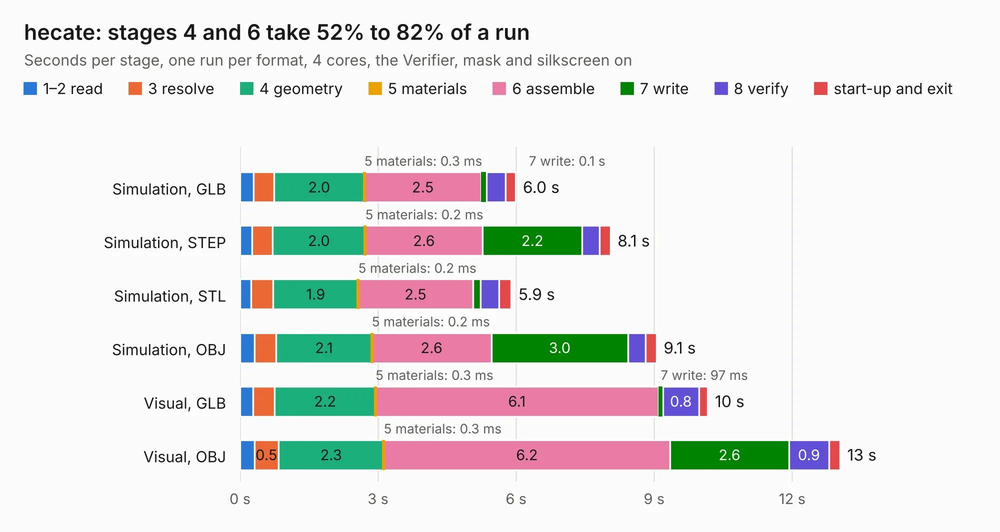

# 2370. hecate

Board 2,370 of the 3,109 of [Corpus Testing](../Corpus-Testing.md), on [Corpus Page 22](../CorpusTestingPages/Corpus-Testing-22.md#2370-hecate).

| Mode and format | 1–2 read | 3 resolve | 4 geometry | 5 materials | 6 assemble | 7 write | 8 verify | start-up and exit | Total |
|---|---:|---:|---:|---:|---:|---:|---:|---:|---:|
| Simulation, GLB | 0.3 | 0.4 | 2.0 | 0.3&nbsp;ms | 2.5 | 0.1 | 0.4 | 0.2 | 6.0 |
| Simulation, STEP | 0.3 | 0.5 | 2.0 | 0.2&nbsp;ms | 2.6 | 2.2 | 0.4 | 0.2 | 8.1 |
| Simulation, STL | 0.2 | 0.5 | 1.9 | 0.2&nbsp;ms | 2.5 | 0.2 | 0.4 | 0.3 | 5.9 |
| Simulation, OBJ | 0.3 | 0.5 | 2.1 | 0.2&nbsp;ms | 2.6 | 3.0 | 0.4 | 0.2 | 9.1 |
| Visual, GLB | 0.3 | 0.5 | 2.2 | 0.3&nbsp;ms | 6.1 | 97&nbsp;ms | 0.8 | 0.2 | 10.2 |
| Visual, OBJ | 0.3 | 0.5 | 2.3 | 0.3&nbsp;ms | 6.2 | 2.6 | 0.9 | 0.2 | 13.0 |

<table align="center"><tr><td valign="top">

| Board | Repo: [rh1tech/frank](https://github.com/rh1tech/frank) Board: `hecate.kicad_pcb` |
|---|---|
| Folder | hardware / hecate |
| Complexity | 337&nbsp;/&nbsp;1000 (size&nbsp;202, features&nbsp;135) |
| KESE&nbsp;features | through vias, slotted holes, custom pads, rounded, trapezoid or chamfered pads, filled zones, copper drawings, curved board outline, TrueType text, stack-up, dielectric εr and tanδ |
| Tested | 9th November 2026 |
| Copper&nbsp;layers | 2 |
| File&nbsp;format | KiCad 10 (20260206) |
| Parts,&nbsp;tracks,&nbsp;vias | 54, 361, 51 |
| Triangles,&nbsp;simulation | 659,544 in 80 parts |
| Verifier | PASS in all six runs |

</td><td valign="top">

<table>
<tr><th>File type</th><th>File size</th><th>Peak memory used</th></tr>
<tr><th colspan="3" align="left">Simulation</th></tr>
<tr><td>GLB</td><td align="right">23&nbsp;MB</td><td align="right">421&nbsp;MB</td></tr>
<tr><td>STEP</td><td align="right">123&nbsp;MB</td><td align="right">436&nbsp;MB</td></tr>
<tr><td>STL</td><td align="right">33&nbsp;MB</td><td align="right">426&nbsp;MB</td></tr>
<tr><td>OBJ</td><td align="right">67&nbsp;MB</td><td align="right">474&nbsp;MB</td></tr>
<tr><th colspan="3" align="left">Visual</th></tr>
<tr><td>GLB</td><td align="right">19&nbsp;MB</td><td align="right">464&nbsp;MB</td></tr>
<tr><td>OBJ</td><td align="right">56&nbsp;MB</td><td align="right">529&nbsp;MB</td></tr>
</table>

</td></tr></table>

| Previous | Next |
|:---|---:|
| [2369. frank_pga](b2369b_frank_frank-pga.md) | [2371. megafrank](b2371b_frank_megafrank.md) |
