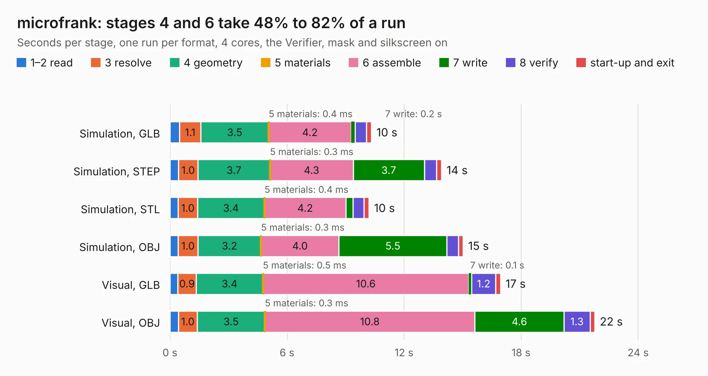

# 2370. microfrank

Board 2,370 of the 3,107 of [Corpus Testing](../Corpus-Testing.md), on [Corpus Page 22](../CorpusTestingPages/Corpus-Testing-22.md#2370-microfrank).

| Mode and format | 1–2 read | 3 resolve | 4 geometry | 5 materials | 6 assemble | 7 write | 8 verify | start-up and exit | Total |
|---|---:|---:|---:|---:|---:|---:|---:|---:|---:|
| Simulation, GLB | 0.5 | 1.1 | 3.5 | 0.4&nbsp;ms | 4.2 | 0.2 | 0.6 | 0.3 | 10.3 |
| Simulation, STEP | 0.4 | 1.0 | 3.7 | 0.3&nbsp;ms | 4.3 | 3.7 | 0.6 | 0.3 | 13.9 |
| Simulation, STL | 0.4 | 1.0 | 3.4 | 0.4&nbsp;ms | 4.2 | 0.4 | 0.6 | 0.3 | 10.2 |
| Simulation, OBJ | 0.4 | 1.0 | 3.2 | 0.3&nbsp;ms | 4.0 | 5.5 | 0.6 | 0.2 | 15.0 |
| Visual, GLB | 0.4 | 0.9 | 3.4 | 0.5&nbsp;ms | 10.6 | 0.1 | 1.2 | 0.2 | 16.9 |
| Visual, OBJ | 0.4 | 1.0 | 3.5 | 0.3&nbsp;ms | 10.8 | 4.6 | 1.3 | 0.2 | 21.8 |

<table align="center"><tr><td valign="top">

| Board | Repo: [rh1tech/frank](https://github.com/rh1tech/frank) Board: `microfrank.kicad_pcb` |
|---|---|
| Folder | hardware / microfrank |
| Complexity | 360&nbsp;/&nbsp;1000 (size&nbsp;240, features&nbsp;120) |
| KESE&nbsp;features | through vias, slotted holes, rounded, trapezoid or chamfered pads, filled zones, copper drawings, curved board outline, TrueType text, stack-up, dielectric εr and tanδ |
| Tested | 9th November 2026 |
| Copper&nbsp;layers | 4 |
| File&nbsp;format | KiCad 10 (20260206) |
| Parts,&nbsp;tracks,&nbsp;vias | 99, 915, 116 |
| Triangles,&nbsp;simulation | 1,388,196 in 136 parts |
| Verifier | PASS in all six runs |

</td><td valign="top">

<table>
<tr><th>File type</th><th>File size</th><th>Peak memory used</th></tr>
<tr><th colspan="3" align="left">Simulation</th></tr>
<tr><td>GLB</td><td align="right">48&nbsp;MB</td><td align="right">641&nbsp;MB</td></tr>
<tr><td>STEP</td><td align="right">220&nbsp;MB</td><td align="right">674&nbsp;MB</td></tr>
<tr><td>STL</td><td align="right">69&nbsp;MB</td><td align="right">639&nbsp;MB</td></tr>
<tr><td>OBJ</td><td align="right">143&nbsp;MB</td><td align="right">966&nbsp;MB</td></tr>
<tr><th colspan="3" align="left">Visual</th></tr>
<tr><td>GLB</td><td align="right">34&nbsp;MB</td><td align="right">727&nbsp;MB</td></tr>
<tr><td>OBJ</td><td align="right">104&nbsp;MB</td><td align="right">800&nbsp;MB</td></tr>
</table>

</td></tr></table>

| Previous | Next |
|:---|---:|
| [2369. megafrank](b2369b_frank_megafrank.md) | [2371. minifrank](b2371b_frank_minifrank.md) |
