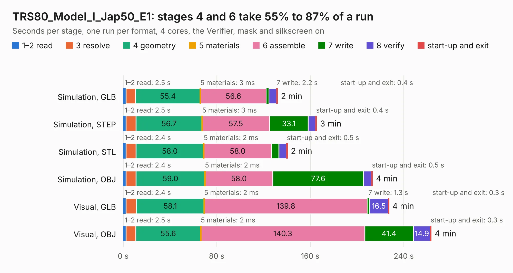

# 2371. TRS80_Model_I_Jap50_E1

Board 2,371 of the 3,119 of [Corpus Testing](../Corpus-Testing.md), on [Corpus Page 22](../CorpusTestingPages/Corpus-Testing-22.md#2371-trs80_model_i_jap50_e1).

| Mode and format | 1–2 read | 3 resolve | 4 geometry | 5 materials | 6 assemble | 7 write | 8 verify | start-up and exit | Total |
|---|---:|---:|---:|---:|---:|---:|---:|---:|---:|
| Simulation, GLB | 2.5 | 8.1 | 55.4 | 3&nbsp;ms | 56.6 | 2.2 | 6.7 | 0.4 | 131.8 |
| Simulation, STEP | 2.5 | 8.5 | 56.7 | 3&nbsp;ms | 57.5 | 33.1 | 6.6 | 0.4 | 165.3 |
| Simulation, STL | 2.4 | 8.5 | 58.0 | 2&nbsp;ms | 58.0 | 6.3 | 6.7 | 0.5 | 140.4 |
| Simulation, OBJ | 2.4 | 8.5 | 59.0 | 2&nbsp;ms | 58.0 | 77.6 | 7.0 | 0.5 | 213.1 |
| Visual, GLB | 2.4 | 8.7 | 58.1 | 2&nbsp;ms | 139.8 | 1.3 | 16.5 | 0.3 | 227.2 |
| Visual, OBJ | 2.5 | 8.3 | 55.6 | 2&nbsp;ms | 140.3 | 41.4 | 14.9 | 0.3 | 263.3 |

<table align="center"><tr><td valign="top">

| Board | Repo: [RetroStack/TRS-80-Model-I-Jap50-E1](https://github.com/RetroStack/TRS-80-Model-I-Jap50-E1) Board: `TRS80_Model_I_Jap50_E1.kicad_pcb` |
|---|---|
| Folder | KiCAD |
| Complexity | 389&nbsp;/&nbsp;1000 (size&nbsp;239, features&nbsp;150) |
| KESE&nbsp;features | through vias, rounded, trapezoid or chamfered pads, drill offsets, arc tracks, filled zones, copper text, curved board outline, TrueType text, stack-up, dielectric εr and tanδ, copper finish |
| Tested | 9th November 2026 |
| Copper&nbsp;layers | 2 |
| File&nbsp;format | KiCad 9 (20241229) |
| Parts,&nbsp;tracks,&nbsp;vias | 253, 17,144, 739 |
| Triangles,&nbsp;simulation | 14,147,000 in 421 parts |
| Verifier | PASS in all six runs |

</td><td valign="top">

<table>
<tr><th>File type</th><th>File size</th><th>Peak memory used</th></tr>
<tr><th colspan="3" align="left">Simulation</th></tr>
<tr><td>GLB</td><td align="right">471&nbsp;MB</td><td align="right">4.4&nbsp;GB</td></tr>
<tr><td>STEP</td><td align="right">2.0&nbsp;GB</td><td align="right">5.1&nbsp;GB</td></tr>
<tr><td>STL</td><td align="right">707&nbsp;MB</td><td align="right">4.4&nbsp;GB</td></tr>
<tr><td>OBJ</td><td align="right">1.5&nbsp;GB</td><td align="right">8.7&nbsp;GB</td></tr>
<tr><th colspan="3" align="left">Visual</th></tr>
<tr><td>GLB</td><td align="right">299&nbsp;MB</td><td align="right">4.3&nbsp;GB</td></tr>
<tr><td>OBJ</td><td align="right">958&nbsp;MB</td><td align="right">6.0&nbsp;GB</td></tr>
</table>

</td></tr></table>

| Previous | Next |
|:---|---:|
| [2370. TRS80_Model_I_Jap20_E1](b2370b_TRS-80-Model-I-Jap20-E1_TRS80-Model-I-Jap20-E1.md) | [2372. AVIONICS_BOARD](b2372b_1kcubesat-hardware_AVIONICS-BOARD.md) |
