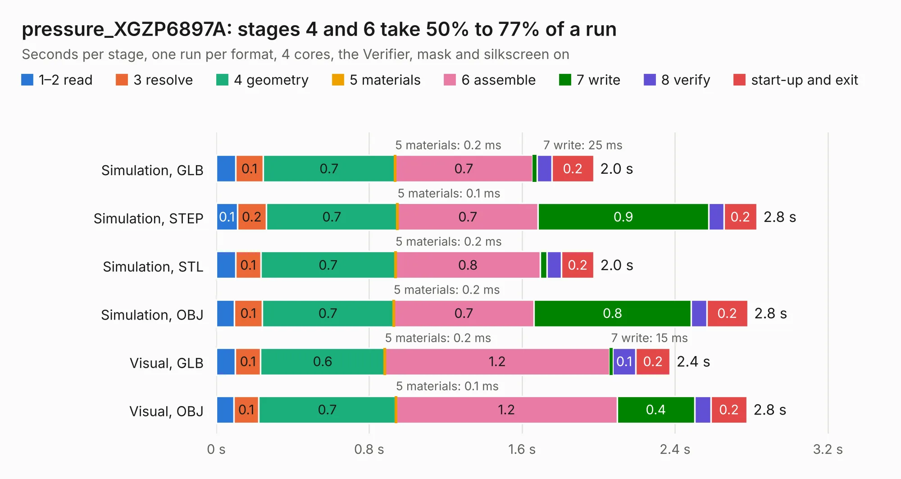

# 2371. pressure_XGZP6897A

Board 2,371 of the 3,131 of [Corpus Testing](../Corpus-Testing.md), on [Corpus Page 22](../CorpusTestingPages/Corpus-Testing-22.md#2371-pressure_xgzp6897a).

| Mode and format | 1–2 read | 3 resolve | 4 geometry | 5 materials | 6 assemble | 7 write | 8 verify | start-up and exit | Total |
|---|---:|---:|---:|---:|---:|---:|---:|---:|---:|
| Simulation, GLB | 0.1 | 0.1 | 0.7 | 0.2&nbsp;ms | 0.7 | 25&nbsp;ms | 77&nbsp;ms | 0.2 | 2.0 |
| Simulation, STEP | 0.1 | 0.2 | 0.7 | 0.1&nbsp;ms | 0.7 | 0.9 | 79&nbsp;ms | 0.2 | 2.8 |
| Simulation, STL | 0.1 | 0.1 | 0.7 | 0.2&nbsp;ms | 0.8 | 35&nbsp;ms | 76&nbsp;ms | 0.2 | 2.0 |
| Simulation, OBJ | 95&nbsp;ms | 0.1 | 0.7 | 0.2&nbsp;ms | 0.7 | 0.8 | 82&nbsp;ms | 0.2 | 2.8 |
| Visual, GLB | 0.1 | 0.1 | 0.6 | 0.2&nbsp;ms | 1.2 | 15&nbsp;ms | 0.1 | 0.2 | 2.4 |
| Visual, OBJ | 91&nbsp;ms | 0.1 | 0.7 | 0.1&nbsp;ms | 1.2 | 0.4 | 87&nbsp;ms | 0.2 | 2.8 |

<table align="center"><tr><td valign="top">

| Board | Repo: [respiraworks/ventilator](https://github.com/respiraworks/ventilator) Board: `pressure_XGZP6897A.kicad_pcb` |
|---|---|
| Folder | pcb / sensor-daughterboards / pressure_XGZP6897A |
| Complexity | 157&nbsp;/&nbsp;1000 (size&nbsp;112, features&nbsp;45) |
| KESE&nbsp;features | through vias, rounded, trapezoid or chamfered pads, filled zones |
| Tested | 9th November 2026 |
| Copper&nbsp;layers | 2 |
| File&nbsp;format | KiCad 5 (20171130) |
| Parts,&nbsp;tracks,&nbsp;vias | 12, 38, 7 |
| Triangles,&nbsp;simulation | 160,728 in 22 parts |
| Verifier | PASS in all six runs |

</td><td valign="top">

<table>
<tr><th>File type</th><th>File size</th><th>Peak memory used</th></tr>
<tr><th colspan="3" align="left">Simulation</th></tr>
<tr><td>GLB</td><td align="right">5.2&nbsp;MB</td><td align="right">192&nbsp;MB</td></tr>
<tr><td>STEP</td><td align="right">19&nbsp;MB</td><td align="right">208&nbsp;MB</td></tr>
<tr><td>STL</td><td align="right">8.0&nbsp;MB</td><td align="right">193&nbsp;MB</td></tr>
<tr><td>OBJ</td><td align="right">16&nbsp;MB</td><td align="right">193&nbsp;MB</td></tr>
<tr><th colspan="3" align="left">Visual</th></tr>
<tr><td>GLB</td><td align="right">3.0&nbsp;MB</td><td align="right">159&nbsp;MB</td></tr>
<tr><td>OBJ</td><td align="right">8.4&nbsp;MB</td><td align="right">159&nbsp;MB</td></tr>
</table>

</td></tr></table>

| Previous | Next |
|:---|---:|
| [2370. pressure_ms4525do](b2370b_ventilator_pressure-ms4525do.md) | [2372. Ventilator](b2372b_ventilator_Ventilator.md) |
