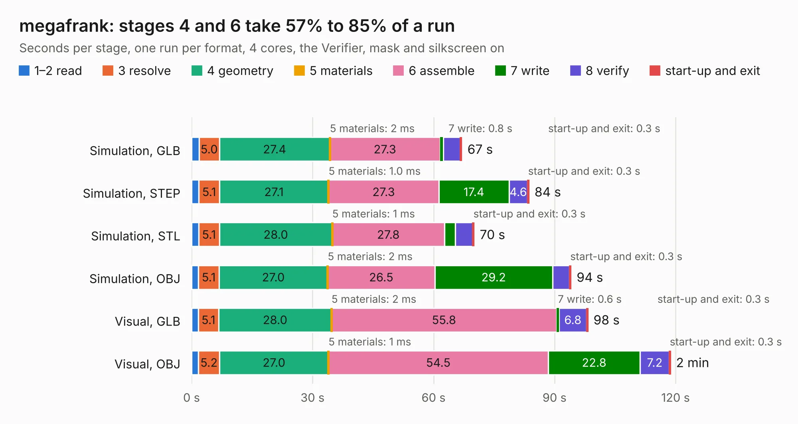

# 2372. megafrank

Board 2,372 of the 3,110 of [Corpus Testing](../Corpus-Testing.md), on [Corpus Page 22](../CorpusTestingPages/Corpus-Testing-22.md#2372-megafrank).

| Mode and format | 1–2 read | 3 resolve | 4 geometry | 5 materials | 6 assemble | 7 write | 8 verify | start-up and exit | Total |
|---|---:|---:|---:|---:|---:|---:|---:|---:|---:|
| Simulation, GLB | 1.8 | 5.0 | 27.4 | 2&nbsp;ms | 27.3 | 0.8 | 4.2 | 0.3 | 67.0 |
| Simulation, STEP | 1.8 | 5.1 | 27.1 | 1.0&nbsp;ms | 27.3 | 17.4 | 4.6 | 0.3 | 83.6 |
| Simulation, STL | 1.7 | 5.1 | 28.0 | 1&nbsp;ms | 27.8 | 2.7 | 4.4 | 0.3 | 70.0 |
| Simulation, OBJ | 1.7 | 5.1 | 27.0 | 2&nbsp;ms | 26.5 | 29.2 | 4.2 | 0.3 | 94.1 |
| Visual, GLB | 1.6 | 5.1 | 28.0 | 2&nbsp;ms | 55.8 | 0.6 | 6.8 | 0.3 | 98.2 |
| Visual, OBJ | 1.7 | 5.2 | 27.0 | 1&nbsp;ms | 54.5 | 22.8 | 7.2 | 0.3 | 118.7 |

<table align="center"><tr><td valign="top">

| Board | Repo: [rh1tech/frank](https://github.com/rh1tech/frank) Board: `megafrank.kicad_pcb` |
|---|---|
| Folder | hardware / megafrank |
| Complexity | 349&nbsp;/&nbsp;1000 (size&nbsp;214, features&nbsp;135) |
| KESE&nbsp;features | through vias, slotted holes, custom pads, rounded, trapezoid or chamfered pads, filled zones, copper drawings, curved board outline, TrueType text, stack-up, dielectric εr and tanδ |
| Tested | 9th November 2026 |
| Copper&nbsp;layers | 2 |
| File&nbsp;format | KiCad 10 (20260206) |
| Parts,&nbsp;tracks,&nbsp;vias | 258, 2,815, 492 |
| Triangles,&nbsp;simulation | 4,955,126 in 326 parts |
| Verifier | PASS in all six runs |

</td><td valign="top">

<table>
<tr><th>File type</th><th>File size</th><th>Peak memory used</th></tr>
<tr><th colspan="3" align="left">Simulation</th></tr>
<tr><td>GLB</td><td align="right">168&nbsp;MB</td><td align="right">1.6&nbsp;GB</td></tr>
<tr><td>STEP</td><td align="right">899&nbsp;MB</td><td align="right">2.1&nbsp;GB</td></tr>
<tr><td>STL</td><td align="right">248&nbsp;MB</td><td align="right">1.6&nbsp;GB</td></tr>
<tr><td>OBJ</td><td align="right">525&nbsp;MB</td><td align="right">3.2&nbsp;GB</td></tr>
<tr><th colspan="3" align="left">Visual</th></tr>
<tr><td>GLB</td><td align="right">134&nbsp;MB</td><td align="right">2.1&nbsp;GB</td></tr>
<tr><td>OBJ</td><td align="right">427&nbsp;MB</td><td align="right">2.7&nbsp;GB</td></tr>
</table>

</td></tr></table>

| Previous | Next |
|:---|---:|
| [2371. hecate](b2371b_frank_hecate.md) | [2373. microfrank](b2373b_frank_microfrank.md) |
