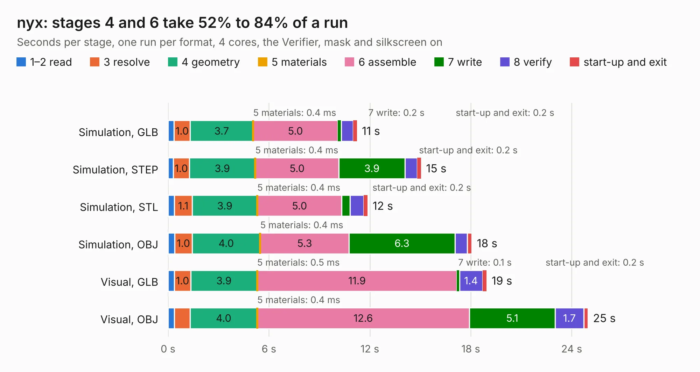

# 2372. nyx

Board 2,372 of the 3,107 of [Corpus Testing](../Corpus-Testing.md), on [Corpus Page 22](../CorpusTestingPages/Corpus-Testing-22.md#2372-nyx).

| Mode and format | 1–2 read | 3 resolve | 4 geometry | 5 materials | 6 assemble | 7 write | 8 verify | start-up and exit | Total |
|---|---:|---:|---:|---:|---:|---:|---:|---:|---:|
| Simulation, GLB | 0.4 | 1.0 | 3.7 | 0.4&nbsp;ms | 5.0 | 0.2 | 0.7 | 0.2 | 11.2 |
| Simulation, STEP | 0.3 | 1.0 | 3.9 | 0.4&nbsp;ms | 5.0 | 3.9 | 0.7 | 0.2 | 15.0 |
| Simulation, STL | 0.4 | 1.1 | 3.9 | 0.4&nbsp;ms | 5.0 | 0.5 | 0.8 | 0.2 | 11.9 |
| Simulation, OBJ | 0.4 | 1.0 | 4.0 | 0.4&nbsp;ms | 5.3 | 6.3 | 0.7 | 0.3 | 18.1 |
| Visual, GLB | 0.4 | 1.0 | 3.9 | 0.5&nbsp;ms | 11.9 | 0.1 | 1.4 | 0.2 | 18.9 |
| Visual, OBJ | 0.4 | 0.9 | 4.0 | 0.4&nbsp;ms | 12.6 | 5.1 | 1.7 | 0.3 | 25.0 |

<table align="center"><tr><td valign="top">

| Board | Repo: [rh1tech/frank](https://github.com/rh1tech/frank) Board: `nyx.kicad_pcb` |
|---|---|
| Folder | hardware / nyx |
| Complexity | 361&nbsp;/&nbsp;1000 (size&nbsp;236, features&nbsp;125) |
| KESE&nbsp;features | through vias, slotted holes, rounded, trapezoid or chamfered pads, arc tracks, filled zones, curved board outline, TrueType text, stack-up, dielectric εr and tanδ |
| Tested | 9th November 2026 |
| Copper&nbsp;layers | 4 |
| File&nbsp;format | KiCad 10 (20260206) |
| Parts,&nbsp;tracks,&nbsp;vias | 54, 1,186, 77 |
| Triangles,&nbsp;simulation | 1,400,020 in 101 parts |
| Verifier | PASS in all six runs |

</td><td valign="top">

<table>
<tr><th>File type</th><th>File size</th><th>Peak memory used</th></tr>
<tr><th colspan="3" align="left">Simulation</th></tr>
<tr><td>GLB</td><td align="right">48&nbsp;MB</td><td align="right">570&nbsp;MB</td></tr>
<tr><td>STEP</td><td align="right">230&nbsp;MB</td><td align="right">664&nbsp;MB</td></tr>
<tr><td>STL</td><td align="right">70&nbsp;MB</td><td align="right">623&nbsp;MB</td></tr>
<tr><td>OBJ</td><td align="right">145&nbsp;MB</td><td align="right">952&nbsp;MB</td></tr>
<tr><th colspan="3" align="left">Visual</th></tr>
<tr><td>GLB</td><td align="right">34&nbsp;MB</td><td align="right">749&nbsp;MB</td></tr>
<tr><td>OBJ</td><td align="right">104&nbsp;MB</td><td align="right">824&nbsp;MB</td></tr>
</table>

</td></tr></table>

| Previous | Next |
|:---|---:|
| [2371. minifrank](b2371b_frank_minifrank.md) | [2373. oldskool](b2373b_frank_oldskool.md) |
