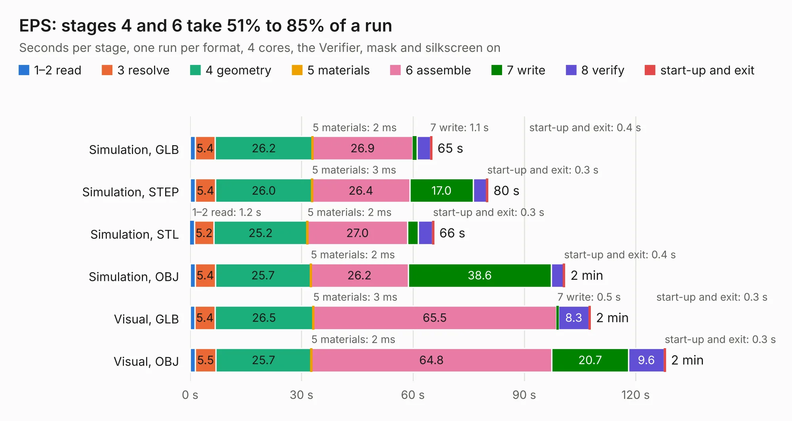

# 2375. EPS

Board 2,375 of the 3,121 of [Corpus Testing](../Corpus-Testing.md), on [Corpus Page 22](../CorpusTestingPages/Corpus-Testing-22.md#2375-eps).

| Mode and format | 1–2 read | 3 resolve | 4 geometry | 5 materials | 6 assemble | 7 write | 8 verify | start-up and exit | Total |
|---|---:|---:|---:|---:|---:|---:|---:|---:|---:|
| Simulation, GLB | 1.3 | 5.4 | 26.2 | 2&nbsp;ms | 26.9 | 1.1 | 3.7 | 0.4 | 65.1 |
| Simulation, STEP | 1.4 | 5.4 | 26.0 | 3&nbsp;ms | 26.4 | 17.0 | 3.6 | 0.3 | 80.2 |
| Simulation, STL | 1.2 | 5.2 | 25.2 | 2&nbsp;ms | 27.0 | 2.8 | 3.9 | 0.3 | 65.6 |
| Simulation, OBJ | 1.4 | 5.4 | 25.7 | 2&nbsp;ms | 26.2 | 38.6 | 3.2 | 0.4 | 100.9 |
| Visual, GLB | 1.3 | 5.4 | 26.5 | 3&nbsp;ms | 65.5 | 0.5 | 8.3 | 0.3 | 107.8 |
| Visual, OBJ | 1.4 | 5.5 | 25.7 | 2&nbsp;ms | 64.8 | 20.7 | 9.6 | 0.3 | 128.0 |

<table align="center"><tr><td valign="top">

| Board | Repo: [rgw3d/1kcubesat_hardware](https://github.com/rgw3d/1kcubesat_hardware) Board: `EPS.kicad_pcb` |
|---|---|
| Folder | eps_board |
| Complexity | 393&nbsp;/&nbsp;1000 (size&nbsp;303, features&nbsp;90) |
| KESE&nbsp;features | through vias, slotted holes, custom pads, rounded, trapezoid or chamfered pads, filled zones, copper drawings, curved board outline |
| Tested | 9th November 2026 |
| Copper&nbsp;layers | 4 |
| File&nbsp;format | KiCad 5 (20171130) |
| Parts,&nbsp;tracks,&nbsp;vias | 633, 7,205, 621 |
| Triangles,&nbsp;simulation | 7,584,446 in 370 parts |
| Verifier | PASS in all six runs |

</td><td valign="top">

<table>
<tr><th>File type</th><th>File size</th><th>Peak memory used</th></tr>
<tr><th colspan="3" align="left">Simulation</th></tr>
<tr><td>GLB</td><td align="right">257&nbsp;MB</td><td align="right">2.2&nbsp;GB</td></tr>
<tr><td>STEP</td><td align="right">1.1&nbsp;GB</td><td align="right">2.6&nbsp;GB</td></tr>
<tr><td>STL</td><td align="right">379&nbsp;MB</td><td align="right">2.2&nbsp;GB</td></tr>
<tr><td>OBJ</td><td align="right">805&nbsp;MB</td><td align="right">4.7&nbsp;GB</td></tr>
<tr><th colspan="3" align="left">Visual</th></tr>
<tr><td>GLB</td><td align="right">155&nbsp;MB</td><td align="right">2.4&nbsp;GB</td></tr>
<tr><td>OBJ</td><td align="right">490&nbsp;MB</td><td align="right">3.0&nbsp;GB</td></tr>
</table>

</td></tr></table>

| Previous | Next |
|:---|---:|
| [2374. AVIONICS_BOARD](b2374b_1kcubesat-hardware_AVIONICS-BOARD.md) | [2376. sun_sensor_test](b2376b_1kcubesat-hardware_sun-sensor-test.md) |
