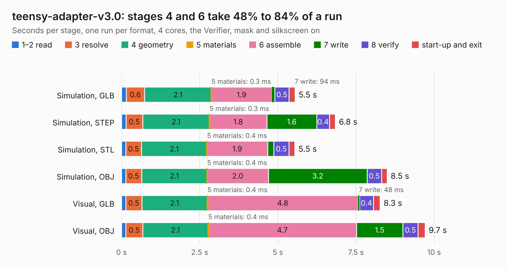

# 2375. teensy-adapter-v3.0

Board 2,375 of the 3,103 of [Corpus Testing](../Corpus-Testing.md), on [Corpus Page 22](../CorpusTestingPages/Corpus-Testing-22.md#2375-teensy-adapter-v30).

| Mode and format | 1–2 read | 3 resolve | 4 geometry | 5 materials | 6 assemble | 7 write | 8 verify | start-up and exit | Total |
|---|---:|---:|---:|---:|---:|---:|---:|---:|---:|
| Simulation, GLB | 0.2 | 0.6 | 2.1 | 0.3&nbsp;ms | 1.9 | 94&nbsp;ms | 0.5 | 0.2 | 5.5 |
| Simulation, STEP | 0.1 | 0.5 | 2.1 | 0.3&nbsp;ms | 1.8 | 1.6 | 0.4 | 0.2 | 6.8 |
| Simulation, STL | 0.1 | 0.5 | 2.1 | 0.4&nbsp;ms | 1.9 | 0.2 | 0.5 | 0.2 | 5.5 |
| Simulation, OBJ | 0.1 | 0.5 | 2.1 | 0.4&nbsp;ms | 2.0 | 3.2 | 0.5 | 0.2 | 8.5 |
| Visual, GLB | 0.1 | 0.5 | 2.1 | 0.4&nbsp;ms | 4.8 | 48&nbsp;ms | 0.4 | 0.2 | 8.3 |
| Visual, OBJ | 0.1 | 0.5 | 2.1 | 0.4&nbsp;ms | 4.7 | 1.5 | 0.5 | 0.2 | 9.7 |

<table align="center"><tr><td valign="top">

| Board | Repo: [robojackets/robocup-pcb](https://github.com/robojackets/robocup-pcb) Board: `teensy-adapter-v3.0.kicad_pcb` |
|---|---|
| Folder | boards-archive / pre-2026 / off-robot / kicad / teensy-adapter-v3.0 |
| Complexity | 215&nbsp;/&nbsp;1000 (size&nbsp;140, features&nbsp;75) |
| KESE&nbsp;features | through vias, rounded, trapezoid or chamfered pads, filled zones, stack-up, dielectric εr and tanδ |
| Tested | 9th November 2026 |
| Copper&nbsp;layers | 4 |
| File&nbsp;format | KiCad 8 (20240108) |
| Parts,&nbsp;tracks,&nbsp;vias | 8, 114, 14 |
| Triangles,&nbsp;simulation | 781,546 in 76 parts |
| Verifier | PASS in all six runs |

</td><td valign="top">

<table>
<tr><th>File type</th><th>File size</th><th>Peak memory used</th></tr>
<tr><th colspan="3" align="left">Simulation</th></tr>
<tr><td>GLB</td><td align="right">26&nbsp;MB</td><td align="right">350&nbsp;MB</td></tr>
<tr><td>STEP</td><td align="right">86&nbsp;MB</td><td align="right">393&nbsp;MB</td></tr>
<tr><td>STL</td><td align="right">39&nbsp;MB</td><td align="right">343&nbsp;MB</td></tr>
<tr><td>OBJ</td><td align="right">78&nbsp;MB</td><td align="right">542&nbsp;MB</td></tr>
<tr><th colspan="3" align="left">Visual</th></tr>
<tr><td>GLB</td><td align="right">12&nbsp;MB</td><td align="right">395&nbsp;MB</td></tr>
<tr><td>OBJ</td><td align="right">36&nbsp;MB</td><td align="right">397&nbsp;MB</td></tr>
</table>

</td></tr></table>

| Previous | Next |
|:---|---:|
| [2374. flyback-breakout-v1.0](b2374b_robocup-pcb_flyback-breakout-v1-0.md) | [2376. motortester-v2.0](b2376b_robocup-pcb_motortester-v2-0.md) |
