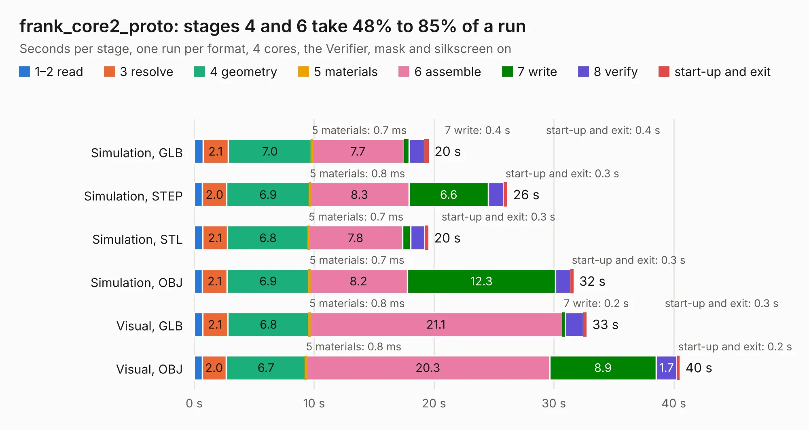

# 2379. frank_core2_proto

Board 2,379 of the 3,122 of [Corpus Testing](../Corpus-Testing.md), on [Corpus Page 23](../CorpusTestingPages/Corpus-Testing-23.md#2379-frank_core2_proto).

| Mode and format | 1–2 read | 3 resolve | 4 geometry | 5 materials | 6 assemble | 7 write | 8 verify | start-up and exit | Total |
|---|---:|---:|---:|---:|---:|---:|---:|---:|---:|
| Simulation, GLB | 0.7 | 2.1 | 7.0 | 0.7&nbsp;ms | 7.7 | 0.4 | 1.3 | 0.4 | 19.6 |
| Simulation, STEP | 0.7 | 2.0 | 6.9 | 0.8&nbsp;ms | 8.3 | 6.6 | 1.3 | 0.3 | 26.1 |
| Simulation, STL | 0.7 | 2.1 | 6.8 | 0.7&nbsp;ms | 7.8 | 0.7 | 1.2 | 0.3 | 19.5 |
| Simulation, OBJ | 0.7 | 2.1 | 6.9 | 0.7&nbsp;ms | 8.2 | 12.3 | 1.2 | 0.3 | 31.6 |
| Visual, GLB | 0.7 | 2.1 | 6.8 | 0.8&nbsp;ms | 21.1 | 0.2 | 1.5 | 0.3 | 32.7 |
| Visual, OBJ | 0.7 | 2.0 | 6.7 | 0.8&nbsp;ms | 20.3 | 8.9 | 1.7 | 0.2 | 40.5 |

<table align="center"><tr><td valign="top">

| Board | Repo: [rh1tech/frank](https://github.com/rh1tech/frank) Board: `frank_core2_proto.kicad_pcb` |
|---|---|
| Folder | hardware / frank_core2_proto |
| Complexity | 394&nbsp;/&nbsp;1000 (size&nbsp;259, features&nbsp;135) |
| KESE&nbsp;features | through vias, slotted holes, custom pads, rounded, trapezoid or chamfered pads, filled zones, copper drawings, curved board outline, TrueType text, stack-up, dielectric εr and tanδ |
| Tested | 9th November 2026 |
| Copper&nbsp;layers | 4 |
| File&nbsp;format | KiCad 10 (20260206) |
| Parts,&nbsp;tracks,&nbsp;vias | 133, 1,427, 246 |
| Triangles,&nbsp;simulation | 2,270,508 in 168 parts |
| Verifier | PASS in all six runs |

</td><td valign="top">

<table>
<tr><th>File type</th><th>File size</th><th>Peak memory used</th></tr>
<tr><th colspan="3" align="left">Simulation</th></tr>
<tr><td>GLB</td><td align="right">78&nbsp;MB</td><td align="right">958&nbsp;MB</td></tr>
<tr><td>STEP</td><td align="right">347&nbsp;MB</td><td align="right">973&nbsp;MB</td></tr>
<tr><td>STL</td><td align="right">114&nbsp;MB</td><td align="right">923&nbsp;MB</td></tr>
<tr><td>OBJ</td><td align="right">238&nbsp;MB</td><td align="right">1.5&nbsp;GB</td></tr>
<tr><th colspan="3" align="left">Visual</th></tr>
<tr><td>GLB</td><td align="right">53&nbsp;MB</td><td align="right">1.0&nbsp;GB</td></tr>
<tr><td>OBJ</td><td align="right">167&nbsp;MB</td><td align="right">1.2&nbsp;GB</td></tr>
</table>

</td></tr></table>

| Previous | Next |
|:---|---:|
| [2378. frank](b2378b_frank_frank.md) | [2380. frank_core2u](b2380b_frank_frank-core2u.md) |
