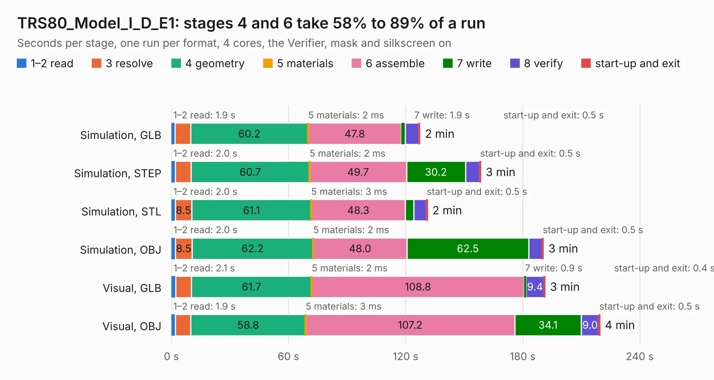

# 2380 TRS80_Model_I_D_E1

Board 2,380 of the 3,138 of [Corpus Testing](../Corpus-Testing.md), on [Corpus Page 23](../CorpusTestingPages/Corpus-Testing-23.md#2380-trs80_model_i_d_e1).

| Mode and format | 1–2 read | 3 resolve | 4 geometry | 5 materials | 6 assemble | 7 write | 8 verify | start-up and exit | Total |
|---|---:|---:|---:|---:|---:|---:|---:|---:|---:|
| Simulation, GLB | 1.9 | 8.0 | 60.2 | 2&nbsp;ms | 47.8 | 1.9 | 7.0 | 0.5 | 127.3 |
| Simulation, STEP | 2.0 | 8.1 | 60.7 | 2&nbsp;ms | 49.7 | 30.2 | 7.3 | 0.5 | 158.5 |
| Simulation, STL | 2.0 | 8.5 | 61.1 | 3&nbsp;ms | 48.3 | 4.3 | 6.5 | 0.5 | 131.1 |
| Simulation, OBJ | 2.0 | 8.5 | 62.2 | 2&nbsp;ms | 48.0 | 62.5 | 6.9 | 0.5 | 190.6 |
| Visual, GLB | 2.1 | 8.1 | 61.7 | 2&nbsp;ms | 108.8 | 0.9 | 9.4 | 0.4 | 191.4 |
| Visual, OBJ | 1.9 | 8.0 | 58.8 | 3&nbsp;ms | 107.2 | 34.1 | 9.0 | 0.5 | 219.5 |

<table align="center"><tr><td valign="top">

| Board | Repo: [RetroStack/TRS-80-Model-I-D-E1](https://github.com/RetroStack/TRS-80-Model-I-D-E1) Board: `TRS80_Model_I_D_E1.kicad_pcb` |
|---|---|
| Folder | KiCAD |
| Complexity | 356&nbsp;/&nbsp;1000 (size&nbsp;226, features&nbsp;130) |
| KESE&nbsp;features | through vias, rounded, trapezoid or chamfered pads, drill offsets, filled zones, copper drawings, copper text, curved board outline, stack-up, dielectric εr and tanδ, copper finish |
| Tested | 9th November 2026 |
| Copper&nbsp;layers | 2 |
| File&nbsp;format | KiCad 9 (20241229) |
| Parts,&nbsp;tracks,&nbsp;vias | 225, 8,917, 349 |
| Triangles,&nbsp;simulation | 9,640,646 in 388 parts |
| Verifier | PASS in all six runs |

</td><td valign="top">

<table>
<tr><th>File type</th><th>File size</th><th>Peak memory used</th></tr>
<tr><th colspan="3" align="left">Simulation</th></tr>
<tr><td>GLB</td><td align="right">329&nbsp;MB</td><td align="right">2.4&nbsp;GB</td></tr>
<tr><td>STEP</td><td align="right">1.7&nbsp;GB</td><td align="right">3.4&nbsp;GB</td></tr>
<tr><td>STL</td><td align="right">482&nbsp;MB</td><td align="right">2.5&nbsp;GB</td></tr>
<tr><td>OBJ</td><td align="right">1.0&nbsp;GB</td><td align="right">6.0&nbsp;GB</td></tr>
<tr><th colspan="3" align="left">Visual</th></tr>
<tr><td>GLB</td><td align="right">181&nbsp;MB</td><td align="right">2.9&nbsp;GB</td></tr>
<tr><td>OBJ</td><td align="right">578&nbsp;MB</td><td align="right">3.6&nbsp;GB</td></tr>
</table>

</td></tr></table>

| Previous | Next |
|:---|---:|
| [2379 TRS80_Model_I_A_E1](b2379b_TRS-80-Model-I-A-E1_TRS80-Model-I-A-E1.md) | [2381 TRS80_Model_I_E_E1](b2381b_TRS-80-Model-I-E-E1_TRS80-Model-I-E-E1.md) |
