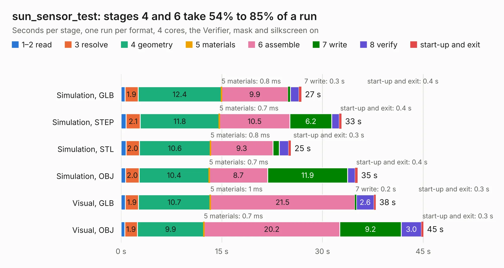

# 2381. sun_sensor_test

Board 2,381 of the 3,129 of [Corpus Testing](../Corpus-Testing.md), on [Corpus Page 23](../CorpusTestingPages/Corpus-Testing-23.md#2381-sun_sensor_test).

| Mode and format | 1–2 read | 3 resolve | 4 geometry | 5 materials | 6 assemble | 7 write | 8 verify | start-up and exit | Total |
|---|---:|---:|---:|---:|---:|---:|---:|---:|---:|
| Simulation, GLB | 0.6 | 1.9 | 12.4 | 0.8&nbsp;ms | 9.9 | 0.3 | 1.3 | 0.4 | 26.9 |
| Simulation, STEP | 0.8 | 2.1 | 11.8 | 0.7&nbsp;ms | 10.5 | 6.2 | 1.1 | 0.4 | 32.8 |
| Simulation, STL | 0.8 | 2.0 | 10.6 | 0.8&nbsp;ms | 9.3 | 0.9 | 1.4 | 0.3 | 25.3 |
| Simulation, OBJ | 0.7 | 2.0 | 10.4 | 0.7&nbsp;ms | 8.7 | 11.9 | 1.1 | 0.4 | 35.2 |
| Visual, GLB | 0.7 | 1.9 | 10.7 | 1&nbsp;ms | 21.5 | 0.2 | 2.6 | 0.3 | 37.9 |
| Visual, OBJ | 0.5 | 1.9 | 9.9 | 0.7&nbsp;ms | 20.2 | 9.2 | 3.0 | 0.3 | 45.0 |

<table align="center"><tr><td valign="top">

| Board | Repo: [rgw3d/1kcubesat_hardware](https://github.com/rgw3d/1kcubesat_hardware) Board: `sun_sensor_test.kicad_pcb` |
|---|---|
| Folder | sun_sensor_test |
| Complexity | 293&nbsp;/&nbsp;1000 (size&nbsp;238, features&nbsp;55) |
| KESE&nbsp;features | through vias, slotted holes, rounded, trapezoid or chamfered pads, filled zones |
| Tested | 9th November 2026 |
| Copper&nbsp;layers | 2 |
| File&nbsp;format | KiCad 5 (20171130) |
| Parts,&nbsp;tracks,&nbsp;vias | 149, 1,529, 250 |
| Triangles,&nbsp;simulation | 1,920,440 in 117 parts |
| Verifier | PASS in all six runs |

</td><td valign="top">

<table>
<tr><th>File type</th><th>File size</th><th>Peak memory used</th></tr>
<tr><th colspan="3" align="left">Simulation</th></tr>
<tr><td>GLB</td><td align="right">67&nbsp;MB</td><td align="right">797&nbsp;MB</td></tr>
<tr><td>STEP</td><td align="right">349&nbsp;MB</td><td align="right">890&nbsp;MB</td></tr>
<tr><td>STL</td><td align="right">96&nbsp;MB</td><td align="right">781&nbsp;MB</td></tr>
<tr><td>OBJ</td><td align="right">203&nbsp;MB</td><td align="right">1.3&nbsp;GB</td></tr>
<tr><th colspan="3" align="left">Visual</th></tr>
<tr><td>GLB</td><td align="right">52&nbsp;MB</td><td align="right">908&nbsp;MB</td></tr>
<tr><td>OBJ</td><td align="right">159&nbsp;MB</td><td align="right">1.1&nbsp;GB</td></tr>
</table>

</td></tr></table>

| Previous | Next |
|:---|---:|
| [2380. EPS](b2380b_1kcubesat-hardware_EPS.md) | [2382. frank](b2382b_frank_frank.md) |
