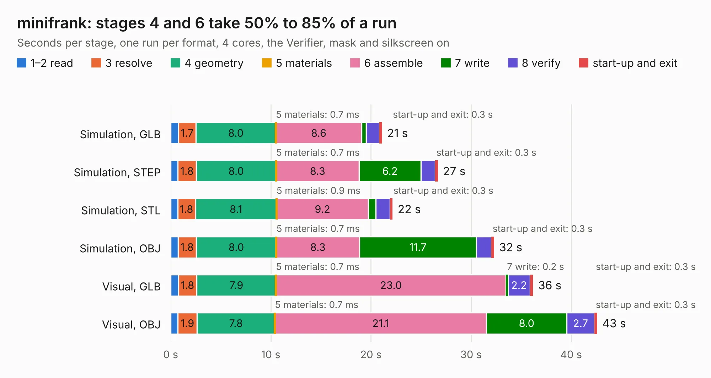

# 2381. minifrank

Board 2,381 of the 3,117 of [Corpus Testing](../Corpus-Testing.md), on [Corpus Page 23](../CorpusTestingPages/Corpus-Testing-23.md#2381-minifrank).

| Mode and format | 1–2 read | 3 resolve | 4 geometry | 5 materials | 6 assemble | 7 write | 8 verify | start-up and exit | Total |
|---|---:|---:|---:|---:|---:|---:|---:|---:|---:|
| Simulation, GLB | 0.8 | 1.7 | 8.0 | 0.7&nbsp;ms | 8.6 | 0.5 | 1.3 | 0.3 | 21.1 |
| Simulation, STEP | 0.7 | 1.8 | 8.0 | 0.7&nbsp;ms | 8.3 | 6.2 | 1.4 | 0.3 | 26.7 |
| Simulation, STL | 0.7 | 1.8 | 8.1 | 0.9&nbsp;ms | 9.2 | 0.7 | 1.4 | 0.3 | 22.2 |
| Simulation, OBJ | 0.7 | 1.8 | 8.0 | 0.7&nbsp;ms | 8.3 | 11.7 | 1.5 | 0.3 | 32.3 |
| Visual, GLB | 0.8 | 1.8 | 7.9 | 0.7&nbsp;ms | 23.0 | 0.2 | 2.2 | 0.3 | 36.2 |
| Visual, OBJ | 0.7 | 1.9 | 7.8 | 0.7&nbsp;ms | 21.1 | 8.0 | 2.7 | 0.3 | 42.6 |

<table align="center"><tr><td valign="top">

| Board | Repo: [rh1tech/frank](https://github.com/rh1tech/frank) Board: `minifrank.kicad_pcb` |
|---|---|
| Folder | hardware / minifrank |
| Complexity | 383&nbsp;/&nbsp;1000 (size&nbsp;248, features&nbsp;135) |
| KESE&nbsp;features | through vias, slotted holes, custom pads, rounded, trapezoid or chamfered pads, filled zones, copper drawings, curved board outline, TrueType text, stack-up, dielectric εr and tanδ |
| Tested | 9th November 2026 |
| Copper&nbsp;layers | 4 |
| File&nbsp;format | KiCad 10 (20260206) |
| Parts,&nbsp;tracks,&nbsp;vias | 139, 1,148, 163 |
| Triangles,&nbsp;simulation | 2,418,568 in 186 parts |
| Verifier | PASS in all six runs |

</td><td valign="top">

<table>
<tr><th>File type</th><th>File size</th><th>Peak memory used</th></tr>
<tr><th colspan="3" align="left">Simulation</th></tr>
<tr><td>GLB</td><td align="right">83&nbsp;MB</td><td align="right">941&nbsp;MB</td></tr>
<tr><td>STEP</td><td align="right">372&nbsp;MB</td><td align="right">993&nbsp;MB</td></tr>
<tr><td>STL</td><td align="right">121&nbsp;MB</td><td align="right">804&nbsp;MB</td></tr>
<tr><td>OBJ</td><td align="right">254&nbsp;MB</td><td align="right">1.6&nbsp;GB</td></tr>
<tr><th colspan="3" align="left">Visual</th></tr>
<tr><td>GLB</td><td align="right">56&nbsp;MB</td><td align="right">1.0&nbsp;GB</td></tr>
<tr><td>OBJ</td><td align="right">172&nbsp;MB</td><td align="right">1.3&nbsp;GB</td></tr>
</table>

</td></tr></table>

| Previous | Next |
|:---|---:|
| [2380. microfrank](b2380b_frank_microfrank.md) | [2382. nyx](b2382b_frank_nyx.md) |
