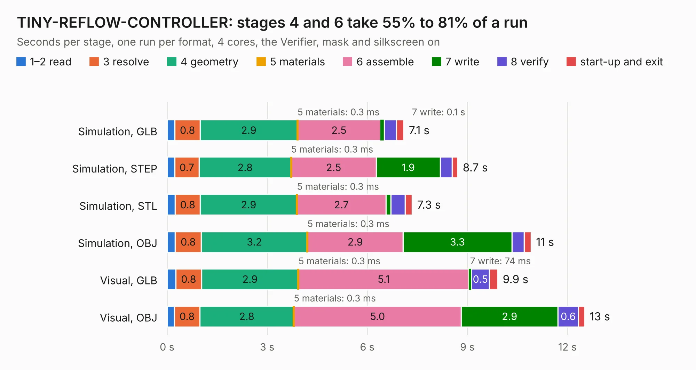

# 2383. TINY-REFLOW-CONTROLLER

Board 2,383 of the 3,102 of [Corpus Testing](../Corpus-Testing.md), on [Corpus Page 23](../CorpusTestingPages/Corpus-Testing-23.md#2383-tiny-reflow-controller).

| Mode and format | 1–2 read | 3 resolve | 4 geometry | 5 materials | 6 assemble | 7 write | 8 verify | start-up and exit | Total |
|---|---:|---:|---:|---:|---:|---:|---:|---:|---:|
| Simulation, GLB | 0.2 | 0.8 | 2.9 | 0.3&nbsp;ms | 2.5 | 0.1 | 0.4 | 0.2 | 7.1 |
| Simulation, STEP | 0.2 | 0.7 | 2.8 | 0.3&nbsp;ms | 2.5 | 1.9 | 0.4 | 0.2 | 8.7 |
| Simulation, STL | 0.2 | 0.8 | 2.9 | 0.3&nbsp;ms | 2.7 | 0.2 | 0.4 | 0.2 | 7.3 |
| Simulation, OBJ | 0.2 | 0.8 | 3.2 | 0.3&nbsp;ms | 2.9 | 3.3 | 0.4 | 0.2 | 10.9 |
| Visual, GLB | 0.3 | 0.8 | 2.9 | 0.3&nbsp;ms | 5.1 | 74&nbsp;ms | 0.5 | 0.3 | 9.9 |
| Visual, OBJ | 0.2 | 0.8 | 2.8 | 0.3&nbsp;ms | 5.0 | 2.9 | 0.6 | 0.2 | 12.5 |

<table align="center"><tr><td valign="top">

| Board | Repo: [rocketscream/TinyReflowController](https://github.com/rocketscream/TinyReflowController) Board: `TINY-REFLOW-CONTROLLER.kicad_pcb` |
|---|---|
| Complexity | 278&nbsp;/&nbsp;1000 (size&nbsp;213, features&nbsp;65) |
| KESE&nbsp;features | through vias, slotted holes, rounded, trapezoid or chamfered pads, filled zones, curved board outline |
| Tested | 9th November 2026 |
| Copper&nbsp;layers | 2 |
| File&nbsp;format | KiCad 5 (20171130) |
| Parts,&nbsp;tracks,&nbsp;vias | 54, 539, 147 |
| Triangles,&nbsp;simulation | 645,002 in 68 parts |
| Verifier | PASS in all six runs |

</td><td valign="top">

<table>
<tr><th>File type</th><th>File size</th><th>Peak memory used</th></tr>
<tr><th colspan="3" align="left">Simulation</th></tr>
<tr><td>GLB</td><td align="right">23&nbsp;MB</td><td align="right">346&nbsp;MB</td></tr>
<tr><td>STEP</td><td align="right">110&nbsp;MB</td><td align="right">424&nbsp;MB</td></tr>
<tr><td>STL</td><td align="right">32&nbsp;MB</td><td align="right">349&nbsp;MB</td></tr>
<tr><td>OBJ</td><td align="right">66&nbsp;MB</td><td align="right">478&nbsp;MB</td></tr>
<tr><th colspan="3" align="left">Visual</th></tr>
<tr><td>GLB</td><td align="right">18&nbsp;MB</td><td align="right">463&nbsp;MB</td></tr>
<tr><td>OBJ</td><td align="right">55&nbsp;MB</td><td align="right">466&nbsp;MB</td></tr>
</table>

</td></tr></table>

| Previous | Next |
|:---|---:|
| [2382. Alius_6502](b2382b_Alius6502-PCB_Alius-6502.md) | [2384. TheMainBoard](b2384b_Thermometer_TheMainBoard.md) |
