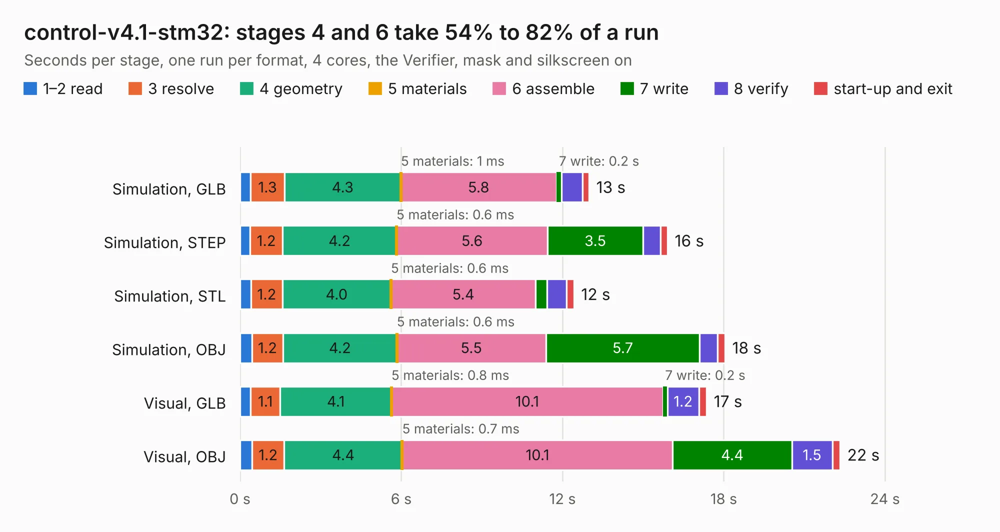

# 2383. control-v4.1-stm32

Board 2,383 of the 3,106 of [Corpus Testing](../Corpus-Testing.md), on [Corpus Page 23](../CorpusTestingPages/Corpus-Testing-23.md#2383-control-v41-stm32).

| Mode and format | 1–2 read | 3 resolve | 4 geometry | 5 materials | 6 assemble | 7 write | 8 verify | start-up and exit | Total |
|---|---:|---:|---:|---:|---:|---:|---:|---:|---:|
| Simulation, GLB | 0.4 | 1.3 | 4.3 | 1&nbsp;ms | 5.8 | 0.2 | 0.8 | 0.2 | 13.0 |
| Simulation, STEP | 0.4 | 1.2 | 4.2 | 0.6&nbsp;ms | 5.6 | 3.5 | 0.7 | 0.3 | 15.9 |
| Simulation, STL | 0.4 | 1.2 | 4.0 | 0.6&nbsp;ms | 5.4 | 0.4 | 0.7 | 0.3 | 12.4 |
| Simulation, OBJ | 0.4 | 1.2 | 4.2 | 0.6&nbsp;ms | 5.5 | 5.7 | 0.7 | 0.3 | 18.0 |
| Visual, GLB | 0.4 | 1.1 | 4.1 | 0.8&nbsp;ms | 10.1 | 0.2 | 1.2 | 0.3 | 17.4 |
| Visual, OBJ | 0.4 | 1.2 | 4.4 | 0.7&nbsp;ms | 10.1 | 4.4 | 1.5 | 0.3 | 22.3 |

<table align="center"><tr><td valign="top">

| Board | Repo: [robojackets/robocup-pcb](https://github.com/robojackets/robocup-pcb) Board: `control-v4.1-stm32.kicad_pcb` |
|---|---|
| Folder | boards / rev-2026 / control-v4.1-stm32 |
| Complexity | 336&nbsp;/&nbsp;1000 (size&nbsp;236, features&nbsp;100) |
| KESE&nbsp;features | through vias, rounded, trapezoid or chamfered pads, filled zones, curved board outline, knockout text, stack-up, dielectric εr and tanδ |
| Tested | 9th November 2026 |
| Copper&nbsp;layers | 4 |
| File&nbsp;format | KiCad 9 (20241229) |
| Parts,&nbsp;tracks,&nbsp;vias | 83, 795, 103 |
| Triangles,&nbsp;simulation | 1,237,914 in 141 parts |
| Verifier | PASS in all six runs |

</td><td valign="top">

<table>
<tr><th>File type</th><th>File size</th><th>Peak memory used</th></tr>
<tr><th colspan="3" align="left">Simulation</th></tr>
<tr><td>GLB</td><td align="right">43&nbsp;MB</td><td align="right">503&nbsp;MB</td></tr>
<tr><td>STEP</td><td align="right">185&nbsp;MB</td><td align="right">599&nbsp;MB</td></tr>
<tr><td>STL</td><td align="right">62&nbsp;MB</td><td align="right">495&nbsp;MB</td></tr>
<tr><td>OBJ</td><td align="right">128&nbsp;MB</td><td align="right">839&nbsp;MB</td></tr>
<tr><th colspan="3" align="left">Visual</th></tr>
<tr><td>GLB</td><td align="right">29&nbsp;MB</td><td align="right">709&nbsp;MB</td></tr>
<tr><td>OBJ</td><td align="right">89&nbsp;MB</td><td align="right">719&nbsp;MB</td></tr>
</table>

</td></tr></table>

| Previous | Next |
|:---|---:|
| [2382. control-v4.0](b2382b_robocup-pcb_control-v4-0.md) | [2384. kicker-v3.4](b2384b_robocup-pcb_kicker-v3-4.md) |
