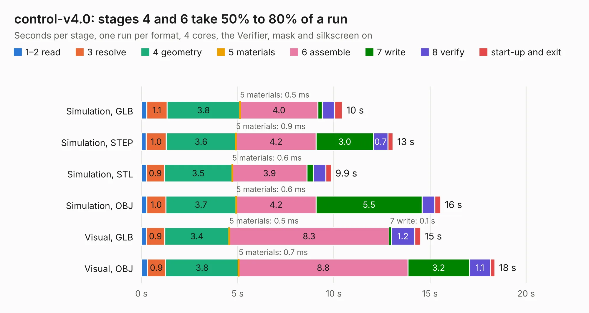

# 2386. control-v4.0

Board 2,386 of the 3,110 of [Corpus Testing](../Corpus-Testing.md), on [Corpus Page 23](../CorpusTestingPages/Corpus-Testing-23.md#2386-control-v40).

| Mode and format | 1–2 read | 3 resolve | 4 geometry | 5 materials | 6 assemble | 7 write | 8 verify | start-up and exit | Total |
|---|---:|---:|---:|---:|---:|---:|---:|---:|---:|
| Simulation, GLB | 0.3 | 1.1 | 3.8 | 0.5&nbsp;ms | 4.0 | 0.2 | 0.7 | 0.4 | 10.4 |
| Simulation, STEP | 0.2 | 1.0 | 3.6 | 0.9&nbsp;ms | 4.2 | 3.0 | 0.7 | 0.3 | 13.1 |
| Simulation, STL | 0.3 | 0.9 | 3.5 | 0.6&nbsp;ms | 3.9 | 0.3 | 0.6 | 0.3 | 9.9 |
| Simulation, OBJ | 0.3 | 1.0 | 3.7 | 0.6&nbsp;ms | 4.2 | 5.5 | 0.7 | 0.3 | 15.6 |
| Visual, GLB | 0.3 | 0.9 | 3.4 | 0.5&nbsp;ms | 8.3 | 0.1 | 1.2 | 0.3 | 14.5 |
| Visual, OBJ | 0.3 | 0.9 | 3.8 | 0.7&nbsp;ms | 8.8 | 3.2 | 1.1 | 0.2 | 18.4 |

<table align="center"><tr><td valign="top">

| Board | Repo: [robojackets/robocup-pcb](https://github.com/robojackets/robocup-pcb) Board: `control-v4.0.kicad_pcb` |
|---|---|
| Folder | boards / rev-2026 / control-v4.0 |
| Complexity | 269&nbsp;/&nbsp;1000 (size&nbsp;169, features&nbsp;100) |
| KESE&nbsp;features | through vias, rounded, trapezoid or chamfered pads, filled zones, curved board outline, knockout text, stack-up, dielectric εr and tanδ |
| Tested | 9th November 2026 |
| Copper&nbsp;layers | 4 |
| File&nbsp;format | KiCad 9 (20241229) |
| Parts,&nbsp;tracks,&nbsp;vias | 17, 455, 45 |
| Triangles,&nbsp;simulation | 908,638 in 73 parts |
| Verifier | PASS in all six runs |

</td><td valign="top">

<table>
<tr><th>File type</th><th>File size</th><th>Peak memory used</th></tr>
<tr><th colspan="3" align="left">Simulation</th></tr>
<tr><td>GLB</td><td align="right">31&nbsp;MB</td><td align="right">380&nbsp;MB</td></tr>
<tr><td>STEP</td><td align="right">129&nbsp;MB</td><td align="right">470&nbsp;MB</td></tr>
<tr><td>STL</td><td align="right">45&nbsp;MB</td><td align="right">381&nbsp;MB</td></tr>
<tr><td>OBJ</td><td align="right">92&nbsp;MB</td><td align="right">669&nbsp;MB</td></tr>
<tr><th colspan="3" align="left">Visual</th></tr>
<tr><td>GLB</td><td align="right">18&nbsp;MB</td><td align="right">457&nbsp;MB</td></tr>
<tr><td>OBJ</td><td align="right">55&nbsp;MB</td><td align="right">524&nbsp;MB</td></tr>
</table>

</td></tr></table>

| Previous | Next |
|:---|---:|
| [2385. robocup-controller-pcb](b2385b_robocup-pcb_robocup-controller-pcb.md) | [2387. control-v4.1-stm32](b2387b_robocup-pcb_control-v4-1-stm32.md) |
