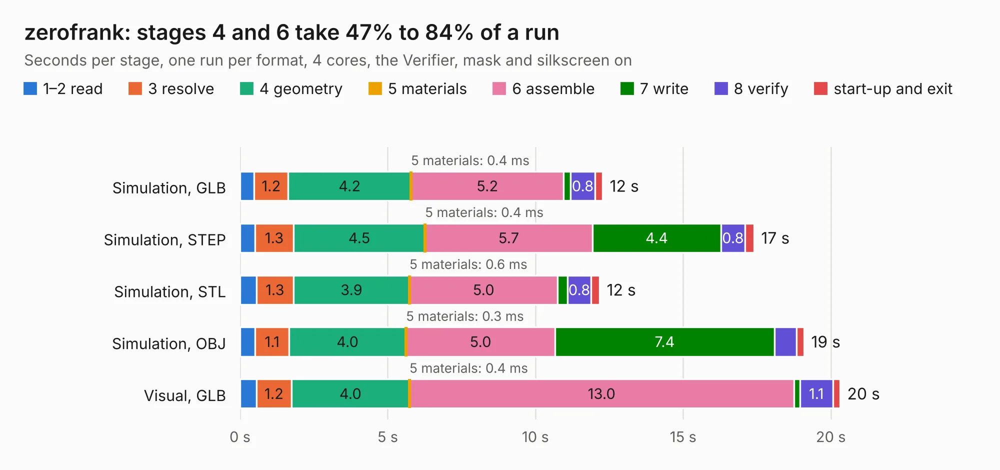

# 2391. zerofrank

Board 2,391 of the 3,122 of [Corpus Testing](../Corpus-Testing.md), on [Corpus Page 23](../CorpusTestingPages/Corpus-Testing-23.md#2391-zerofrank).

| Mode and format | 1–2 read | 3 resolve | 4 geometry | 5 materials | 6 assemble | 7 write | 8 verify | start-up and exit | Total |
|---|---:|---:|---:|---:|---:|---:|---:|---:|---:|
| Simulation, GLB | 0.5 | 1.2 | 4.2 | 0.4&nbsp;ms | 5.2 | 0.2 | 0.8 | 0.3 | 12.3 |
| Simulation, STEP | 0.5 | 1.3 | 4.5 | 0.4&nbsp;ms | 5.7 | 4.4 | 0.8 | 0.3 | 17.4 |
| Simulation, STL | 0.6 | 1.3 | 3.9 | 0.6&nbsp;ms | 5.0 | 0.3 | 0.8 | 0.3 | 12.2 |
| Simulation, OBJ | 0.5 | 1.1 | 4.0 | 0.3&nbsp;ms | 5.0 | 7.4 | 0.8 | 0.3 | 19.1 |
| Visual, GLB | 0.6 | 1.2 | 4.0 | 0.4&nbsp;ms | 13.0 | 0.2 | 1.1 | 0.2 | 20.3 |
| Visual, OBJ | 0.5 | 1.1 | 3.8 | 0.3&nbsp;ms | 12.6 | 5.2 | 1.6 | 0.2 | 25.0 |

<table align="center"><tr><td valign="top">

| Board | Repo: [rh1tech/frank](https://github.com/rh1tech/frank) Board: `zerofrank.kicad_pcb` |
|---|---|
| Folder | hardware / zerofrank |
| Complexity | 371&nbsp;/&nbsp;1000 (size&nbsp;236, features&nbsp;135) |
| KESE&nbsp;features | through vias, slotted holes, custom pads, rounded, trapezoid or chamfered pads, filled zones, copper drawings, curved board outline, TrueType text, stack-up, dielectric εr and tanδ |
| Tested | 9th November 2026 |
| Copper&nbsp;layers | 4 |
| File&nbsp;format | KiCad 10 (20260206) |
| Parts,&nbsp;tracks,&nbsp;vias | 89, 656, 125 |
| Triangles,&nbsp;simulation | 1,245,682 in 116 parts |
| Verifier | PASS in all six runs |

</td><td valign="top">

<table>
<tr><th>File type</th><th>File size</th><th>Peak memory used</th></tr>
<tr><th colspan="3" align="left">Simulation</th></tr>
<tr><td>GLB</td><td align="right">43&nbsp;MB</td><td align="right">576&nbsp;MB</td></tr>
<tr><td>STEP</td><td align="right">203&nbsp;MB</td><td align="right">632&nbsp;MB</td></tr>
<tr><td>STL</td><td align="right">62&nbsp;MB</td><td align="right">567&nbsp;MB</td></tr>
<tr><td>OBJ</td><td align="right">128&nbsp;MB</td><td align="right">875&nbsp;MB</td></tr>
<tr><th colspan="3" align="left">Visual</th></tr>
<tr><td>GLB</td><td align="right">31&nbsp;MB</td><td align="right">853&nbsp;MB</td></tr>
<tr><td>OBJ</td><td align="right">95&nbsp;MB</td><td align="right">784&nbsp;MB</td></tr>
</table>

</td></tr></table>

| Previous | Next |
|:---|---:|
| [2390. xt8086_alpha](b2390b_frank_xt8086-alpha.md) | [2392. PicoEVB](b2392b_PicoEVB_PicoEVB.md) |
