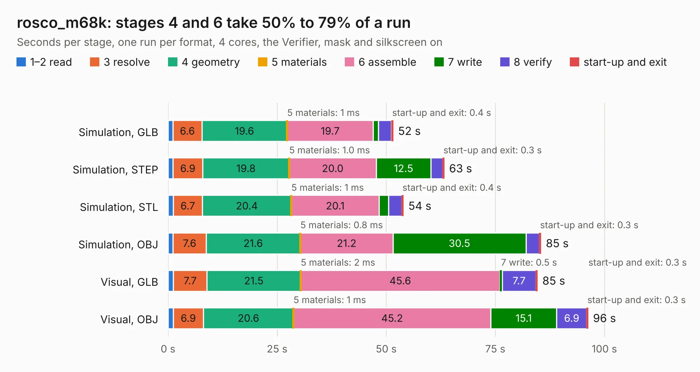

# 2392. rosco_m68k

Board 2,392 of the 3,102 of [Corpus Testing](../Corpus-Testing.md), on [Corpus Page 23](../CorpusTestingPages/Corpus-Testing-23.md#2392-rosco_m68k).

| Mode and format | 1–2 read | 3 resolve | 4 geometry | 5 materials | 6 assemble | 7 write | 8 verify | start-up and exit | Total |
|---|---:|---:|---:|---:|---:|---:|---:|---:|---:|
| Simulation, GLB | 1.1 | 6.6 | 19.6 | 1&nbsp;ms | 19.7 | 1.1 | 3.0 | 0.4 | 51.6 |
| Simulation, STEP | 1.1 | 6.9 | 19.8 | 1.0&nbsp;ms | 20.0 | 12.5 | 2.7 | 0.3 | 63.3 |
| Simulation, STL | 1.2 | 6.7 | 20.4 | 1&nbsp;ms | 20.1 | 2.2 | 3.0 | 0.4 | 53.9 |
| Simulation, OBJ | 1.2 | 7.6 | 21.6 | 0.8&nbsp;ms | 21.2 | 30.5 | 3.1 | 0.3 | 85.4 |
| Visual, GLB | 1.2 | 7.7 | 21.5 | 2&nbsp;ms | 45.6 | 0.5 | 7.7 | 0.3 | 84.6 |
| Visual, OBJ | 1.2 | 6.9 | 20.6 | 1&nbsp;ms | 45.2 | 15.1 | 6.9 | 0.3 | 96.3 |

<table align="center"><tr><td valign="top">

| Board | Repo: [rosco-m68k/rosco_m68k](https://github.com/rosco-m68k/rosco_m68k) Board: `rosco_m68k.kicad_pcb` |
|---|---|
| Folder | design / r2020 / kicad |
| Complexity | 386&nbsp;/&nbsp;1000 (size&nbsp;261, features&nbsp;125) |
| KESE&nbsp;features | through vias, slotted holes, rounded, trapezoid or chamfered pads, filled zones, curved board outline, knockout text, TrueType text, stack-up, dielectric εr and tanδ |
| Tested | 9th November 2026 |
| Copper&nbsp;layers | 4 |
| File&nbsp;format | KiCad 7 (20221018) |
| Parts,&nbsp;tracks,&nbsp;vias | 87, 3,771, 341 |
| Triangles,&nbsp;simulation | 6,485,168 in 204 parts |
| Verifier | PASS in all six runs |

</td><td valign="top">

<table>
<tr><th>File type</th><th>File size</th><th>Peak memory used</th></tr>
<tr><th colspan="3" align="left">Simulation</th></tr>
<tr><td>GLB</td><td align="right">218&nbsp;MB</td><td align="right">1.6&nbsp;GB</td></tr>
<tr><td>STEP</td><td align="right">889&nbsp;MB</td><td align="right">2.0&nbsp;GB</td></tr>
<tr><td>STL</td><td align="right">324&nbsp;MB</td><td align="right">1.5&nbsp;GB</td></tr>
<tr><td>OBJ</td><td align="right">694&nbsp;MB</td><td align="right">4.1&nbsp;GB</td></tr>
<tr><th colspan="3" align="left">Visual</th></tr>
<tr><td>GLB</td><td align="right">122&nbsp;MB</td><td align="right">2.2&nbsp;GB</td></tr>
<tr><td>OBJ</td><td align="right">386&nbsp;MB</td><td align="right">2.6&nbsp;GB</td></tr>
</table>

</td></tr></table>

| Previous | Next |
|:---|---:|
| [2391. rosco_m68k](b2391b_rosco-m68k_design-r2-kicad_rosco-m68k.md) | [2393. rosco_m68k](b2393b_rosco-m68k_design-r2030-kicad_rosco-m68k.md) |
