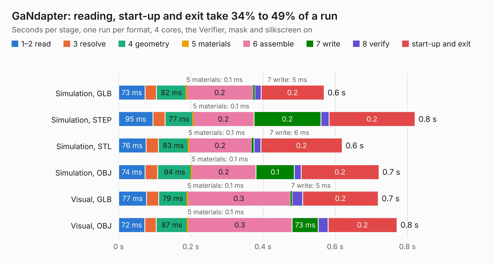

# 2393. GaNdapter

Board 2,393 of the 3,109 of [Corpus Testing](../Corpus-Testing.md), on [Corpus Page 23](../CorpusTestingPages/Corpus-Testing-23.md#2393-gandapter).

| Mode and format | 1–2 read | 3 resolve | 4 geometry | 5 materials | 6 assemble | 7 write | 8 verify | start-up and exit | Total |
|---|---:|---:|---:|---:|---:|---:|---:|---:|---:|
| Simulation, GLB | 73&nbsp;ms | 32&nbsp;ms | 82&nbsp;ms | 0.1&nbsp;ms | 0.2 | 5&nbsp;ms | 17&nbsp;ms | 0.2 | 0.6 |
| Simulation, STEP | 95&nbsp;ms | 34&nbsp;ms | 77&nbsp;ms | 0.1&nbsp;ms | 0.2 | 0.2 | 23&nbsp;ms | 0.2 | 0.8 |
| Simulation, STL | 76&nbsp;ms | 34&nbsp;ms | 83&nbsp;ms | 0.1&nbsp;ms | 0.2 | 6&nbsp;ms | 19&nbsp;ms | 0.2 | 0.6 |
| Simulation, OBJ | 74&nbsp;ms | 34&nbsp;ms | 94&nbsp;ms | 0.1&nbsp;ms | 0.2 | 0.1 | 19&nbsp;ms | 0.2 | 0.7 |
| Visual, GLB | 77&nbsp;ms | 34&nbsp;ms | 79&nbsp;ms | 0.1&nbsp;ms | 0.3 | 5&nbsp;ms | 30&nbsp;ms | 0.2 | 0.7 |
| Visual, OBJ | 72&nbsp;ms | 32&nbsp;ms | 87&nbsp;ms | 0.1&nbsp;ms | 0.3 | 73&nbsp;ms | 27&nbsp;ms | 0.2 | 0.8 |

<table align="center"><tr><td valign="top">

| Board | Repo: [rootthecause/dcdc](https://github.com/rootthecause/dcdc) Board: `GaNdapter.kicad_pcb` |
|---|---|
| Folder | extra / external-boards / GaNdapter |
| Complexity | 129&nbsp;/&nbsp;1000 (size&nbsp;29, features&nbsp;100) |
| KESE&nbsp;features | slotted holes, rounded, trapezoid or chamfered pads, filled zones, curved board outline, stack-up, dielectric εr and tanδ, copper finish, mask and silkscreen colours |
| Tested | 9th November 2026 |
| Copper&nbsp;layers | 2 |
| File&nbsp;format | KiCad 8 (20240108) |
| Parts,&nbsp;tracks,&nbsp;vias | 2, 0, 0 |
| Triangles,&nbsp;simulation | 18,750 in 14 parts |
| Verifier | PASS in all six runs |

</td><td valign="top">

<table>
<tr><th>File type</th><th>File size</th><th>Peak memory used</th></tr>
<tr><th colspan="3" align="left">Simulation</th></tr>
<tr><td>GLB</td><td align="right">663&nbsp;kB</td><td align="right">61&nbsp;MB</td></tr>
<tr><td>STEP</td><td align="right">3.3&nbsp;MB</td><td align="right">64&nbsp;MB</td></tr>
<tr><td>STL</td><td align="right">939&nbsp;kB</td><td align="right">62&nbsp;MB</td></tr>
<tr><td>OBJ</td><td align="right">1.9&nbsp;MB</td><td align="right">64&nbsp;MB</td></tr>
<tr><th colspan="3" align="left">Visual</th></tr>
<tr><td>GLB</td><td align="right">495&nbsp;kB</td><td align="right">82&nbsp;MB</td></tr>
<tr><td>OBJ</td><td align="right">1.4&nbsp;MB</td><td align="right">83&nbsp;MB</td></tr>
</table>

</td></tr></table>

| Previous | Next |
|:---|---:|
| [2392. GaNdapter-dual](b2392b_dcdc_GaNdapter-dual.md) | [2394. DCDCv9-3](b2394b_dcdc_DCDCv9-3.md) |
