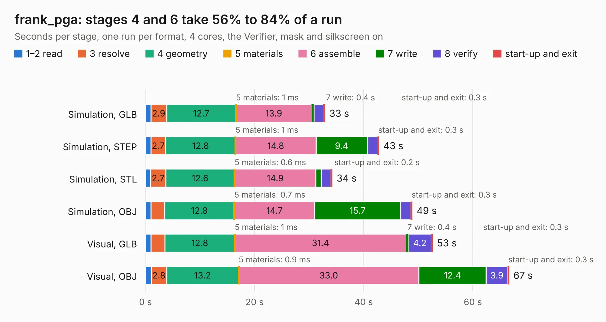

# 2393 frank_pga

Board 2,393 of the 3,138 of [Corpus Testing](../Corpus-Testing.md), on [Corpus Page 23](../CorpusTestingPages/Corpus-Testing-23.md#2393-frank_pga).

| Mode and format | 1–2 read | 3 resolve | 4 geometry | 5 materials | 6 assemble | 7 write | 8 verify | start-up and exit | Total |
|---|---:|---:|---:|---:|---:|---:|---:|---:|---:|
| Simulation, GLB | 1.0 | 2.9 | 12.7 | 1&nbsp;ms | 13.9 | 0.4 | 1.8 | 0.3 | 32.9 |
| Simulation, STEP | 1.0 | 2.7 | 12.8 | 1&nbsp;ms | 14.8 | 9.4 | 1.8 | 0.3 | 42.8 |
| Simulation, STL | 1.0 | 2.7 | 12.6 | 0.6&nbsp;ms | 14.9 | 1.0 | 1.8 | 0.2 | 34.2 |
| Simulation, OBJ | 1.0 | 2.5 | 12.8 | 0.7&nbsp;ms | 14.7 | 15.7 | 1.9 | 0.3 | 48.9 |
| Visual, GLB | 1.0 | 2.5 | 12.8 | 1&nbsp;ms | 31.4 | 0.4 | 4.2 | 0.3 | 52.6 |
| Visual, OBJ | 1.1 | 2.8 | 13.2 | 0.9&nbsp;ms | 33.0 | 12.4 | 3.9 | 0.3 | 66.6 |

<table align="center"><tr><td valign="top">

| Board | Repo: [rh1tech/frank](https://github.com/rh1tech/frank) Board: `frank_pga.kicad_pcb` |
|---|---|
| Folder | hardware / frank_pga |
| Complexity | 324&nbsp;/&nbsp;1000 (size&nbsp;204, features&nbsp;120) |
| KESE&nbsp;features | through vias, slotted holes, rounded, trapezoid or chamfered pads, filled zones, copper drawings, curved board outline, TrueType text, stack-up, dielectric εr and tanδ |
| Tested | 9th November 2026 |
| Copper&nbsp;layers | 2 |
| File&nbsp;format | KiCad 10 (20260206) |
| Parts,&nbsp;tracks,&nbsp;vias | 171, 2,027, 348 |
| Triangles,&nbsp;simulation | 3,227,326 in 217 parts |
| Verifier | PASS in all six runs |

</td><td valign="top">

<table>
<tr><th>File type</th><th>File size</th><th>Peak memory used</th></tr>
<tr><th colspan="3" align="left">Simulation</th></tr>
<tr><td>GLB</td><td align="right">110&nbsp;MB</td><td align="right">1.1&nbsp;GB</td></tr>
<tr><td>STEP</td><td align="right">608&nbsp;MB</td><td align="right">1.4&nbsp;GB</td></tr>
<tr><td>STL</td><td align="right">161&nbsp;MB</td><td align="right">1.1&nbsp;GB</td></tr>
<tr><td>OBJ</td><td align="right">339&nbsp;MB</td><td align="right">2.1&nbsp;GB</td></tr>
<tr><th colspan="3" align="left">Visual</th></tr>
<tr><td>GLB</td><td align="right">91&nbsp;MB</td><td align="right">1.5&nbsp;GB</td></tr>
<tr><td>OBJ</td><td align="right">286&nbsp;MB</td><td align="right">2.0&nbsp;GB</td></tr>
</table>

</td></tr></table>

| Previous | Next |
|:---|---:|
| [2392 frank_next](b2392b_frank_frank-next.md) | [2394 hecate](b2394b_frank_hecate.md) |
