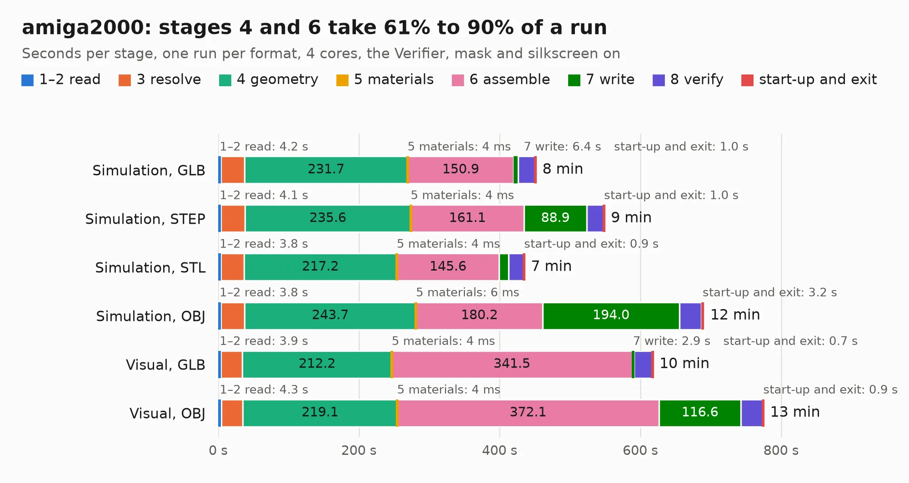

# 2395. amiga2000

Board 2,395 of the 3,126 of [Corpus Testing](../Corpus-Testing.md), on [Corpus Page 23](../CorpusTestingPages/Corpus-Testing-23.md#2395-amiga2000).

| Mode and format | 1–2 read | 3 resolve | 4 geometry | 5 materials | 6 assemble | 7 write | 8 verify | start-up and exit | Total |
|---|---:|---:|---:|---:|---:|---:|---:|---:|---:|
| Simulation, GLB | 4.2 | 33.3 | 231.7 | 4&nbsp;ms | 150.9 | 6.4 | 24.1 | 1.0 | 451.5 |
| Simulation, STEP | 4.1 | 33.9 | 235.6 | 4&nbsp;ms | 161.1 | 88.9 | 24.3 | 1.0 | 548.9 |
| Simulation, STL | 3.8 | 32.7 | 217.2 | 4&nbsp;ms | 145.6 | 13.1 | 21.9 | 0.9 | 435.3 |
| Simulation, OBJ | 3.8 | 33.6 | 243.7 | 6&nbsp;ms | 180.2 | 194.0 | 31.5 | 3.2 | 690.1 |
| Visual, GLB | 3.9 | 30.6 | 212.2 | 4&nbsp;ms | 341.5 | 2.9 | 26.2 | 0.7 | 617.8 |
| Visual, OBJ | 4.3 | 30.8 | 219.1 | 4&nbsp;ms | 372.1 | 116.6 | 31.3 | 0.9 | 775.1 |

<table align="center"><tr><td valign="top">

| Board | Repo: [rhaamo/kicad-amiga2000](https://github.com/rhaamo/kicad-amiga2000) Board: `amiga2000.kicad_pcb` |
|---|---|
| Complexity | 367&nbsp;/&nbsp;1000 (size&nbsp;287, features&nbsp;80) |
| KESE&nbsp;features | through vias, slotted holes, custom pads, rounded, trapezoid or chamfered pads, filled zones, copper drawings |
| Tested | 9th November 2026 to 11th November 2026 |
| Copper&nbsp;layers | 2 |
| File&nbsp;format | KiCad 7 (20221018) |
| Parts,&nbsp;tracks,&nbsp;vias | 558, 16,864, 999 |
| Triangles,&nbsp;simulation | 27,072,260 in 823 parts |
| Verifier | PASS in all six runs |
| Run&nbsp;again | Visual, OBJ: failed in the corpus run, run again with the memory cap raised from 11 GB to 14.5 GB, and passed |
| Run&nbsp;again | Simulation, OBJ: failed in the corpus run, run again with no memory cap and no time limit (swap added to a 16 GB machine), and passed |

</td><td valign="top">

<table>
<tr><th>File type</th><th>File size</th><th>Peak memory used</th></tr>
<tr><th colspan="3" align="left">Simulation</th></tr>
<tr><td>GLB</td><td align="right">934&nbsp;MB</td><td align="right">5.9&nbsp;GB</td></tr>
<tr><td>STEP</td><td align="right">4.8&nbsp;GB</td><td align="right">8.2&nbsp;GB</td></tr>
<tr><td>STL</td><td align="right">1.4&nbsp;GB</td><td align="right">5.9&nbsp;GB</td></tr>
<tr><td>OBJ</td><td align="right">3.0&nbsp;GB</td><td align="right">18&nbsp;GB</td></tr>
<tr><th colspan="3" align="left">Visual</th></tr>
<tr><td>GLB</td><td align="right">533&nbsp;MB</td><td align="right">8.0&nbsp;GB</td></tr>
<tr><td>OBJ</td><td align="right">1.7&nbsp;GB</td><td align="right">11&nbsp;GB</td></tr>
</table>

</td></tr></table>

| Previous | Next |
|:---|---:|
| [2394. zerofrank](b2394b_frank_zerofrank.md) | [2396. PicoEVB](b2396b_PicoEVB_PicoEVB.md) |
