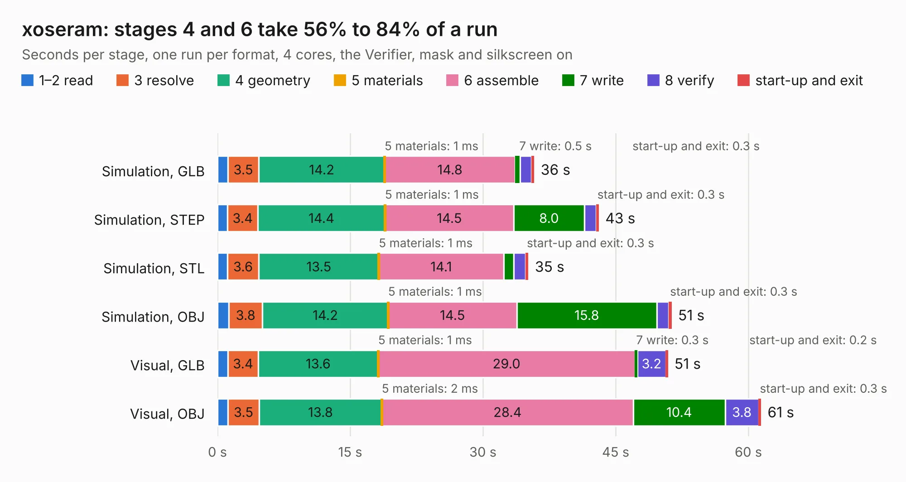

# 2396. xoseram

Board 2,396 of the 3,103 of [Corpus Testing](../Corpus-Testing.md), on [Corpus Page 23](../CorpusTestingPages/Corpus-Testing-23.md#2396-xoseram).

| Mode and format | 1–2 read | 3 resolve | 4 geometry | 5 materials | 6 assemble | 7 write | 8 verify | start-up and exit | Total |
|---|---:|---:|---:|---:|---:|---:|---:|---:|---:|
| Simulation, GLB | 1.2 | 3.5 | 14.2 | 1&nbsp;ms | 14.8 | 0.5 | 1.3 | 0.3 | 35.8 |
| Simulation, STEP | 1.1 | 3.4 | 14.4 | 1&nbsp;ms | 14.5 | 8.0 | 1.3 | 0.3 | 43.1 |
| Simulation, STL | 1.1 | 3.6 | 13.5 | 1&nbsp;ms | 14.1 | 1.2 | 1.3 | 0.3 | 35.1 |
| Simulation, OBJ | 1.3 | 3.8 | 14.2 | 1&nbsp;ms | 14.5 | 15.8 | 1.3 | 0.3 | 51.3 |
| Visual, GLB | 1.2 | 3.4 | 13.6 | 1&nbsp;ms | 29.0 | 0.3 | 3.2 | 0.2 | 50.9 |
| Visual, OBJ | 1.2 | 3.5 | 13.8 | 2&nbsp;ms | 28.4 | 10.4 | 3.8 | 0.3 | 61.4 |

<table align="center"><tr><td valign="top">

| Board | Repo: [rosco-m68k/XoseraBoard](https://github.com/rosco-m68k/XoseraBoard) Board: `xoseram.kicad_pcb` |
|---|---|
| Folder | kicad / xoseram |
| Complexity | 409&nbsp;/&nbsp;1000 (size&nbsp;274, features&nbsp;135) |
| KESE&nbsp;features | through vias, slotted holes, custom pads, rounded, trapezoid or chamfered pads, filled zones, copper drawings, curved board outline, TrueType text, stack-up, dielectric εr and tanδ |
| Tested | 9th November 2026 |
| Copper&nbsp;layers | 4 |
| File&nbsp;format | KiCad 8 (20240108) |
| Parts,&nbsp;tracks,&nbsp;vias | 183, 2,256, 379 |
| Triangles,&nbsp;simulation | 3,356,522 in 288 parts |
| Verifier | PASS in all six runs |

</td><td valign="top">

<table>
<tr><th>File type</th><th>File size</th><th>Peak memory used</th></tr>
<tr><th colspan="3" align="left">Simulation</th></tr>
<tr><td>GLB</td><td align="right">115&nbsp;MB</td><td align="right">1.1&nbsp;GB</td></tr>
<tr><td>STEP</td><td align="right">457&nbsp;MB</td><td align="right">1.4&nbsp;GB</td></tr>
<tr><td>STL</td><td align="right">168&nbsp;MB</td><td align="right">1.1&nbsp;GB</td></tr>
<tr><td>OBJ</td><td align="right">362&nbsp;MB</td><td align="right">2.2&nbsp;GB</td></tr>
<tr><th colspan="3" align="left">Visual</th></tr>
<tr><td>GLB</td><td align="right">73&nbsp;MB</td><td align="right">1.4&nbsp;GB</td></tr>
<tr><td>OBJ</td><td align="right">231&nbsp;MB</td><td align="right">1.6&nbsp;GB</td></tr>
</table>

</td></tr></table>

| Previous | Next |
|:---|---:|
| [2395. rosco_pro_030_proto](b2395b_rosco-m68k-pro_rosco-pro-030-proto.md) | [2397. hellen1-mcz33810](b2397b_hellen-one_hellen1-mcz33810.md) |
