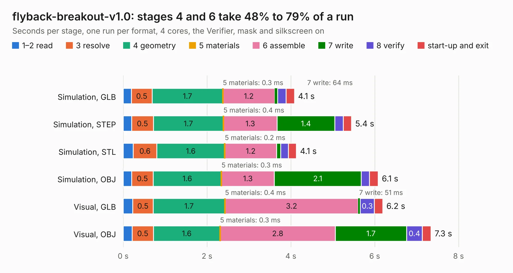

# 2398. flyback-breakout-v1.0

Board 2,398 of the 3,129 of [Corpus Testing](../Corpus-Testing.md), on [Corpus Page 23](../CorpusTestingPages/Corpus-Testing-23.md#2398-flyback-breakout-v10).

| Mode and format | 1–2 read | 3 resolve | 4 geometry | 5 materials | 6 assemble | 7 write | 8 verify | start-up and exit | Total |
|---|---:|---:|---:|---:|---:|---:|---:|---:|---:|
| Simulation, GLB | 0.2 | 0.5 | 1.7 | 0.3&nbsp;ms | 1.2 | 64&nbsp;ms | 0.2 | 0.2 | 4.1 |
| Simulation, STEP | 0.2 | 0.5 | 1.7 | 0.4&nbsp;ms | 1.3 | 1.4 | 0.2 | 0.2 | 5.4 |
| Simulation, STL | 0.2 | 0.6 | 1.6 | 0.2&nbsp;ms | 1.2 | 95&nbsp;ms | 0.2 | 0.2 | 4.1 |
| Simulation, OBJ | 0.2 | 0.5 | 1.6 | 0.3&nbsp;ms | 1.3 | 2.1 | 0.2 | 0.2 | 6.1 |
| Visual, GLB | 0.2 | 0.5 | 1.7 | 0.4&nbsp;ms | 3.2 | 51&nbsp;ms | 0.3 | 0.2 | 6.2 |
| Visual, OBJ | 0.2 | 0.5 | 1.6 | 0.3&nbsp;ms | 2.8 | 1.7 | 0.4 | 0.2 | 7.3 |

<table align="center"><tr><td valign="top">

| Board | Repo: [robojackets/robocup-pcb](https://github.com/robojackets/robocup-pcb) Board: `flyback-breakout-v1.0.kicad_pcb` |
|---|---|
| Folder | boards-archive / pre-2026 / off-robot / flyback-breakout-v1.0 |
| Complexity | 266&nbsp;/&nbsp;1000 (size&nbsp;166, features&nbsp;100) |
| KESE&nbsp;features | through vias, custom pads, rounded, trapezoid or chamfered pads, filled zones, copper drawings, stack-up, dielectric εr and tanδ |
| Tested | 9th November 2026 |
| Copper&nbsp;layers | 2 |
| File&nbsp;format | KiCad 9 (20241229) |
| Parts,&nbsp;tracks,&nbsp;vias | 51, 152, 165 |
| Triangles,&nbsp;simulation | 431,466 in 50 parts |
| Verifier | PASS in all six runs |

</td><td valign="top">

<table>
<tr><th>File type</th><th>File size</th><th>Peak memory used</th></tr>
<tr><th colspan="3" align="left">Simulation</th></tr>
<tr><td>GLB</td><td align="right">15&nbsp;MB</td><td align="right">267&nbsp;MB</td></tr>
<tr><td>STEP</td><td align="right">54&nbsp;MB</td><td align="right">316&nbsp;MB</td></tr>
<tr><td>STL</td><td align="right">22&nbsp;MB</td><td align="right">280&nbsp;MB</td></tr>
<tr><td>OBJ</td><td align="right">43&nbsp;MB</td><td align="right">330&nbsp;MB</td></tr>
<tr><th colspan="3" align="left">Visual</th></tr>
<tr><td>GLB</td><td align="right">12&nbsp;MB</td><td align="right">306&nbsp;MB</td></tr>
<tr><td>OBJ</td><td align="right">35&nbsp;MB</td><td align="right">307&nbsp;MB</td></tr>
</table>

</td></tr></table>

| Previous | Next |
|:---|---:|
| [2397. PicoEVB](b2397b_PicoEVB_PicoEVB.md) | [2399. teensy-adapter-v3.0](b2399b_robocup-pcb_teensy-adapter-v3-0.md) |
