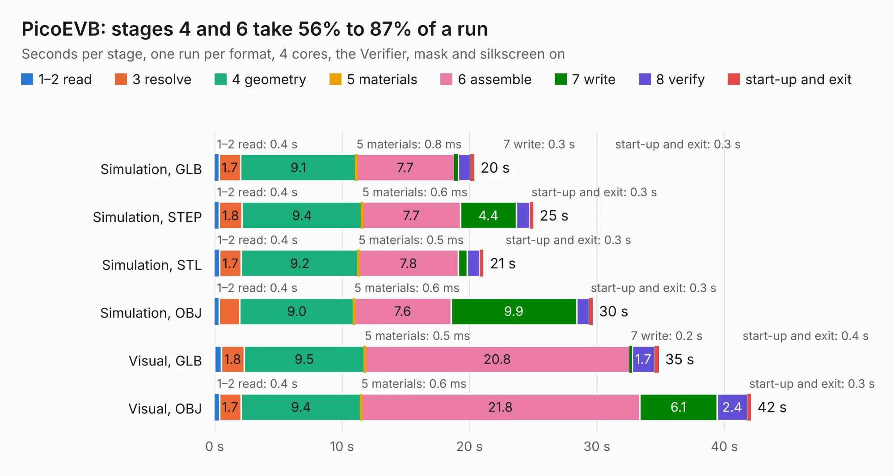

# 2399. PicoEVB

Board 2,399 of the 3,131 of [Corpus Testing](../Corpus-Testing.md), on [Corpus Page 23](../CorpusTestingPages/Corpus-Testing-23.md#2399-picoevb).

| Mode and format | 1–2 read | 3 resolve | 4 geometry | 5 materials | 6 assemble | 7 write | 8 verify | start-up and exit | Total |
|---|---:|---:|---:|---:|---:|---:|---:|---:|---:|
| Simulation, GLB | 0.4 | 1.7 | 9.1 | 0.8&nbsp;ms | 7.7 | 0.3 | 1.0 | 0.3 | 20.4 |
| Simulation, STEP | 0.4 | 1.8 | 9.4 | 0.6&nbsp;ms | 7.7 | 4.4 | 1.0 | 0.3 | 25.0 |
| Simulation, STL | 0.4 | 1.7 | 9.2 | 0.5&nbsp;ms | 7.8 | 0.7 | 1.0 | 0.3 | 21.1 |
| Simulation, OBJ | 0.4 | 1.6 | 9.0 | 0.6&nbsp;ms | 7.6 | 9.9 | 1.0 | 0.3 | 29.7 |
| Visual, GLB | 0.5 | 1.8 | 9.5 | 0.5&nbsp;ms | 20.8 | 0.2 | 1.7 | 0.4 | 34.9 |
| Visual, OBJ | 0.4 | 1.7 | 9.4 | 0.6&nbsp;ms | 21.8 | 6.1 | 2.4 | 0.3 | 42.1 |

<table align="center"><tr><td valign="top">

| Board | Repo: [RHSResearchLLC/PicoEVB](https://github.com/RHSResearchLLC/PicoEVB) Board: `PicoEVB.kicad_pcb` |
|---|---|
| Folder | Hardware / board_design |
| Complexity | 251&nbsp;/&nbsp;1000 (size&nbsp;206, features&nbsp;45) |
| KESE&nbsp;features | through vias, filled zones, curved board outline |
| Tested | 9th November 2026 |
| Copper&nbsp;layers | 4 |
| File&nbsp;format | KiCad 4 (4) |
| Parts,&nbsp;tracks,&nbsp;vias | 101, 843, 304 |
| Triangles,&nbsp;simulation | 1,913,616 in 76 parts |
| Verifier | PASS in all six runs |

</td><td valign="top">

<table>
<tr><th>File type</th><th>File size</th><th>Peak memory used</th></tr>
<tr><th colspan="3" align="left">Simulation</th></tr>
<tr><td>GLB</td><td align="right">66&nbsp;MB</td><td align="right">639&nbsp;MB</td></tr>
<tr><td>STEP</td><td align="right">267&nbsp;MB</td><td align="right">758&nbsp;MB</td></tr>
<tr><td>STL</td><td align="right">96&nbsp;MB</td><td align="right">617&nbsp;MB</td></tr>
<tr><td>OBJ</td><td align="right">202&nbsp;MB</td><td align="right">1.3&nbsp;GB</td></tr>
<tr><th colspan="3" align="left">Visual</th></tr>
<tr><td>GLB</td><td align="right">38&nbsp;MB</td><td align="right">875&nbsp;MB</td></tr>
<tr><td>OBJ</td><td align="right">113&nbsp;MB</td><td align="right">845&nbsp;MB</td></tr>
</table>

</td></tr></table>

| Previous | Next |
|:---|---:|
| [2398. amiga2000](b2398b_kicad-amiga2000_amiga2000.md) | [2400. flyback-breakout-v1.0](b2400b_robocup-pcb_flyback-breakout-v1-0.md) |
