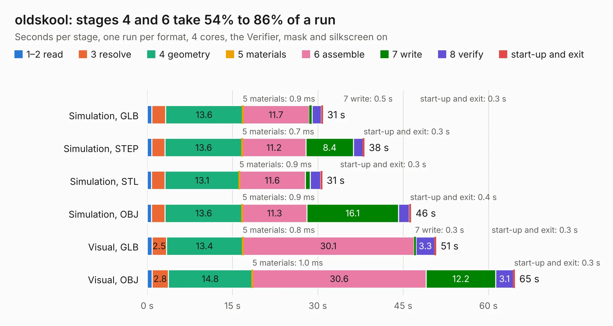

# 2399. oldskool

Board 2,399 of the 3,138 of [Corpus Testing](../Corpus-Testing.md), on [Corpus Page 23](../CorpusTestingPages/Corpus-Testing-23.md#2399-oldskool).

| Mode and format | 1–2 read | 3 resolve | 4 geometry | 5 materials | 6 assemble | 7 write | 8 verify | start-up and exit | Total |
|---|---:|---:|---:|---:|---:|---:|---:|---:|---:|
| Simulation, GLB | 0.8 | 2.4 | 13.6 | 0.9&nbsp;ms | 11.7 | 0.5 | 1.6 | 0.3 | 30.9 |
| Simulation, STEP | 0.8 | 2.3 | 13.6 | 0.7&nbsp;ms | 11.2 | 8.4 | 1.6 | 0.3 | 38.2 |
| Simulation, STL | 0.7 | 2.4 | 13.1 | 0.9&nbsp;ms | 11.6 | 0.9 | 1.8 | 0.3 | 30.8 |
| Simulation, OBJ | 0.7 | 2.4 | 13.6 | 0.9&nbsp;ms | 11.3 | 16.1 | 1.9 | 0.4 | 46.4 |
| Visual, GLB | 0.9 | 2.5 | 13.4 | 0.8&nbsp;ms | 30.1 | 0.3 | 3.3 | 0.3 | 50.8 |
| Visual, OBJ | 0.9 | 2.8 | 14.8 | 1.0&nbsp;ms | 30.6 | 12.2 | 3.1 | 0.3 | 64.7 |

<table align="center"><tr><td valign="top">

| Board | Repo: [rh1tech/frank](https://github.com/rh1tech/frank) Board: `oldskool.kicad_pcb` |
|---|---|
| Folder | hardware / oldskool |
| Complexity | 320&nbsp;/&nbsp;1000 (size&nbsp;185, features&nbsp;135) |
| KESE&nbsp;features | through vias, slotted holes, custom pads, rounded, trapezoid or chamfered pads, filled zones, copper drawings, curved board outline, TrueType text, stack-up, dielectric εr and tanδ |
| Tested | 9th November 2026 |
| Copper&nbsp;layers | 2 |
| File&nbsp;format | KiCad 10 (20260206) |
| Parts,&nbsp;tracks,&nbsp;vias | 100, 1,131, 76 |
| Triangles,&nbsp;simulation | 2,736,136 in 156 parts |
| Verifier | PASS in all six runs |

</td><td valign="top">

<table>
<tr><th>File type</th><th>File size</th><th>Peak memory used</th></tr>
<tr><th colspan="3" align="left">Simulation</th></tr>
<tr><td>GLB</td><td align="right">92&nbsp;MB</td><td align="right">1.1&nbsp;GB</td></tr>
<tr><td>STEP</td><td align="right">417&nbsp;MB</td><td align="right">1.2&nbsp;GB</td></tr>
<tr><td>STL</td><td align="right">137&nbsp;MB</td><td align="right">1.1&nbsp;GB</td></tr>
<tr><td>OBJ</td><td align="right">285&nbsp;MB</td><td align="right">1.8&nbsp;GB</td></tr>
<tr><th colspan="3" align="left">Visual</th></tr>
<tr><td>GLB</td><td align="right">63&nbsp;MB</td><td align="right">1.1&nbsp;GB</td></tr>
<tr><td>OBJ</td><td align="right">196&nbsp;MB</td><td align="right">1.3&nbsp;GB</td></tr>
</table>

</td></tr></table>

| Previous | Next |
|:---|---:|
| [2398. nyx](b2398b_frank_nyx.md) | [2400. turbosound](b2400b_frank_turbosound.md) |
