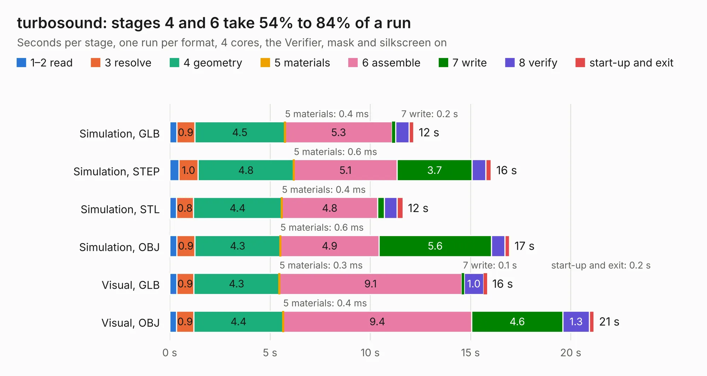

# 2400. turbosound

Board 2,400 of the 3,139 of [Corpus Testing](../Corpus-Testing.md), on [Corpus Page 23](../CorpusTestingPages/Corpus-Testing-23.md#2400-turbosound).

| Mode and format | 1–2 read | 3 resolve | 4 geometry | 5 materials | 6 assemble | 7 write | 8 verify | start-up and exit | Total |
|---|---:|---:|---:|---:|---:|---:|---:|---:|---:|
| Simulation, GLB | 0.3 | 0.9 | 4.5 | 0.4&nbsp;ms | 5.3 | 0.2 | 0.7 | 0.2 | 12.2 |
| Simulation, STEP | 0.5 | 1.0 | 4.8 | 0.6&nbsp;ms | 5.1 | 3.7 | 0.7 | 0.3 | 16.0 |
| Simulation, STL | 0.3 | 0.8 | 4.4 | 0.4&nbsp;ms | 4.8 | 0.3 | 0.6 | 0.3 | 11.6 |
| Simulation, OBJ | 0.3 | 0.9 | 4.3 | 0.6&nbsp;ms | 4.9 | 5.6 | 0.7 | 0.2 | 16.9 |
| Visual, GLB | 0.3 | 0.9 | 4.3 | 0.3&nbsp;ms | 9.1 | 0.1 | 1.0 | 0.2 | 15.8 |
| Visual, OBJ | 0.3 | 0.9 | 4.4 | 0.4&nbsp;ms | 9.4 | 4.6 | 1.3 | 0.2 | 21.2 |

<table align="center"><tr><td valign="top">

| Board | Repo: [rh1tech/frank](https://github.com/rh1tech/frank) Board: `turbosound.kicad_pcb` |
|---|---|
| Folder | hardware / turbosound |
| Complexity | 272&nbsp;/&nbsp;1000 (size&nbsp;172, features&nbsp;100) |
| KESE&nbsp;features | through vias, rounded, trapezoid or chamfered pads, filled zones, curved board outline, TrueType text, stack-up, dielectric εr and tanδ |
| Tested | 9th November 2026 |
| Copper&nbsp;layers | 2 |
| File&nbsp;format | KiCad 10 (20260206) |
| Parts,&nbsp;tracks,&nbsp;vias | 60, 597, 81 |
| Triangles,&nbsp;simulation | 1,111,518 in 105 parts |
| Verifier | PASS in all six runs |

</td><td valign="top">

<table>
<tr><th>File type</th><th>File size</th><th>Peak memory used</th></tr>
<tr><th colspan="3" align="left">Simulation</th></tr>
<tr><td>GLB</td><td align="right">37&nbsp;MB</td><td align="right">476&nbsp;MB</td></tr>
<tr><td>STEP</td><td align="right">183&nbsp;MB</td><td align="right">621&nbsp;MB</td></tr>
<tr><td>STL</td><td align="right">56&nbsp;MB</td><td align="right">493&nbsp;MB</td></tr>
<tr><td>OBJ</td><td align="right">112&nbsp;MB</td><td align="right">809&nbsp;MB</td></tr>
<tr><th colspan="3" align="left">Visual</th></tr>
<tr><td>GLB</td><td align="right">29&nbsp;MB</td><td align="right">670&nbsp;MB</td></tr>
<tr><td>OBJ</td><td align="right">88&nbsp;MB</td><td align="right">670&nbsp;MB</td></tr>
</table>

</td></tr></table>

| Previous | Next |
|:---|---:|
| [2399. oldskool](b2399b_frank_oldskool.md) | [2401. xt8086_alpha](b2401b_frank_xt8086-alpha.md) |
