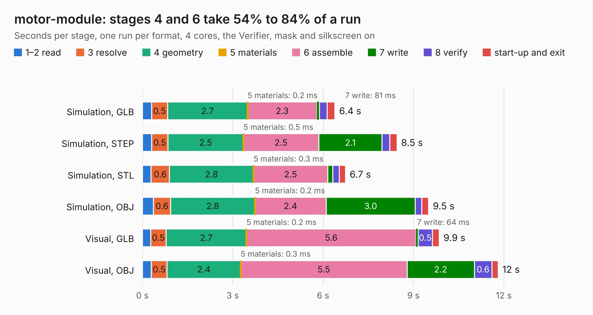

# 2401. motor-module

Board 2,401 of the 3,129 of [Corpus Testing](../Corpus-Testing.md), on [Corpus Page 23](../CorpusTestingPages/Corpus-Testing-23.md#2401-motor-module).

| Mode and format | 1–2 read | 3 resolve | 4 geometry | 5 materials | 6 assemble | 7 write | 8 verify | start-up and exit | Total |
|---|---:|---:|---:|---:|---:|---:|---:|---:|---:|
| Simulation, GLB | 0.3 | 0.5 | 2.7 | 0.2&nbsp;ms | 2.3 | 81&nbsp;ms | 0.3 | 0.3 | 6.4 |
| Simulation, STEP | 0.3 | 0.5 | 2.5 | 0.5&nbsp;ms | 2.5 | 2.1 | 0.3 | 0.2 | 8.5 |
| Simulation, STL | 0.3 | 0.6 | 2.8 | 0.3&nbsp;ms | 2.5 | 0.2 | 0.2 | 0.2 | 6.7 |
| Simulation, OBJ | 0.4 | 0.6 | 2.8 | 0.2&nbsp;ms | 2.4 | 3.0 | 0.2 | 0.2 | 9.5 |
| Visual, GLB | 0.3 | 0.5 | 2.7 | 0.2&nbsp;ms | 5.6 | 64&nbsp;ms | 0.5 | 0.2 | 9.9 |
| Visual, OBJ | 0.3 | 0.5 | 2.4 | 0.3&nbsp;ms | 5.5 | 2.2 | 0.6 | 0.2 | 11.8 |

<table align="center"><tr><td valign="top">

| Board | Repo: [robojackets/robocup-pcb](https://github.com/robojackets/robocup-pcb) Board: `motor-module.kicad_pcb` |
|---|---|
| Folder | boards / develop-2027 / drive-motorboard / motor-module |
| Complexity | 119&nbsp;/&nbsp;1000 (size&nbsp;109, features&nbsp;10) |
| KESE&nbsp;features | rounded, trapezoid or chamfered pads |
| Tested | 9th November 2026 |
| Copper&nbsp;layers | 2 |
| File&nbsp;format | KiCad 9 (20241229) |
| Parts,&nbsp;tracks,&nbsp;vias | 122, 0, 0 |
| Triangles,&nbsp;simulation | 492,312 in 94 parts |
| Note | mostly unrouted |
| Verifier | PASS in all six runs |

</td><td valign="top">

<table>
<tr><th>File type</th><th>File size</th><th>Peak memory used</th></tr>
<tr><th colspan="3" align="left">Simulation</th></tr>
<tr><td>GLB</td><td align="right">18&nbsp;MB</td><td align="right">332&nbsp;MB</td></tr>
<tr><td>STEP</td><td align="right">94&nbsp;MB</td><td align="right">407&nbsp;MB</td></tr>
<tr><td>STL</td><td align="right">25&nbsp;MB</td><td align="right">340&nbsp;MB</td></tr>
<tr><td>OBJ</td><td align="right">53&nbsp;MB</td><td align="right">396&nbsp;MB</td></tr>
<tr><th colspan="3" align="left">Visual</th></tr>
<tr><td>GLB</td><td align="right">15&nbsp;MB</td><td align="right">455&nbsp;MB</td></tr>
<tr><td>OBJ</td><td align="right">43&nbsp;MB</td><td align="right">453&nbsp;MB</td></tr>
</table>

</td></tr></table>

| Previous | Next |
|:---|---:|
| [2400. motortester-v2.0](b2400b_robocup-pcb_motortester-v2-0.md) | [2402. robocup-controller-pcb](b2402b_robocup-pcb_robocup-controller-pcb.md) |
