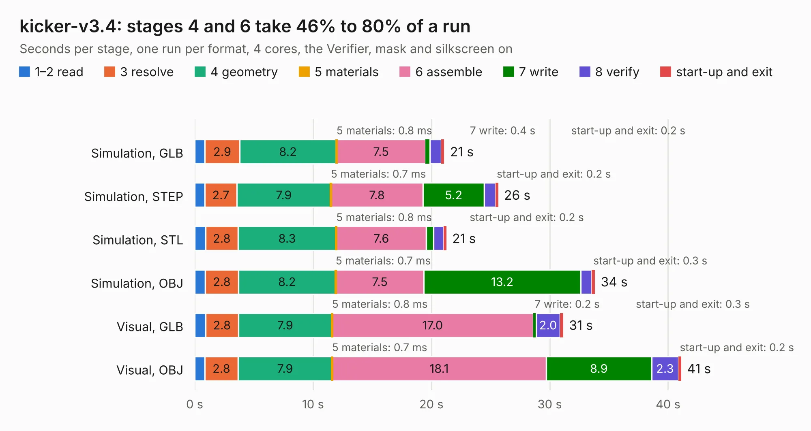

# 2402. kicker-v3.4

Board 2,402 of the 3,124 of [Corpus Testing](../Corpus-Testing.md), on [Corpus Page 23](../CorpusTestingPages/Corpus-Testing-23.md#2402-kicker-v34).

| Mode and format | 1–2 read | 3 resolve | 4 geometry | 5 materials | 6 assemble | 7 write | 8 verify | start-up and exit | Total |
|---|---:|---:|---:|---:|---:|---:|---:|---:|---:|
| Simulation, GLB | 0.9 | 2.9 | 8.2 | 0.8&nbsp;ms | 7.5 | 0.4 | 1.0 | 0.2 | 21.1 |
| Simulation, STEP | 0.9 | 2.7 | 7.9 | 0.7&nbsp;ms | 7.8 | 5.2 | 0.9 | 0.2 | 25.6 |
| Simulation, STL | 0.9 | 2.8 | 8.3 | 0.8&nbsp;ms | 7.6 | 0.6 | 0.9 | 0.2 | 21.3 |
| Simulation, OBJ | 0.9 | 2.8 | 8.2 | 0.7&nbsp;ms | 7.5 | 13.2 | 0.9 | 0.3 | 33.8 |
| Visual, GLB | 0.9 | 2.8 | 7.9 | 0.8&nbsp;ms | 17.0 | 0.2 | 2.0 | 0.3 | 31.1 |
| Visual, OBJ | 0.9 | 2.8 | 7.9 | 0.7&nbsp;ms | 18.1 | 8.9 | 2.3 | 0.2 | 41.1 |

<table align="center"><tr><td valign="top">

| Board | Repo: [robojackets/robocup-pcb](https://github.com/robojackets/robocup-pcb) Board: `kicker-v3.4.kicad_pcb` |
|---|---|
| Folder | boards / rev-2026 / kicker-v3.4 |
| Complexity | 394&nbsp;/&nbsp;1000 (size&nbsp;254, features&nbsp;140) |
| KESE&nbsp;features | through vias, slotted holes, custom pads, rounded, trapezoid or chamfered pads, filled zones, copper drawings, curved board outline, stack-up, dielectric εr and tanδ, copper finish, mask and silkscreen colours |
| Tested | 9th November 2026 |
| Copper&nbsp;layers | 4 |
| File&nbsp;format | KiCad 9 (20241229) |
| Parts,&nbsp;tracks,&nbsp;vias | 146, 624, 532 |
| Triangles,&nbsp;simulation | 2,585,468 in 126 parts |
| Verifier | PASS in all six runs |

</td><td valign="top">

<table>
<tr><th>File type</th><th>File size</th><th>Peak memory used</th></tr>
<tr><th colspan="3" align="left">Simulation</th></tr>
<tr><td>GLB</td><td align="right">89&nbsp;MB</td><td align="right">937&nbsp;MB</td></tr>
<tr><td>STEP</td><td align="right">302&nbsp;MB</td><td align="right">1.1&nbsp;GB</td></tr>
<tr><td>STL</td><td align="right">129&nbsp;MB</td><td align="right">970&nbsp;MB</td></tr>
<tr><td>OBJ</td><td align="right">275&nbsp;MB</td><td align="right">1.7&nbsp;GB</td></tr>
<tr><th colspan="3" align="left">Visual</th></tr>
<tr><td>GLB</td><td align="right">59&nbsp;MB</td><td align="right">1.1&nbsp;GB</td></tr>
<tr><td>OBJ</td><td align="right">184&nbsp;MB</td><td align="right">1.3&nbsp;GB</td></tr>
</table>

</td></tr></table>

| Previous | Next |
|:---|---:|
| [2401. control-v4.1-stm32](b2401b_robocup-pcb_control-v4-1-stm32.md) | [2403. motorboard-v1.0](b2403b_robocup-pcb_motorboard-v1-0.md) |
