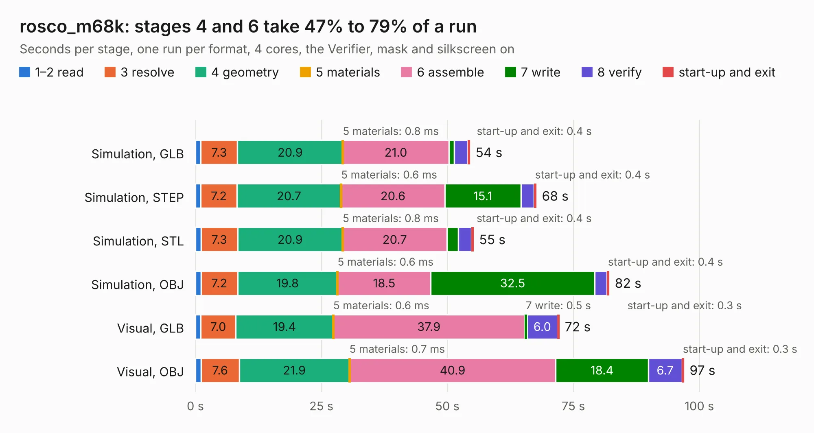

# 2404. rosco_m68k

Board 2,404 of the 3,117 of [Corpus Testing](../Corpus-Testing.md), on [Corpus Page 23](../CorpusTestingPages/Corpus-Testing-23.md#2404-rosco_m68k).

| Mode and format | 1–2 read | 3 resolve | 4 geometry | 5 materials | 6 assemble | 7 write | 8 verify | start-up and exit | Total |
|---|---:|---:|---:|---:|---:|---:|---:|---:|---:|
| Simulation, GLB | 1.1 | 7.3 | 20.9 | 0.8&nbsp;ms | 21.0 | 1.1 | 2.7 | 0.4 | 54.4 |
| Simulation, STEP | 1.1 | 7.2 | 20.7 | 0.6&nbsp;ms | 20.6 | 15.1 | 2.6 | 0.4 | 67.6 |
| Simulation, STL | 1.1 | 7.3 | 20.9 | 0.8&nbsp;ms | 20.7 | 2.3 | 2.6 | 0.4 | 55.1 |
| Simulation, OBJ | 1.1 | 7.2 | 19.8 | 0.6&nbsp;ms | 18.5 | 32.5 | 2.5 | 0.4 | 82.1 |
| Visual, GLB | 1.0 | 7.0 | 19.4 | 0.6&nbsp;ms | 37.9 | 0.5 | 6.0 | 0.3 | 72.1 |
| Visual, OBJ | 1.1 | 7.6 | 21.9 | 0.7&nbsp;ms | 40.9 | 18.4 | 6.7 | 0.3 | 96.9 |

<table align="center"><tr><td valign="top">

| Board | Repo: [rosco-m68k/rosco_m68k](https://github.com/rosco-m68k/rosco_m68k) Board: `rosco_m68k.kicad_pcb` |
|---|---|
| Folder | design / r1.2 / kicad |
| Complexity | 259&nbsp;/&nbsp;1000 (size&nbsp;214, features&nbsp;45) |
| KESE&nbsp;features | through vias, filled zones, curved board outline |
| Tested | 9th November 2026 |
| Copper&nbsp;layers | 4 |
| File&nbsp;format | KiCad 5 (20171130) |
| Parts,&nbsp;tracks,&nbsp;vias | 74, 2,802, 259 |
| Triangles,&nbsp;simulation | 5,423,534 in 139 parts |
| Verifier | PASS in all six runs |

</td><td valign="top">

<table>
<tr><th>File type</th><th>File size</th><th>Peak memory used</th></tr>
<tr><th colspan="3" align="left">Simulation</th></tr>
<tr><td>GLB</td><td align="right">186&nbsp;MB</td><td align="right">1.3&nbsp;GB</td></tr>
<tr><td>STEP</td><td align="right">771&nbsp;MB</td><td align="right">1.6&nbsp;GB</td></tr>
<tr><td>STL</td><td align="right">271&nbsp;MB</td><td align="right">1.3&nbsp;GB</td></tr>
<tr><td>OBJ</td><td align="right">582&nbsp;MB</td><td align="right">3.5&nbsp;GB</td></tr>
<tr><th colspan="3" align="left">Visual</th></tr>
<tr><td>GLB</td><td align="right">95&nbsp;MB</td><td align="right">1.6&nbsp;GB</td></tr>
<tr><td>OBJ</td><td align="right">302&nbsp;MB</td><td align="right">2.0&nbsp;GB</td></tr>
</table>

</td></tr></table>

| Previous | Next |
|:---|---:|
| [2403. rosco_m68k](b2403b_rosco-m68k_design-r0-r0-kicad-import_rosco-m68k.md) | [2405. rosco_m68k](b2405b_rosco-m68k_design-r1-kicad_rosco-m68k.md) |
