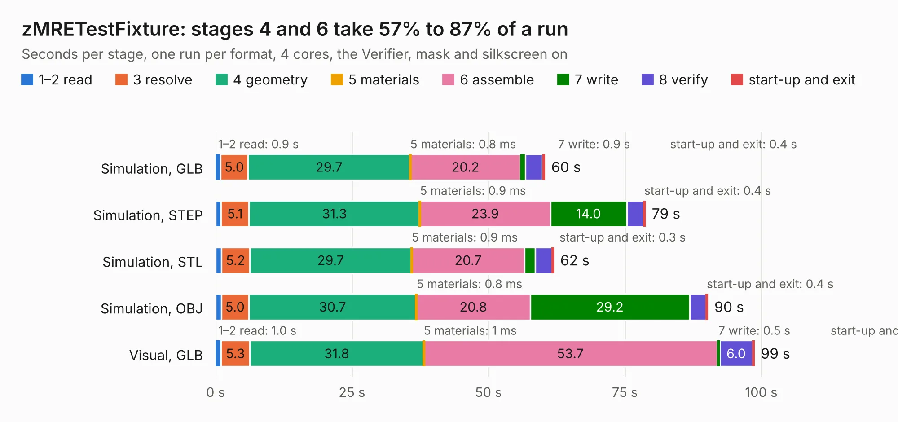

# 2405. zMRETestFixture

Board 2,405 of the 3,104 of [Corpus Testing](../Corpus-Testing.md), on [Corpus Page 23](../CorpusTestingPages/Corpus-Testing-23.md#2405-zmretestfixture).

| Mode and format | 1–2 read | 3 resolve | 4 geometry | 5 materials | 6 assemble | 7 write | 8 verify | start-up and exit | Total |
|---|---:|---:|---:|---:|---:|---:|---:|---:|---:|
| Simulation, GLB | 0.9 | 5.0 | 29.7 | 0.8&nbsp;ms | 20.2 | 0.9 | 3.1 | 0.4 | 60.3 |
| Simulation, STEP | 1.0 | 5.1 | 31.3 | 0.9&nbsp;ms | 23.9 | 14.0 | 3.0 | 0.4 | 78.8 |
| Simulation, STL | 1.1 | 5.2 | 29.7 | 0.9&nbsp;ms | 20.7 | 1.9 | 3.1 | 0.3 | 62.0 |
| Simulation, OBJ | 1.1 | 5.0 | 30.7 | 0.8&nbsp;ms | 20.8 | 29.2 | 2.9 | 0.4 | 90.2 |
| Visual, GLB | 1.0 | 5.3 | 31.8 | 1&nbsp;ms | 53.7 | 0.5 | 6.0 | 0.3 | 98.7 |
| Visual, OBJ | 1.0 | 4.9 | 30.8 | 0.8&nbsp;ms | 56.6 | 21.6 | 6.8 | 0.4 | 122.2 |

<table align="center"><tr><td valign="top">

| Board | Repo: [rusefi/hw_microrusefi](https://github.com/rusefi/hw_microrusefi) Board: `zMRETestFixture.kicad_pcb` |
|---|---|
| Complexity | 249&nbsp;/&nbsp;1000 (size&nbsp;204, features&nbsp;45) |
| KESE&nbsp;features | through vias, filled zones, curved board outline |
| Tested | 9th November 2026 to 10th November 2026 |
| Copper&nbsp;layers | 2 |
| File&nbsp;format | KiCad 5 (20171130) |
| Parts,&nbsp;tracks,&nbsp;vias | 190, 1,607, 431 |
| Triangles,&nbsp;simulation | 4,664,266 in 178 parts |
| Verifier | PASS in all six runs |

</td><td valign="top">

<table>
<tr><th>File type</th><th>File size</th><th>Peak memory used</th></tr>
<tr><th colspan="3" align="left">Simulation</th></tr>
<tr><td>GLB</td><td align="right">161&nbsp;MB</td><td align="right">1.5&nbsp;GB</td></tr>
<tr><td>STEP</td><td align="right">799&nbsp;MB</td><td align="right">1.9&nbsp;GB</td></tr>
<tr><td>STL</td><td align="right">233&nbsp;MB</td><td align="right">1.6&nbsp;GB</td></tr>
<tr><td>OBJ</td><td align="right">505&nbsp;MB</td><td align="right">3.1&nbsp;GB</td></tr>
<tr><th colspan="3" align="left">Visual</th></tr>
<tr><td>GLB</td><td align="right">114&nbsp;MB</td><td align="right">1.9&nbsp;GB</td></tr>
<tr><td>OBJ</td><td align="right">359&nbsp;MB</td><td align="right">2.3&nbsp;GB</td></tr>
</table>

</td></tr></table>

| Previous | Next |
|:---|---:|
| [2404. output.Panel_R0.5.1_300x300_2layer_step1_Modified_1and5_only](b2404b_hw-microrusefi_output-Panel-R0-5-1-300x300-2layer-step1-Modified-1and5-only.md) | [2406. Motor_driver_A4988](b2406b_rusefi-hardware_Motor-driver-A4988.md) |
