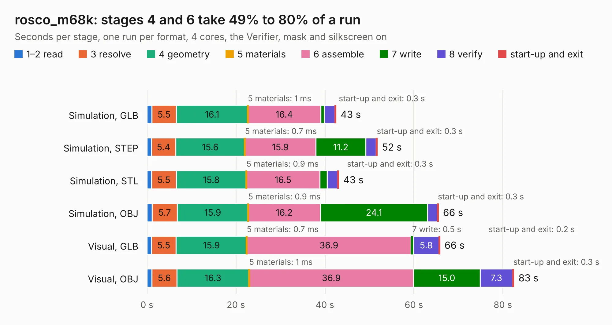

# 2405. rosco_m68k

Board 2,405 of the 3,116 of [Corpus Testing](../Corpus-Testing.md), on [Corpus Page 23](../CorpusTestingPages/Corpus-Testing-23.md#2405-rosco_m68k).

| Mode and format | 1–2 read | 3 resolve | 4 geometry | 5 materials | 6 assemble | 7 write | 8 verify | start-up and exit | Total |
|---|---:|---:|---:|---:|---:|---:|---:|---:|---:|
| Simulation, GLB | 1.1 | 5.5 | 16.1 | 1&nbsp;ms | 16.4 | 0.9 | 2.3 | 0.3 | 42.5 |
| Simulation, STEP | 1.0 | 5.4 | 15.6 | 0.7&nbsp;ms | 15.9 | 11.2 | 2.3 | 0.3 | 51.8 |
| Simulation, STL | 1.0 | 5.5 | 15.8 | 0.9&nbsp;ms | 16.5 | 1.7 | 2.3 | 0.3 | 43.2 |
| Simulation, OBJ | 1.1 | 5.7 | 15.9 | 0.9&nbsp;ms | 16.2 | 24.1 | 2.2 | 0.3 | 65.6 |
| Visual, GLB | 1.0 | 5.5 | 15.9 | 0.7&nbsp;ms | 36.9 | 0.5 | 5.8 | 0.2 | 65.9 |
| Visual, OBJ | 1.1 | 5.6 | 16.3 | 1&nbsp;ms | 36.9 | 15.0 | 7.3 | 0.3 | 82.5 |

<table align="center"><tr><td valign="top">

| Board | Repo: [rosco-m68k/rosco_m68k](https://github.com/rosco-m68k/rosco_m68k) Board: `rosco_m68k.kicad_pcb` |
|---|---|
| Folder | design / r2 / kicad |
| Complexity | 422&nbsp;/&nbsp;1000 (size&nbsp;272, features&nbsp;150) |
| KESE&nbsp;features | through vias, slotted holes, custom pads, rounded, trapezoid or chamfered pads, filled zones, copper drawings, curved board outline, knockout text, TrueType text, stack-up, dielectric εr and tanδ |
| Tested | 9th November 2026 |
| Copper&nbsp;layers | 4 |
| File&nbsp;format | KiCad 8 (20240108) |
| Parts,&nbsp;tracks,&nbsp;vias | 128, 3,716, 402 |
| Triangles,&nbsp;simulation | 5,616,966 in 210 parts |
| Verifier | PASS in all six runs |

</td><td valign="top">

<table>
<tr><th>File type</th><th>File size</th><th>Peak memory used</th></tr>
<tr><th colspan="3" align="left">Simulation</th></tr>
<tr><td>GLB</td><td align="right">189&nbsp;MB</td><td align="right">1.4&nbsp;GB</td></tr>
<tr><td>STEP</td><td align="right">803&nbsp;MB</td><td align="right">1.8&nbsp;GB</td></tr>
<tr><td>STL</td><td align="right">281&nbsp;MB</td><td align="right">1.4&nbsp;GB</td></tr>
<tr><td>OBJ</td><td align="right">601&nbsp;MB</td><td align="right">3.6&nbsp;GB</td></tr>
<tr><th colspan="3" align="left">Visual</th></tr>
<tr><td>GLB</td><td align="right">111&nbsp;MB</td><td align="right">1.8&nbsp;GB</td></tr>
<tr><td>OBJ</td><td align="right">352&nbsp;MB</td><td align="right">2.4&nbsp;GB</td></tr>
</table>

</td></tr></table>

| Previous | Next |
|:---|---:|
| [2404. rosco_m68k](b2404b_rosco-m68k_design-r1-kicad_rosco-m68k.md) | [2406. rosco_m68k](b2406b_rosco-m68k_design-r2020-kicad_rosco-m68k.md) |
