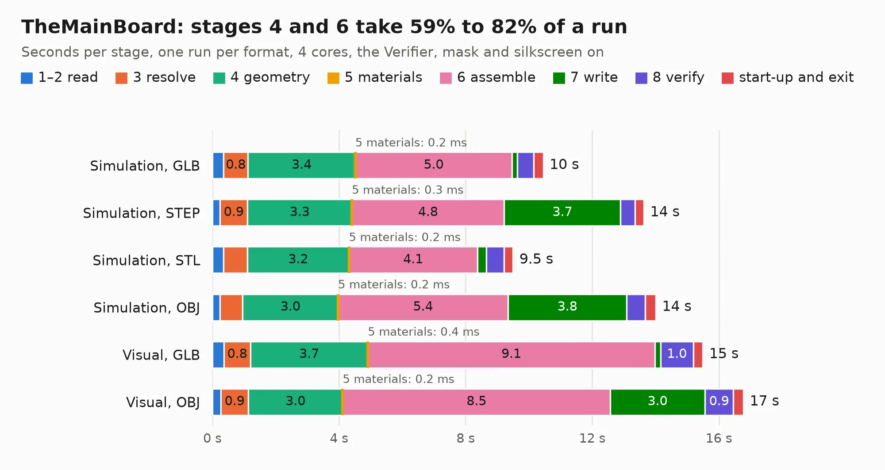

# 2407. TheMainBoard

Board 2,407 of the 3,125 of [Corpus Testing](../Corpus-Testing.md), on [Corpus Page 23](../CorpusTestingPages/Corpus-Testing-23.md#2407-themainboard).

| Mode and format | 1–2 read | 3 resolve | 4 geometry | 5 materials | 6 assemble | 7 write | 8 verify | start-up and exit | Total |
|---|---:|---:|---:|---:|---:|---:|---:|---:|---:|
| Simulation, GLB | 0.4 | 0.8 | 3.4 | 0.2&nbsp;ms | 5.0 | 0.2 | 0.5 | 0.3 | 10.4 |
| Simulation, STEP | 0.2 | 0.9 | 3.3 | 0.3&nbsp;ms | 4.8 | 3.7 | 0.5 | 0.3 | 13.6 |
| Simulation, STL | 0.3 | 0.8 | 3.2 | 0.2&nbsp;ms | 4.1 | 0.3 | 0.6 | 0.3 | 9.5 |
| Simulation, OBJ | 0.2 | 0.7 | 3.0 | 0.2&nbsp;ms | 5.4 | 3.8 | 0.6 | 0.3 | 14.0 |
| Visual, GLB | 0.4 | 0.8 | 3.7 | 0.4&nbsp;ms | 9.1 | 0.2 | 1.0 | 0.3 | 15.5 |
| Visual, OBJ | 0.3 | 0.9 | 3.0 | 0.2&nbsp;ms | 8.5 | 3.0 | 0.9 | 0.3 | 16.8 |

<table align="center"><tr><td valign="top">

| Board | Repo: [RolandThsive/Thermometer](https://github.com/RolandThsive/Thermometer) Board: `TheMainBoard.kicad_pcb` |
|---|---|
| Folder | Electronics / The Main Board / TheMainBoard |
| Complexity | 276&nbsp;/&nbsp;1000 (size&nbsp;166, features&nbsp;110) |
| KESE&nbsp;features | through vias, rounded, trapezoid or chamfered pads, drill offsets, filled zones, curved board outline, TrueType text, stack-up, dielectric εr and tanδ |
| Tested | 11th November 2026 |
| Copper&nbsp;layers | 2 |
| File&nbsp;format | KiCad 10 (20260206) |
| Parts,&nbsp;tracks,&nbsp;vias | 31, 390, 176 |
| Triangles,&nbsp;simulation | 624,140 in 50 parts |
| Verifier | PASS in all six runs |

</td><td valign="top">

<table>
<tr><th>File type</th><th>File size</th><th>Peak memory used</th></tr>
<tr><th colspan="3" align="left">Simulation</th></tr>
<tr><td>GLB</td><td align="right">22&nbsp;MB</td><td align="right">334&nbsp;MB</td></tr>
<tr><td>STEP</td><td align="right">100&nbsp;MB</td><td align="right">394&nbsp;MB</td></tr>
<tr><td>STL</td><td align="right">31&nbsp;MB</td><td align="right">336&nbsp;MB</td></tr>
<tr><td>OBJ</td><td align="right">63&nbsp;MB</td><td align="right">449&nbsp;MB</td></tr>
<tr><th colspan="3" align="left">Visual</th></tr>
<tr><td>GLB</td><td align="right">17&nbsp;MB</td><td align="right">402&nbsp;MB</td></tr>
<tr><td>OBJ</td><td align="right">51&nbsp;MB</td><td align="right">439&nbsp;MB</td></tr>
</table>

</td></tr></table>

| Previous | Next |
|:---|---:|
| [2406. TINY-REFLOW-CONTROLLER](b2406b_TinyReflowController_TINY-REFLOW-CONTROLLER.md) | [2408. GaNdapter-dual](b2408b_dcdc_GaNdapter-dual.md) |
