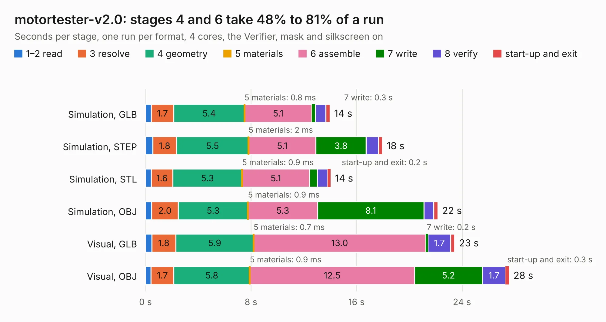

# 2407 motortester-v2.0

Board 2,407 of the 3,138 of [Corpus Testing](../Corpus-Testing.md), on [Corpus Page 23](../CorpusTestingPages/Corpus-Testing-23.md#2407-motortester-v20).

| Mode and format | 1–2 read | 3 resolve | 4 geometry | 5 materials | 6 assemble | 7 write | 8 verify | start-up and exit | Total |
|---|---:|---:|---:|---:|---:|---:|---:|---:|---:|
| Simulation, GLB | 0.4 | 1.7 | 5.4 | 0.8&nbsp;ms | 5.1 | 0.3 | 0.8 | 0.3 | 14.0 |
| Simulation, STEP | 0.6 | 1.8 | 5.5 | 2&nbsp;ms | 5.1 | 3.8 | 0.9 | 0.3 | 18.0 |
| Simulation, STL | 0.4 | 1.6 | 5.3 | 0.9&nbsp;ms | 5.1 | 0.6 | 0.8 | 0.2 | 14.0 |
| Simulation, OBJ | 0.5 | 2.0 | 5.3 | 0.9&nbsp;ms | 5.3 | 8.1 | 0.7 | 0.3 | 22.2 |
| Visual, GLB | 0.5 | 1.8 | 5.9 | 0.7&nbsp;ms | 13.0 | 0.2 | 1.7 | 0.3 | 23.4 |
| Visual, OBJ | 0.4 | 1.7 | 5.8 | 0.9&nbsp;ms | 12.5 | 5.2 | 1.7 | 0.3 | 27.6 |

<table align="center"><tr><td valign="top">

| Board | Repo: [robojackets/robocup-pcb](https://github.com/robojackets/robocup-pcb) Board: `motortester-v2.0.kicad_pcb` |
|---|---|
| Folder | boards-archive / pre-2026 / off-robot / motortester-v2.0 |
| Complexity | 288&nbsp;/&nbsp;1000 (size&nbsp;193, features&nbsp;95) |
| KESE&nbsp;features | through vias, slotted holes, rounded, trapezoid or chamfered pads, filled zones, curved board outline, stack-up, dielectric εr and tanδ |
| Tested | 9th November 2026 |
| Copper&nbsp;layers | 4 |
| File&nbsp;format | KiCad 8 (20240108) |
| Parts,&nbsp;tracks,&nbsp;vias | 76, 386, 195 |
| Triangles,&nbsp;simulation | 1,539,214 in 147 parts |
| Verifier | PASS in all six runs |

</td><td valign="top">

<table>
<tr><th>File type</th><th>File size</th><th>Peak memory used</th></tr>
<tr><th colspan="3" align="left">Simulation</th></tr>
<tr><td>GLB</td><td align="right">52&nbsp;MB</td><td align="right">622&nbsp;MB</td></tr>
<tr><td>STEP</td><td align="right">178&nbsp;MB</td><td align="right">677&nbsp;MB</td></tr>
<tr><td>STL</td><td align="right">77&nbsp;MB</td><td align="right">654&nbsp;MB</td></tr>
<tr><td>OBJ</td><td align="right">159&nbsp;MB</td><td align="right">1.1&nbsp;GB</td></tr>
<tr><th colspan="3" align="left">Visual</th></tr>
<tr><td>GLB</td><td align="right">31&nbsp;MB</td><td align="right">755&nbsp;MB</td></tr>
<tr><td>OBJ</td><td align="right">95&nbsp;MB</td><td align="right">717&nbsp;MB</td></tr>
</table>

</td></tr></table>

| Previous | Next |
|:---|---:|
| [2406 teensy-adapter-v3.0](b2406b_robocup-pcb_teensy-adapter-v3-0.md) | [2408 motor-module](b2408b_robocup-pcb_motor-module.md) |
