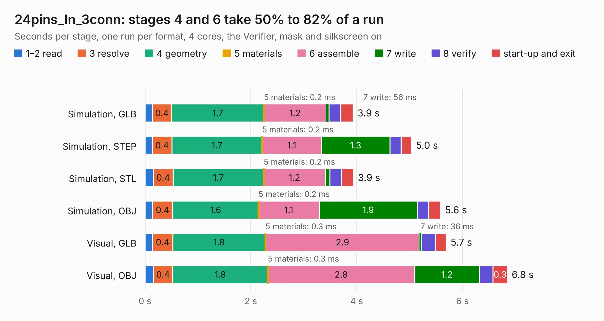

# 2407. 24pins_In_3conn

Board 2,407 of the 3,103 of [Corpus Testing](../Corpus-Testing.md), on [Corpus Page 23](../CorpusTestingPages/Corpus-Testing-23.md#2407-24pins_in_3conn).

| Mode and format | 1–2 read | 3 resolve | 4 geometry | 5 materials | 6 assemble | 7 write | 8 verify | start-up and exit | Total |
|---|---:|---:|---:|---:|---:|---:|---:|---:|---:|
| Simulation, GLB | 0.1 | 0.4 | 1.7 | 0.2&nbsp;ms | 1.2 | 56&nbsp;ms | 0.2 | 0.2 | 3.9 |
| Simulation, STEP | 0.1 | 0.4 | 1.7 | 0.2&nbsp;ms | 1.1 | 1.3 | 0.2 | 0.2 | 5.0 |
| Simulation, STL | 0.2 | 0.4 | 1.7 | 0.2&nbsp;ms | 1.2 | 89&nbsp;ms | 0.2 | 0.2 | 3.9 |
| Simulation, OBJ | 0.1 | 0.4 | 1.6 | 0.2&nbsp;ms | 1.1 | 1.9 | 0.2 | 0.2 | 5.6 |
| Visual, GLB | 0.1 | 0.4 | 1.8 | 0.3&nbsp;ms | 2.9 | 36&nbsp;ms | 0.3 | 0.2 | 5.7 |
| Visual, OBJ | 0.2 | 0.4 | 1.8 | 0.3&nbsp;ms | 2.8 | 1.2 | 0.3 | 0.3 | 6.8 |

<table align="center"><tr><td valign="top">

| Board | Repo: [rusefi/rusefi-hardware](https://github.com/rusefi/rusefi-hardware) Board: `24pins_In_3conn.kicad_pcb` |
|---|---|
| Folder | breakout-boards / Breakout-24pin |
| Complexity | 157&nbsp;/&nbsp;1000 (size&nbsp;117, features&nbsp;40) |
| KESE&nbsp;features | slotted holes, stack-up, dielectric εr and tanδ |
| Tested | 9th November 2026 |
| Copper&nbsp;layers | 2 |
| File&nbsp;format | KiCad 7 (20221018) |
| Parts,&nbsp;tracks,&nbsp;vias | 4, 156, 0 |
| Triangles,&nbsp;simulation | 318,636 in 36 parts |
| Verifier | PASS in all six runs |

</td><td valign="top">

<table>
<tr><th>File type</th><th>File size</th><th>Peak memory used</th></tr>
<tr><th colspan="3" align="left">Simulation</th></tr>
<tr><td>GLB</td><td align="right">11&nbsp;MB</td><td align="right">227&nbsp;MB</td></tr>
<tr><td>STEP</td><td align="right">49&nbsp;MB</td><td align="right">254&nbsp;MB</td></tr>
<tr><td>STL</td><td align="right">16&nbsp;MB</td><td align="right">235&nbsp;MB</td></tr>
<tr><td>OBJ</td><td align="right">32&nbsp;MB</td><td align="right">264&nbsp;MB</td></tr>
<tr><th colspan="3" align="left">Visual</th></tr>
<tr><td>GLB</td><td align="right">7.2&nbsp;MB</td><td align="right">228&nbsp;MB</td></tr>
<tr><td>OBJ</td><td align="right">21&nbsp;MB</td><td align="right">230&nbsp;MB</td></tr>
</table>

</td></tr></table>

| Previous | Next |
|:---|---:|
| [2406. Breakout-24pin-superseal](b2406b_rusefi-hardware_Breakout-24pin-superseal.md) | [2408. 284617-1](b2408b_rusefi-hardware_284617-1.md) |
