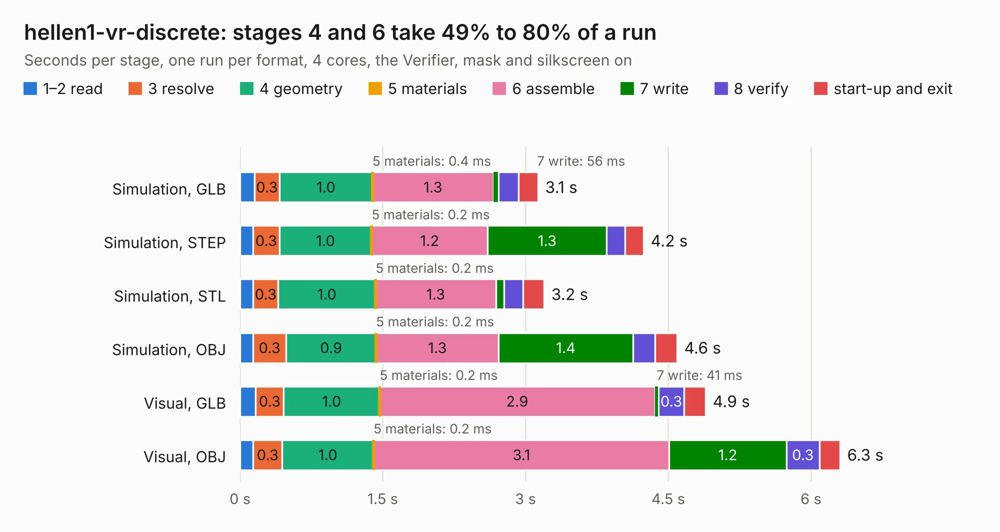

# 2408. hellen1-vr-discrete

Board 2,408 of the 3,111 of [Corpus Testing](../Corpus-Testing.md), on [Corpus Page 23](../CorpusTestingPages/Corpus-Testing-23.md#2408-hellen1-vr-discrete).

| Mode and format | 1–2 read | 3 resolve | 4 geometry | 5 materials | 6 assemble | 7 write | 8 verify | start-up and exit | Total |
|---|---:|---:|---:|---:|---:|---:|---:|---:|---:|
| Simulation, GLB | 0.2 | 0.3 | 1.0 | 0.4&nbsp;ms | 1.3 | 56&nbsp;ms | 0.2 | 0.2 | 3.1 |
| Simulation, STEP | 0.1 | 0.3 | 1.0 | 0.2&nbsp;ms | 1.2 | 1.3 | 0.2 | 0.2 | 4.2 |
| Simulation, STL | 0.1 | 0.3 | 1.0 | 0.2&nbsp;ms | 1.3 | 87&nbsp;ms | 0.2 | 0.2 | 3.2 |
| Simulation, OBJ | 0.1 | 0.3 | 0.9 | 0.2&nbsp;ms | 1.3 | 1.4 | 0.2 | 0.2 | 4.6 |
| Visual, GLB | 0.2 | 0.3 | 1.0 | 0.2&nbsp;ms | 2.9 | 41&nbsp;ms | 0.3 | 0.2 | 4.9 |
| Visual, OBJ | 0.1 | 0.3 | 1.0 | 0.2&nbsp;ms | 3.1 | 1.2 | 0.3 | 0.2 | 6.3 |

<table align="center"><tr><td valign="top">

| Board | Repo: [rusefi/hellen-one](https://github.com/rusefi/hellen-one) Board: `hellen1-vr-discrete.kicad_pcb` |
|---|---|
| Folder | kicad / modules / hellen1-vr-discrete |
| Complexity | 254&nbsp;/&nbsp;1000 (size&nbsp;174, features&nbsp;80) |
| KESE&nbsp;features | through vias, rounded, trapezoid or chamfered pads, filled zones, stack-up, dielectric εr and tanδ, mask and silkscreen colours |
| Tested | 9th November 2026 |
| Copper&nbsp;layers | 4 |
| File&nbsp;format | KiCad 7 (20221018) |
| Parts,&nbsp;tracks,&nbsp;vias | 48, 270, 44 |
| Triangles,&nbsp;simulation | 358,994 in 42 parts |
| Verifier | PASS in all six runs |

</td><td valign="top">

<table>
<tr><th>File type</th><th>File size</th><th>Peak memory used</th></tr>
<tr><th colspan="3" align="left">Simulation</th></tr>
<tr><td>GLB</td><td align="right">12&nbsp;MB</td><td align="right">272&nbsp;MB</td></tr>
<tr><td>STEP</td><td align="right">52&nbsp;MB</td><td align="right">284&nbsp;MB</td></tr>
<tr><td>STL</td><td align="right">18&nbsp;MB</td><td align="right">273&nbsp;MB</td></tr>
<tr><td>OBJ</td><td align="right">36&nbsp;MB</td><td align="right">277&nbsp;MB</td></tr>
<tr><th colspan="3" align="left">Visual</th></tr>
<tr><td>GLB</td><td align="right">8.4&nbsp;MB</td><td align="right">280&nbsp;MB</td></tr>
<tr><td>OBJ</td><td align="right">25&nbsp;MB</td><td align="right">277&nbsp;MB</td></tr>
</table>

</td></tr></table>

| Previous | Next |
|:---|---:|
| [2407. hellen1-uaefi](b2407b_hellen-one_hellen1-uaefi.md) | [2409. hellen1-vr-max9924](b2409b_hellen-one_hellen1-vr-max9924.md) |
