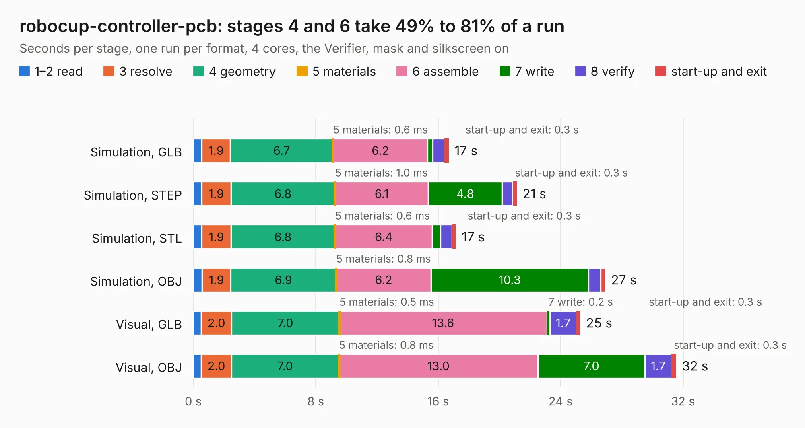

# 2409. robocup-controller-pcb

Board 2,409 of the 3,139 of [Corpus Testing](../Corpus-Testing.md), on [Corpus Page 23](../CorpusTestingPages/Corpus-Testing-23.md#2409-robocup-controller-pcb).

| Mode and format | 1–2 read | 3 resolve | 4 geometry | 5 materials | 6 assemble | 7 write | 8 verify | start-up and exit | Total |
|---|---:|---:|---:|---:|---:|---:|---:|---:|---:|
| Simulation, GLB | 0.6 | 1.9 | 6.7 | 0.6&nbsp;ms | 6.2 | 0.3 | 0.8 | 0.3 | 16.7 |
| Simulation, STEP | 0.5 | 1.9 | 6.8 | 1.0&nbsp;ms | 6.1 | 4.8 | 0.7 | 0.3 | 21.1 |
| Simulation, STL | 0.6 | 1.9 | 6.8 | 0.6&nbsp;ms | 6.4 | 0.5 | 0.8 | 0.3 | 17.2 |
| Simulation, OBJ | 0.6 | 1.9 | 6.9 | 0.8&nbsp;ms | 6.2 | 10.3 | 0.8 | 0.3 | 26.9 |
| Visual, GLB | 0.5 | 2.0 | 7.0 | 0.5&nbsp;ms | 13.6 | 0.2 | 1.7 | 0.3 | 25.3 |
| Visual, OBJ | 0.5 | 2.0 | 7.0 | 0.8&nbsp;ms | 13.0 | 7.0 | 1.7 | 0.3 | 31.6 |

<table align="center"><tr><td valign="top">

| Board | Repo: [robojackets/robocup-pcb](https://github.com/robojackets/robocup-pcb) Board: `robocup-controller-pcb.kicad_pcb` |
|---|---|
| Folder | boards / development / controller |
| Complexity | 342&nbsp;/&nbsp;1000 (size&nbsp;247, features&nbsp;95) |
| KESE&nbsp;features | through vias, slotted holes, rounded, trapezoid or chamfered pads, knockout text, TrueType text, stack-up, dielectric εr and tanδ |
| Tested | 9th November 2026 |
| Copper&nbsp;layers | 4 |
| File&nbsp;format | KiCad 10 (20260206) |
| Parts,&nbsp;tracks,&nbsp;vias | 135, 982, 178 |
| Triangles,&nbsp;simulation | 1,720,566 in 135 parts |
| Verifier | PASS in all six runs |

</td><td valign="top">

<table>
<tr><th>File type</th><th>File size</th><th>Peak memory used</th></tr>
<tr><th colspan="3" align="left">Simulation</th></tr>
<tr><td>GLB</td><td align="right">59&nbsp;MB</td><td align="right">643&nbsp;MB</td></tr>
<tr><td>STEP</td><td align="right">227&nbsp;MB</td><td align="right">759&nbsp;MB</td></tr>
<tr><td>STL</td><td align="right">86&nbsp;MB</td><td align="right">614&nbsp;MB</td></tr>
<tr><td>OBJ</td><td align="right">177&nbsp;MB</td><td align="right">1.1&nbsp;GB</td></tr>
<tr><th colspan="3" align="left">Visual</th></tr>
<tr><td>GLB</td><td align="right">40&nbsp;MB</td><td align="right">878&nbsp;MB</td></tr>
<tr><td>OBJ</td><td align="right">120&nbsp;MB</td><td align="right">877&nbsp;MB</td></tr>
</table>

</td></tr></table>

| Previous | Next |
|:---|---:|
| [2408. motor-module](b2408b_robocup-pcb_motor-module.md) | [2410. control-v4.0](b2410b_robocup-pcb_control-v4-0.md) |
