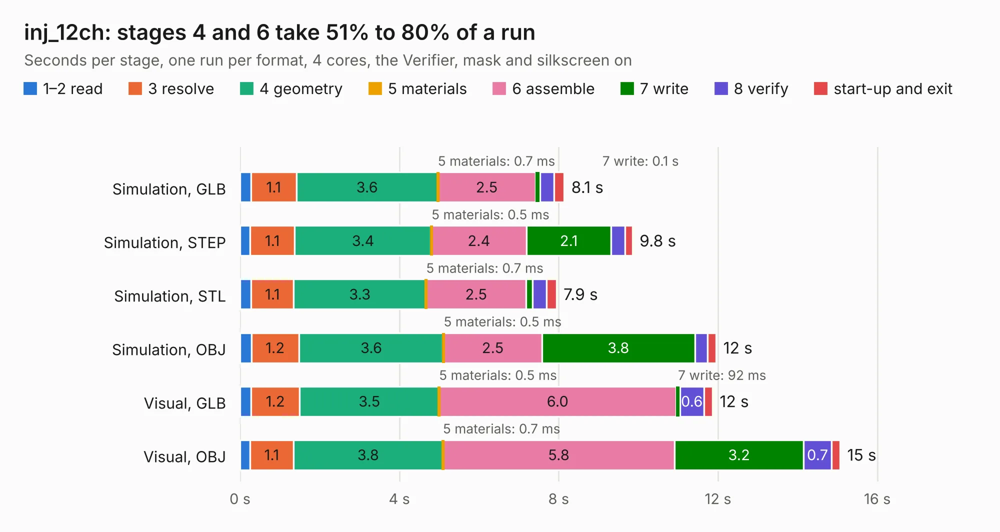

# 2409. inj_12ch

Board 2,409 of the 3,102 of [Corpus Testing](../Corpus-Testing.md), on [Corpus Page 23](../CorpusTestingPages/Corpus-Testing-23.md#2409-inj_12ch).

| Mode and format | 1–2 read | 3 resolve | 4 geometry | 5 materials | 6 assemble | 7 write | 8 verify | start-up and exit | Total |
|---|---:|---:|---:|---:|---:|---:|---:|---:|---:|
| Simulation, GLB | 0.3 | 1.1 | 3.6 | 0.7&nbsp;ms | 2.5 | 0.1 | 0.4 | 0.2 | 8.1 |
| Simulation, STEP | 0.3 | 1.1 | 3.4 | 0.5&nbsp;ms | 2.4 | 2.1 | 0.3 | 0.2 | 9.8 |
| Simulation, STL | 0.3 | 1.1 | 3.3 | 0.7&nbsp;ms | 2.5 | 0.2 | 0.4 | 0.2 | 7.9 |
| Simulation, OBJ | 0.3 | 1.2 | 3.6 | 0.5&nbsp;ms | 2.5 | 3.8 | 0.3 | 0.2 | 12.0 |
| Visual, GLB | 0.3 | 1.2 | 3.5 | 0.5&nbsp;ms | 6.0 | 92&nbsp;ms | 0.6 | 0.2 | 11.9 |
| Visual, OBJ | 0.2 | 1.1 | 3.8 | 0.7&nbsp;ms | 5.8 | 3.2 | 0.7 | 0.2 | 15.1 |

<table align="center"><tr><td valign="top">

| Board | Repo: [rusefi/rusefi-hardware](https://github.com/rusefi/rusefi-hardware) Board: `inj_12ch.kicad_pcb` |
|---|---|
| Folder | classic-designs / 1A_injector_12-channels |
| Complexity | 214&nbsp;/&nbsp;1000 (size&nbsp;179, features&nbsp;35) |
| KESE&nbsp;features | through vias, filled zones |
| Tested | 9th November 2026 |
| Copper&nbsp;layers | 2 |
| File&nbsp;format | KiCad 3 (3) |
| Parts,&nbsp;tracks,&nbsp;vias | 56, 791, 196 |
| Triangles,&nbsp;simulation | 793,042 in 56 parts |
| Verifier | PASS in all six runs |

</td><td valign="top">

<table>
<tr><th>File type</th><th>File size</th><th>Peak memory used</th></tr>
<tr><th colspan="3" align="left">Simulation</th></tr>
<tr><td>GLB</td><td align="right">27&nbsp;MB</td><td align="right">455&nbsp;MB</td></tr>
<tr><td>STEP</td><td align="right">116&nbsp;MB</td><td align="right">474&nbsp;MB</td></tr>
<tr><td>STL</td><td align="right">40&nbsp;MB</td><td align="right">403&nbsp;MB</td></tr>
<tr><td>OBJ</td><td align="right">81&nbsp;MB</td><td align="right">571&nbsp;MB</td></tr>
<tr><th colspan="3" align="left">Visual</th></tr>
<tr><td>GLB</td><td align="right">23&nbsp;MB</td><td align="right">538&nbsp;MB</td></tr>
<tr><td>OBJ</td><td align="right">68&nbsp;MB</td><td align="right">532&nbsp;MB</td></tr>
</table>

</td></tr></table>

| Previous | Next |
|:---|---:|
| [2408. CDI-test](b2408b_rusefi-hardware_CDI-test.md) | [2410. inj_6ch](b2410b_rusefi-hardware_classic-designs-1A-injector-6-channels_inj-6ch.md) |
