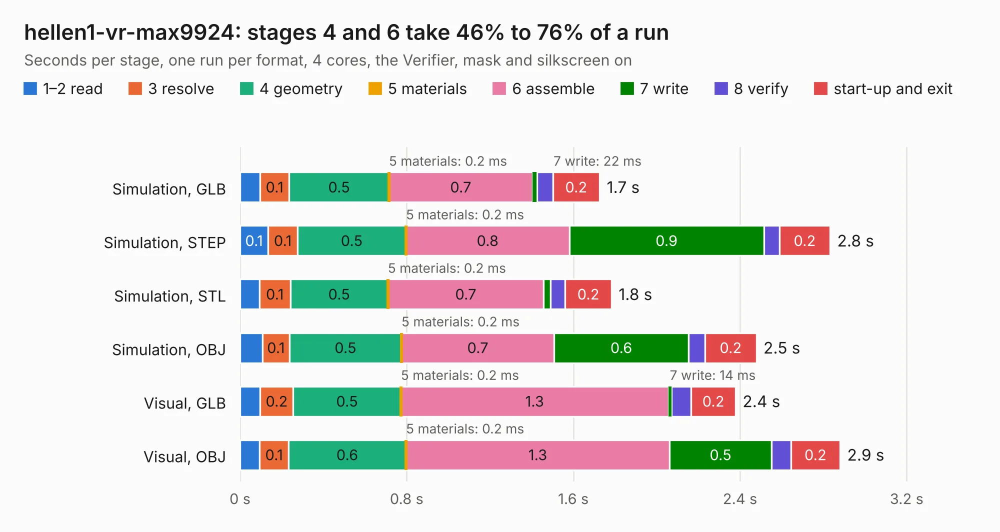

# 2410. hellen1-vr-max9924

Board 2,410 of the 3,112 of [Corpus Testing](../Corpus-Testing.md), on [Corpus Page 23](../CorpusTestingPages/Corpus-Testing-23.md#2410-hellen1-vr-max9924).

| Mode and format | 1–2 read | 3 resolve | 4 geometry | 5 materials | 6 assemble | 7 write | 8 verify | start-up and exit | Total |
|---|---:|---:|---:|---:|---:|---:|---:|---:|---:|
| Simulation, GLB | 96&nbsp;ms | 0.1 | 0.5 | 0.2&nbsp;ms | 0.7 | 22&nbsp;ms | 75&nbsp;ms | 0.2 | 1.7 |
| Simulation, STEP | 0.1 | 0.1 | 0.5 | 0.2&nbsp;ms | 0.8 | 0.9 | 75&nbsp;ms | 0.2 | 2.8 |
| Simulation, STL | 93&nbsp;ms | 0.1 | 0.5 | 0.2&nbsp;ms | 0.7 | 33&nbsp;ms | 71&nbsp;ms | 0.2 | 1.8 |
| Simulation, OBJ | 0.1 | 0.1 | 0.5 | 0.2&nbsp;ms | 0.7 | 0.6 | 80&nbsp;ms | 0.2 | 2.5 |
| Visual, GLB | 97&nbsp;ms | 0.2 | 0.5 | 0.2&nbsp;ms | 1.3 | 14&nbsp;ms | 96&nbsp;ms | 0.2 | 2.4 |
| Visual, OBJ | 94&nbsp;ms | 0.1 | 0.6 | 0.2&nbsp;ms | 1.3 | 0.5 | 92&nbsp;ms | 0.2 | 2.9 |

<table align="center"><tr><td valign="top">

| Board | Repo: [rusefi/hellen-one](https://github.com/rusefi/hellen-one) Board: `hellen1-vr-max9924.kicad_pcb` |
|---|---|
| Folder | kicad / modules / hellen1-vr-max9924 |
| Complexity | 221&nbsp;/&nbsp;1000 (size&nbsp;141, features&nbsp;80) |
| KESE&nbsp;features | through vias, rounded, trapezoid or chamfered pads, filled zones, stack-up, dielectric εr and tanδ, mask and silkscreen colours |
| Tested | 9th November 2026 |
| Copper&nbsp;layers | 4 |
| File&nbsp;format | KiCad 7 (20221018) |
| Parts,&nbsp;tracks,&nbsp;vias | 13, 57, 23 |
| Triangles,&nbsp;simulation | 119,346 in 27 parts |
| Verifier | PASS in all six runs |

</td><td valign="top">

<table>
<tr><th>File type</th><th>File size</th><th>Peak memory used</th></tr>
<tr><th colspan="3" align="left">Simulation</th></tr>
<tr><td>GLB</td><td align="right">4.0&nbsp;MB</td><td align="right">185&nbsp;MB</td></tr>
<tr><td>STEP</td><td align="right">14&nbsp;MB</td><td align="right">196&nbsp;MB</td></tr>
<tr><td>STL</td><td align="right">6.0&nbsp;MB</td><td align="right">185&nbsp;MB</td></tr>
<tr><td>OBJ</td><td align="right">11&nbsp;MB</td><td align="right">188&nbsp;MB</td></tr>
<tr><th colspan="3" align="left">Visual</th></tr>
<tr><td>GLB</td><td align="right">2.6&nbsp;MB</td><td align="right">154&nbsp;MB</td></tr>
<tr><td>OBJ</td><td align="right">7.4&nbsp;MB</td><td align="right">154&nbsp;MB</td></tr>
</table>

</td></tr></table>

| Previous | Next |
|:---|---:|
| [2409. hellen1-vr-discrete](b2409b_hellen-one_hellen1-vr-discrete.md) | [2411. hellen1-wbo](b2411b_hellen-one_hellen1-wbo.md) |
