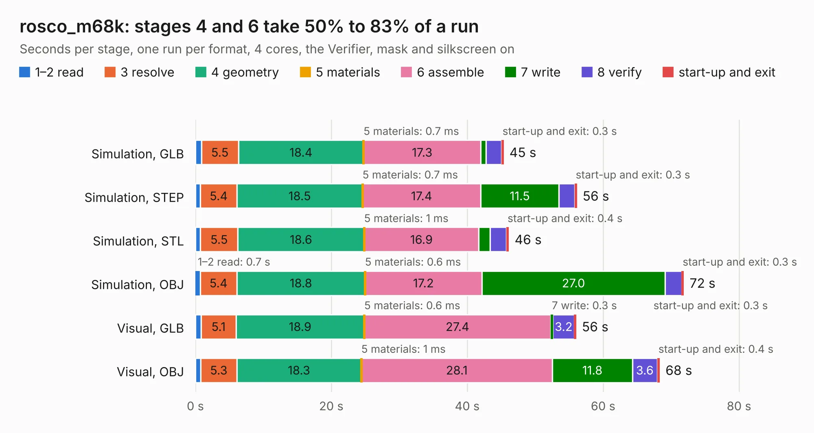

# 2410. rosco_m68k

Board 2,410 of the 3,122 of [Corpus Testing](../Corpus-Testing.md), on [Corpus Page 23](../CorpusTestingPages/Corpus-Testing-23.md#2410-rosco_m68k).

| Mode and format | 1–2 read | 3 resolve | 4 geometry | 5 materials | 6 assemble | 7 write | 8 verify | start-up and exit | Total |
|---|---:|---:|---:|---:|---:|---:|---:|---:|---:|
| Simulation, GLB | 0.9 | 5.5 | 18.4 | 0.7&nbsp;ms | 17.3 | 0.8 | 2.3 | 0.3 | 45.4 |
| Simulation, STEP | 0.7 | 5.4 | 18.5 | 0.7&nbsp;ms | 17.4 | 11.5 | 2.3 | 0.3 | 56.1 |
| Simulation, STL | 0.7 | 5.5 | 18.6 | 1&nbsp;ms | 16.9 | 1.6 | 2.4 | 0.4 | 46.1 |
| Simulation, OBJ | 0.7 | 5.4 | 18.8 | 0.6&nbsp;ms | 17.2 | 27.0 | 2.4 | 0.3 | 71.9 |
| Visual, GLB | 0.8 | 5.1 | 18.9 | 0.6&nbsp;ms | 27.4 | 0.3 | 3.2 | 0.3 | 56.0 |
| Visual, OBJ | 0.8 | 5.3 | 18.3 | 1&nbsp;ms | 28.1 | 11.8 | 3.6 | 0.4 | 68.3 |

<table align="center"><tr><td valign="top">

| Board | Repo: [rosco-m68k/rosco_m68k](https://github.com/rosco-m68k/rosco_m68k) Board: `rosco_m68k.kicad_pcb` |
|---|---|
| Folder | design / r1 / kicad |
| Complexity | 253&nbsp;/&nbsp;1000 (size&nbsp;208, features&nbsp;45) |
| KESE&nbsp;features | through vias, filled zones, curved board outline |
| Tested | 9th November 2026 |
| Copper&nbsp;layers | 4 |
| File&nbsp;format | KiCad 5 (20171130) |
| Parts,&nbsp;tracks,&nbsp;vias | 72, 1,942, 188 |
| Triangles,&nbsp;simulation | 4,707,790 in 144 parts |
| Verifier | PASS in all six runs |

</td><td valign="top">

<table>
<tr><th>File type</th><th>File size</th><th>Peak memory used</th></tr>
<tr><th colspan="3" align="left">Simulation</th></tr>
<tr><td>GLB</td><td align="right">161&nbsp;MB</td><td align="right">1.2&nbsp;GB</td></tr>
<tr><td>STEP</td><td align="right">612&nbsp;MB</td><td align="right">1.4&nbsp;GB</td></tr>
<tr><td>STL</td><td align="right">235&nbsp;MB</td><td align="right">1.3&nbsp;GB</td></tr>
<tr><td>OBJ</td><td align="right">504&nbsp;MB</td><td align="right">3.1&nbsp;GB</td></tr>
<tr><th colspan="3" align="left">Visual</th></tr>
<tr><td>GLB</td><td align="right">71&nbsp;MB</td><td align="right">1.3&nbsp;GB</td></tr>
<tr><td>OBJ</td><td align="right">226&nbsp;MB</td><td align="right">1.5&nbsp;GB</td></tr>
</table>

</td></tr></table>

| Previous | Next |
|:---|---:|
| [2409. rosco_m68k](b2409b_rosco-m68k_design-r1-2-kicad_rosco-m68k.md) | [2411. rosco_m68k](b2411b_rosco-m68k_design-r2-kicad_rosco-m68k.md) |
