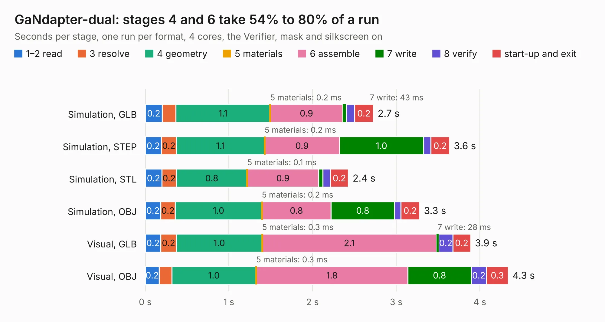

# 2412. GaNdapter-dual

Board 2,412 of the 3,131 of [Corpus Testing](../Corpus-Testing.md), on [Corpus Page 23](../CorpusTestingPages/Corpus-Testing-23.md#2412-gandapter-dual).

| Mode and format | 1–2 read | 3 resolve | 4 geometry | 5 materials | 6 assemble | 7 write | 8 verify | start-up and exit | Total |
|---|---:|---:|---:|---:|---:|---:|---:|---:|---:|
| Simulation, GLB | 0.2 | 0.2 | 1.1 | 0.2&nbsp;ms | 0.9 | 43&nbsp;ms | 97&nbsp;ms | 0.2 | 2.7 |
| Simulation, STEP | 0.2 | 0.2 | 1.1 | 0.2&nbsp;ms | 0.9 | 1.0 | 87&nbsp;ms | 0.2 | 3.6 |
| Simulation, STL | 0.2 | 0.2 | 0.8 | 0.1&nbsp;ms | 0.9 | 48&nbsp;ms | 93&nbsp;ms | 0.2 | 2.4 |
| Simulation, OBJ | 0.2 | 0.2 | 1.0 | 0.2&nbsp;ms | 0.8 | 0.8 | 75&nbsp;ms | 0.2 | 3.3 |
| Visual, GLB | 0.2 | 0.2 | 1.0 | 0.3&nbsp;ms | 2.1 | 28&nbsp;ms | 0.2 | 0.2 | 3.9 |
| Visual, OBJ | 0.2 | 0.2 | 1.0 | 0.3&nbsp;ms | 1.8 | 0.8 | 0.2 | 0.3 | 4.3 |

<table align="center"><tr><td valign="top">

| Board | Repo: [rootthecause/dcdc](https://github.com/rootthecause/dcdc) Board: `GaNdapter-dual.kicad_pcb` |
|---|---|
| Folder | extra / external-boards / GaNdapter-dual |
| Complexity | 241&nbsp;/&nbsp;1000 (size&nbsp;126, features&nbsp;115) |
| KESE&nbsp;features | through vias, slotted holes, rounded, trapezoid or chamfered pads, filled zones, curved board outline, stack-up, dielectric εr and tanδ, copper finish, mask and silkscreen colours |
| Tested | 9th November 2026 |
| Copper&nbsp;layers | 2 |
| File&nbsp;format | KiCad 8 (20240108) |
| Parts,&nbsp;tracks,&nbsp;vias | 4, 4, 88 |
| Triangles,&nbsp;simulation | 199,122 in 17 parts |
| Verifier | PASS in all six runs |

</td><td valign="top">

<table>
<tr><th>File type</th><th>File size</th><th>Peak memory used</th></tr>
<tr><th colspan="3" align="left">Simulation</th></tr>
<tr><td>GLB</td><td align="right">7.2&nbsp;MB</td><td align="right">202&nbsp;MB</td></tr>
<tr><td>STEP</td><td align="right">31&nbsp;MB</td><td align="right">221&nbsp;MB</td></tr>
<tr><td>STL</td><td align="right">10.0&nbsp;MB</td><td align="right">201&nbsp;MB</td></tr>
<tr><td>OBJ</td><td align="right">22&nbsp;MB</td><td align="right">196&nbsp;MB</td></tr>
<tr><th colspan="3" align="left">Visual</th></tr>
<tr><td>GLB</td><td align="right">5.6&nbsp;MB</td><td align="right">196&nbsp;MB</td></tr>
<tr><td>OBJ</td><td align="right">17&nbsp;MB</td><td align="right">200&nbsp;MB</td></tr>
</table>

</td></tr></table>

| Previous | Next |
|:---|---:|
| [2411. TheMainBoard](b2411b_Thermometer_TheMainBoard.md) | [2413. GaNdapter](b2413b_dcdc_GaNdapter.md) |
