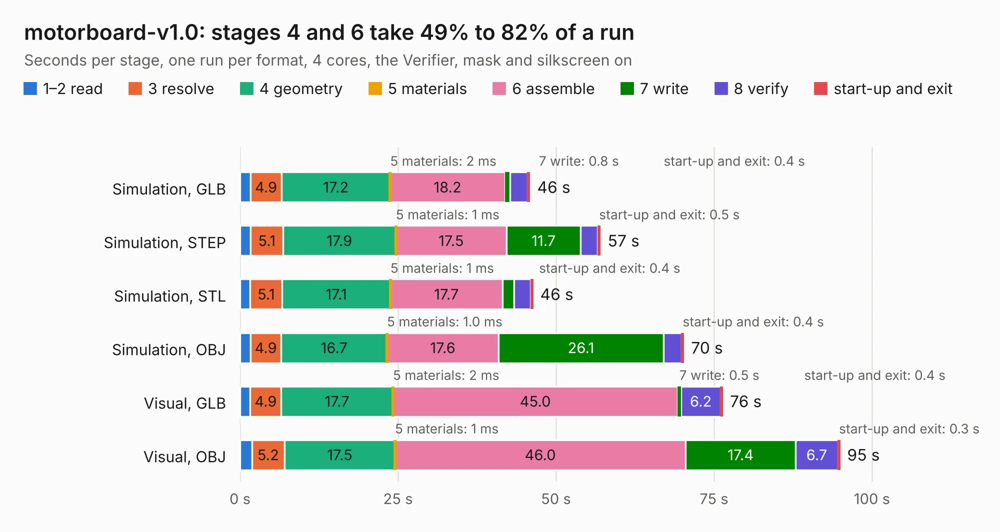

# 2413. motorboard-v1.0

Board 2,413 of the 3,138 of [Corpus Testing](../Corpus-Testing.md), on [Corpus Page 23](../CorpusTestingPages/Corpus-Testing-23.md#2413-motorboard-v10).

| Mode and format | 1–2 read | 3 resolve | 4 geometry | 5 materials | 6 assemble | 7 write | 8 verify | start-up and exit | Total |
|---|---:|---:|---:|---:|---:|---:|---:|---:|---:|
| Simulation, GLB | 1.7 | 4.9 | 17.2 | 2&nbsp;ms | 18.2 | 0.8 | 2.7 | 0.4 | 45.9 |
| Simulation, STEP | 1.7 | 5.1 | 17.9 | 1&nbsp;ms | 17.5 | 11.7 | 2.7 | 0.5 | 57.1 |
| Simulation, STL | 1.6 | 5.1 | 17.1 | 1&nbsp;ms | 17.7 | 1.9 | 2.6 | 0.4 | 46.4 |
| Simulation, OBJ | 1.6 | 4.9 | 16.7 | 1.0&nbsp;ms | 17.6 | 26.1 | 2.9 | 0.4 | 70.2 |
| Visual, GLB | 1.6 | 4.9 | 17.7 | 2&nbsp;ms | 45.0 | 0.5 | 6.2 | 0.4 | 76.4 |
| Visual, OBJ | 1.9 | 5.2 | 17.5 | 1&nbsp;ms | 46.0 | 17.4 | 6.7 | 0.3 | 94.9 |

<table align="center"><tr><td valign="top">

| Board | Repo: [robojackets/robocup-pcb](https://github.com/robojackets/robocup-pcb) Board: `motorboard-v1.0.kicad_pcb` |
|---|---|
| Folder | boards / rev-2026 / motorboard-v1.0 |
| Complexity | 332&nbsp;/&nbsp;1000 (size&nbsp;232, features&nbsp;100) |
| KESE&nbsp;features | through vias, rounded, trapezoid or chamfered pads, filled zones, curved board outline, knockout text, stack-up, dielectric εr and tanδ |
| Tested | 9th November 2026 |
| Copper&nbsp;layers | 4 |
| File&nbsp;format | KiCad 10 (20260206) |
| Parts,&nbsp;tracks,&nbsp;vias | 297, 2,038, 757 |
| Triangles,&nbsp;simulation | 4,902,124 in 375 parts |
| Verifier | PASS in all six runs |

</td><td valign="top">

<table>
<tr><th>File type</th><th>File size</th><th>Peak memory used</th></tr>
<tr><th colspan="3" align="left">Simulation</th></tr>
<tr><td>GLB</td><td align="right">168&nbsp;MB</td><td align="right">1.5&nbsp;GB</td></tr>
<tr><td>STEP</td><td align="right">656&nbsp;MB</td><td align="right">1.7&nbsp;GB</td></tr>
<tr><td>STL</td><td align="right">245&nbsp;MB</td><td align="right">1.6&nbsp;GB</td></tr>
<tr><td>OBJ</td><td align="right">523&nbsp;MB</td><td align="right">3.2&nbsp;GB</td></tr>
<tr><th colspan="3" align="left">Visual</th></tr>
<tr><td>GLB</td><td align="right">105&nbsp;MB</td><td align="right">1.7&nbsp;GB</td></tr>
<tr><td>OBJ</td><td align="right">336&nbsp;MB</td><td align="right">2.3&nbsp;GB</td></tr>
</table>

</td></tr></table>

| Previous | Next |
|:---|---:|
| [2412. kicker-v3.4](b2412b_robocup-pcb_kicker-v3-4.md) | [2414. Alius_6502](b2414b_Alius6502-PCB_Alius-6502.md) |
