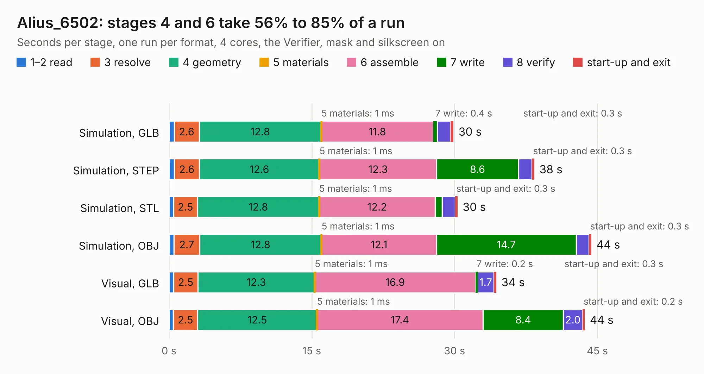

# 2414 Alius_6502

Board 2,414 of the 3,138 of [Corpus Testing](../Corpus-Testing.md), on [Corpus Page 23](../CorpusTestingPages/Corpus-Testing-23.md#2414-alius_6502).

| Mode and format | 1–2 read | 3 resolve | 4 geometry | 5 materials | 6 assemble | 7 write | 8 verify | start-up and exit | Total |
|---|---:|---:|---:|---:|---:|---:|---:|---:|---:|
| Simulation, GLB | 0.5 | 2.6 | 12.8 | 1&nbsp;ms | 11.8 | 0.4 | 1.4 | 0.3 | 29.9 |
| Simulation, STEP | 0.6 | 2.6 | 12.6 | 1&nbsp;ms | 12.3 | 8.6 | 1.4 | 0.3 | 38.4 |
| Simulation, STL | 0.5 | 2.5 | 12.8 | 1&nbsp;ms | 12.2 | 0.8 | 1.3 | 0.3 | 30.3 |
| Simulation, OBJ | 0.5 | 2.7 | 12.8 | 1&nbsp;ms | 12.1 | 14.7 | 1.3 | 0.3 | 44.4 |
| Visual, GLB | 0.5 | 2.5 | 12.3 | 1&nbsp;ms | 16.9 | 0.2 | 1.7 | 0.3 | 34.4 |
| Visual, OBJ | 0.5 | 2.5 | 12.5 | 1&nbsp;ms | 17.4 | 8.4 | 2.0 | 0.2 | 43.7 |

<table align="center"><tr><td valign="top">

| Board | Repo: [robsonde/Alius6502_PCB](https://github.com/robsonde/Alius6502_PCB) Board: `Alius_6502.kicad_pcb` |
|---|---|
| Complexity | 248&nbsp;/&nbsp;1000 (size&nbsp;193, features&nbsp;55) |
| KESE&nbsp;features | through vias, curved board outline, stack-up, dielectric εr and tanδ |
| Tested | 9th November 2026 |
| Copper&nbsp;layers | 2 |
| File&nbsp;format | KiCad 7 (20221018) |
| Parts,&nbsp;tracks,&nbsp;vias | 120, 1,879, 16 |
| Triangles,&nbsp;simulation | 2,658,232 in 209 parts |
| Verifier | PASS in all six runs |

</td><td valign="top">

<table>
<tr><th>File type</th><th>File size</th><th>Peak memory used</th></tr>
<tr><th colspan="3" align="left">Simulation</th></tr>
<tr><td>GLB</td><td align="right">85&nbsp;MB</td><td align="right">835&nbsp;MB</td></tr>
<tr><td>STEP</td><td align="right">419&nbsp;MB</td><td align="right">1.1&nbsp;GB</td></tr>
<tr><td>STL</td><td align="right">133&nbsp;MB</td><td align="right">825&nbsp;MB</td></tr>
<tr><td>OBJ</td><td align="right">275&nbsp;MB</td><td align="right">1.7&nbsp;GB</td></tr>
<tr><th colspan="3" align="left">Visual</th></tr>
<tr><td>GLB</td><td align="right">50&nbsp;MB</td><td align="right">1.2&nbsp;GB</td></tr>
<tr><td>OBJ</td><td align="right">154&nbsp;MB</td><td align="right">1.2&nbsp;GB</td></tr>
</table>

</td></tr></table>

| Previous | Next |
|:---|---:|
| [2413 motorboard-v1.0](b2413b_robocup-pcb_motorboard-v1-0.md) | [2415 TINY-REFLOW-CONTROLLER](b2415b_TinyReflowController_TINY-REFLOW-CONTROLLER.md) |
