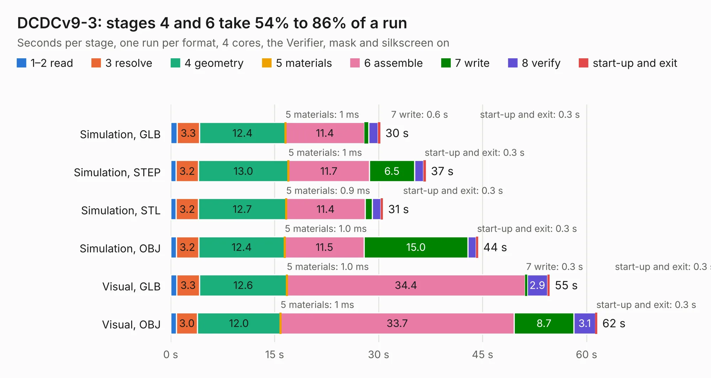

# 2414. DCDCv9-3

Board 2,414 of the 3,131 of [Corpus Testing](../Corpus-Testing.md), on [Corpus Page 23](../CorpusTestingPages/Corpus-Testing-23.md#2414-dcdcv9-3).

| Mode and format | 1–2 read | 3 resolve | 4 geometry | 5 materials | 6 assemble | 7 write | 8 verify | start-up and exit | Total |
|---|---:|---:|---:|---:|---:|---:|---:|---:|---:|
| Simulation, GLB | 0.9 | 3.3 | 12.4 | 1&nbsp;ms | 11.4 | 0.6 | 1.4 | 0.3 | 30.2 |
| Simulation, STEP | 0.8 | 3.2 | 13.0 | 1&nbsp;ms | 11.7 | 6.5 | 1.3 | 0.3 | 36.8 |
| Simulation, STL | 0.8 | 3.2 | 12.7 | 0.9&nbsp;ms | 11.4 | 1.0 | 1.3 | 0.3 | 30.6 |
| Simulation, OBJ | 0.8 | 3.2 | 12.4 | 1.0&nbsp;ms | 11.5 | 15.0 | 1.2 | 0.3 | 44.4 |
| Visual, GLB | 0.9 | 3.3 | 12.6 | 1.0&nbsp;ms | 34.4 | 0.3 | 2.9 | 0.3 | 54.7 |
| Visual, OBJ | 0.8 | 3.0 | 12.0 | 1&nbsp;ms | 33.7 | 8.7 | 3.1 | 0.3 | 61.5 |

<table align="center"><tr><td valign="top">

| Board | Repo: [rootthecause/dcdc](https://github.com/rootthecause/dcdc) Board: `DCDCv9-3.kicad_pcb` |
|---|---|
| Folder | kicad |
| Complexity | 361&nbsp;/&nbsp;1000 (size&nbsp;221, features&nbsp;140) |
| KESE&nbsp;features | through vias, slotted holes, custom pads, rounded, trapezoid or chamfered pads, filled zones, copper drawings, curved board outline, stack-up, dielectric εr and tanδ, copper finish, mask and silkscreen colours |
| Tested | 9th November 2026 |
| Copper&nbsp;layers | 4 |
| File&nbsp;format | KiCad 9 (20241229) |
| Parts,&nbsp;tracks,&nbsp;vias | 197, 682, 744 |
| Triangles,&nbsp;simulation | 3,136,706 in 124 parts |
| Verifier | PASS in all six runs |

</td><td valign="top">

<table>
<tr><th>File type</th><th>File size</th><th>Peak memory used</th></tr>
<tr><th colspan="3" align="left">Simulation</th></tr>
<tr><td>GLB</td><td align="right">103&nbsp;MB</td><td align="right">928&nbsp;MB</td></tr>
<tr><td>STEP</td><td align="right">369&nbsp;MB</td><td align="right">1.1&nbsp;GB</td></tr>
<tr><td>STL</td><td align="right">157&nbsp;MB</td><td align="right">913&nbsp;MB</td></tr>
<tr><td>OBJ</td><td align="right">340&nbsp;MB</td><td align="right">2.1&nbsp;GB</td></tr>
<tr><th colspan="3" align="left">Visual</th></tr>
<tr><td>GLB</td><td align="right">59&nbsp;MB</td><td align="right">1.3&nbsp;GB</td></tr>
<tr><td>OBJ</td><td align="right">189&nbsp;MB</td><td align="right">1.2&nbsp;GB</td></tr>
</table>

</td></tr></table>

| Previous | Next |
|:---|---:|
| [2413. GaNdapter](b2413b_dcdc_GaNdapter.md) | [2415. rosco_m68k](b2415b_rosco-m68k_design-r0-r0-kicad-import_rosco-m68k.md) |
