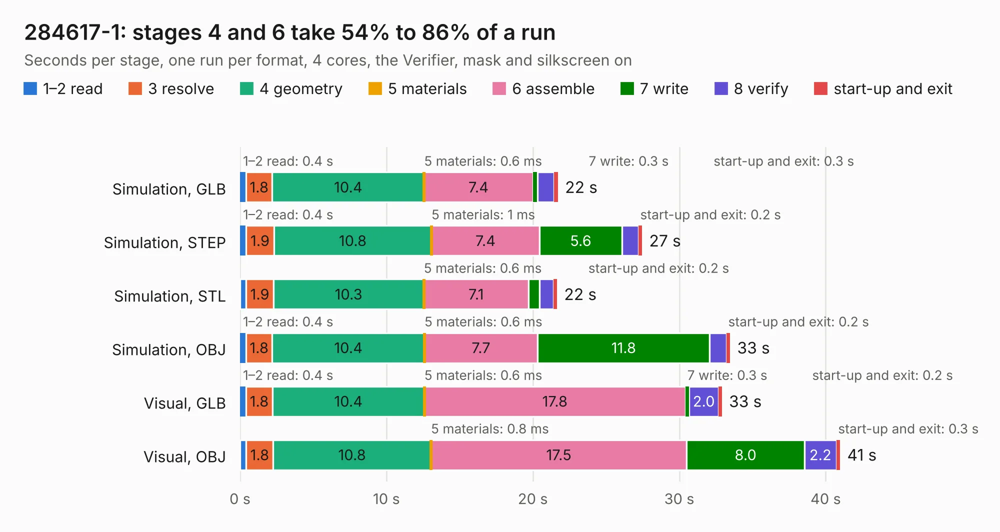

# 2416. 284617-1

Board 2,416 of the 3,111 of [Corpus Testing](../Corpus-Testing.md), on [Corpus Page 23](../CorpusTestingPages/Corpus-Testing-23.md#2416-284617-1).

| Mode and format | 1–2 read | 3 resolve | 4 geometry | 5 materials | 6 assemble | 7 write | 8 verify | start-up and exit | Total |
|---|---:|---:|---:|---:|---:|---:|---:|---:|---:|
| Simulation, GLB | 0.4 | 1.8 | 10.4 | 0.6&nbsp;ms | 7.4 | 0.3 | 1.1 | 0.3 | 21.7 |
| Simulation, STEP | 0.4 | 1.9 | 10.8 | 1&nbsp;ms | 7.4 | 5.6 | 1.1 | 0.2 | 27.5 |
| Simulation, STL | 0.4 | 1.9 | 10.3 | 0.6&nbsp;ms | 7.1 | 0.7 | 1.0 | 0.2 | 21.6 |
| Simulation, OBJ | 0.4 | 1.8 | 10.4 | 0.6&nbsp;ms | 7.7 | 11.8 | 1.1 | 0.2 | 33.5 |
| Visual, GLB | 0.4 | 1.8 | 10.4 | 0.6&nbsp;ms | 17.8 | 0.3 | 2.0 | 0.2 | 32.9 |
| Visual, OBJ | 0.4 | 1.8 | 10.8 | 0.8&nbsp;ms | 17.5 | 8.0 | 2.2 | 0.3 | 41.0 |

<table align="center"><tr><td valign="top">

| Board | Repo: [rusefi/rusefi-hardware](https://github.com/rusefi/rusefi-hardware) Board: `284617-1.kicad_pcb` |
|---|---|
| Folder | breakout-boards / Breakout_154pin_284617-1-Connector |
| Complexity | 185&nbsp;/&nbsp;1000 (size&nbsp;155, features&nbsp;30) |
| KESE&nbsp;features | filled zones, curved board outline |
| Tested | 9th November 2026 |
| Copper&nbsp;layers | 2 |
| File&nbsp;format | KiCad 7 (20221018) |
| Parts,&nbsp;tracks,&nbsp;vias | 13, 823, 0 |
| Triangles,&nbsp;simulation | 2,138,614 in 167 parts |
| Verifier | PASS in all six runs |

</td><td valign="top">

<table>
<tr><th>File type</th><th>File size</th><th>Peak memory used</th></tr>
<tr><th colspan="3" align="left">Simulation</th></tr>
<tr><td>GLB</td><td align="right">72&nbsp;MB</td><td align="right">809&nbsp;MB</td></tr>
<tr><td>STEP</td><td align="right">314&nbsp;MB</td><td align="right">916&nbsp;MB</td></tr>
<tr><td>STL</td><td align="right">107&nbsp;MB</td><td align="right">788&nbsp;MB</td></tr>
<tr><td>OBJ</td><td align="right">222&nbsp;MB</td><td align="right">1.4&nbsp;GB</td></tr>
<tr><th colspan="3" align="left">Visual</th></tr>
<tr><td>GLB</td><td align="right">50&nbsp;MB</td><td align="right">1.1&nbsp;GB</td></tr>
<tr><td>OBJ</td><td align="right">154&nbsp;MB</td><td align="right">1.1&nbsp;GB</td></tr>
</table>

</td></tr></table>

| Previous | Next |
|:---|---:|
| [2415. 24pins_In_3conn](b2415b_rusefi-hardware_24pins-In-3conn.md) | [2417. CDI-test](b2417b_rusefi-hardware_CDI-test.md) |
