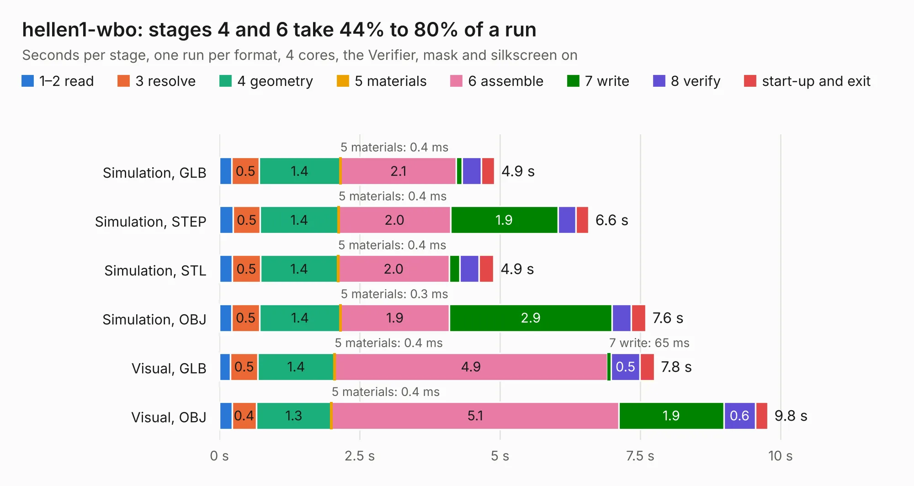

# 2417. hellen1-wbo

Board 2,417 of the 3,118 of [Corpus Testing](../Corpus-Testing.md), on [Corpus Page 23](../CorpusTestingPages/Corpus-Testing-23.md#2417-hellen1-wbo).

| Mode and format | 1–2 read | 3 resolve | 4 geometry | 5 materials | 6 assemble | 7 write | 8 verify | start-up and exit | Total |
|---|---:|---:|---:|---:|---:|---:|---:|---:|---:|
| Simulation, GLB | 0.2 | 0.5 | 1.4 | 0.4&nbsp;ms | 2.1 | 0.1 | 0.3 | 0.2 | 4.9 |
| Simulation, STEP | 0.2 | 0.5 | 1.4 | 0.4&nbsp;ms | 2.0 | 1.9 | 0.3 | 0.2 | 6.6 |
| Simulation, STL | 0.2 | 0.5 | 1.4 | 0.4&nbsp;ms | 2.0 | 0.2 | 0.3 | 0.3 | 4.9 |
| Simulation, OBJ | 0.2 | 0.5 | 1.4 | 0.3&nbsp;ms | 1.9 | 2.9 | 0.3 | 0.3 | 7.6 |
| Visual, GLB | 0.2 | 0.5 | 1.4 | 0.4&nbsp;ms | 4.9 | 65&nbsp;ms | 0.5 | 0.3 | 7.8 |
| Visual, OBJ | 0.2 | 0.4 | 1.3 | 0.4&nbsp;ms | 5.1 | 1.9 | 0.6 | 0.2 | 9.8 |

<table align="center"><tr><td valign="top">

| Board | Repo: [rusefi/hellen-one](https://github.com/rusefi/hellen-one) Board: `hellen1-wbo.kicad_pcb` |
|---|---|
| Folder | kicad / modules / hellen1-wbo |
| Complexity | 306&nbsp;/&nbsp;1000 (size&nbsp;226, features&nbsp;80) |
| KESE&nbsp;features | through vias, rounded, trapezoid or chamfered pads, filled zones, stack-up, dielectric εr and tanδ, mask and silkscreen colours |
| Tested | 9th November 2026 |
| Copper&nbsp;layers | 4 |
| File&nbsp;format | KiCad 8 (20240108) |
| Parts,&nbsp;tracks,&nbsp;vias | 64, 448, 80 |
| Triangles,&nbsp;simulation | 560,150 in 68 parts |
| Verifier | PASS in all six runs |

</td><td valign="top">

<table>
<tr><th>File type</th><th>File size</th><th>Peak memory used</th></tr>
<tr><th colspan="3" align="left">Simulation</th></tr>
<tr><td>GLB</td><td align="right">19&nbsp;MB</td><td align="right">334&nbsp;MB</td></tr>
<tr><td>STEP</td><td align="right">86&nbsp;MB</td><td align="right">362&nbsp;MB</td></tr>
<tr><td>STL</td><td align="right">28&nbsp;MB</td><td align="right">356&nbsp;MB</td></tr>
<tr><td>OBJ</td><td align="right">56&nbsp;MB</td><td align="right">417&nbsp;MB</td></tr>
<tr><th colspan="3" align="left">Visual</th></tr>
<tr><td>GLB</td><td align="right">14&nbsp;MB</td><td align="right">384&nbsp;MB</td></tr>
<tr><td>OBJ</td><td align="right">41&nbsp;MB</td><td align="right">387&nbsp;MB</td></tr>
</table>

</td></tr></table>

| Previous | Next |
|:---|---:|
| [2416. hellen1-vr-max9924](b2416b_hellen-one_hellen1-vr-max9924.md) | [2418. output.Panel_R0.5.1_300x300_2layer_step1_Modified_1and5_only](b2418b_hw-microrusefi_output-Panel-R0-5-1-300x300-2layer-step1-Modified-1and5-only.md) |
