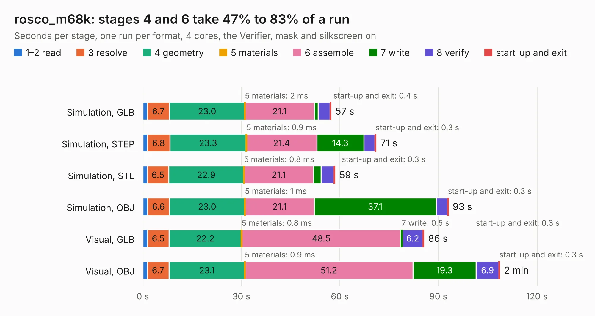

# 2418. rosco_m68k

Board 2,418 of the 3,129 of [Corpus Testing](../Corpus-Testing.md), on [Corpus Page 23](../CorpusTestingPages/Corpus-Testing-23.md#2418-rosco_m68k).

| Mode and format | 1–2 read | 3 resolve | 4 geometry | 5 materials | 6 assemble | 7 write | 8 verify | start-up and exit | Total |
|---|---:|---:|---:|---:|---:|---:|---:|---:|---:|
| Simulation, GLB | 1.4 | 6.7 | 23.0 | 2&nbsp;ms | 21.1 | 1.2 | 3.6 | 0.4 | 57.3 |
| Simulation, STEP | 1.4 | 6.8 | 23.3 | 0.9&nbsp;ms | 21.4 | 14.3 | 3.4 | 0.3 | 71.0 |
| Simulation, STL | 1.4 | 6.5 | 22.9 | 0.8&nbsp;ms | 21.1 | 2.4 | 3.9 | 0.3 | 58.5 |
| Simulation, OBJ | 1.5 | 6.6 | 23.0 | 1&nbsp;ms | 21.1 | 37.1 | 3.4 | 0.3 | 93.1 |
| Visual, GLB | 1.5 | 6.5 | 22.2 | 0.8&nbsp;ms | 48.5 | 0.5 | 6.2 | 0.3 | 85.6 |
| Visual, OBJ | 1.3 | 6.7 | 23.1 | 0.9&nbsp;ms | 51.2 | 19.3 | 6.9 | 0.3 | 108.7 |

<table align="center"><tr><td valign="top">

| Board | Repo: [rosco-m68k/rosco_m68k](https://github.com/rosco-m68k/rosco_m68k) Board: `rosco_m68k.kicad_pcb` |
|---|---|
| Folder | design / r2030 / kicad |
| Complexity | 380&nbsp;/&nbsp;1000 (size&nbsp;255, features&nbsp;125) |
| KESE&nbsp;features | through vias, slotted holes, rounded, trapezoid or chamfered pads, filled zones, curved board outline, knockout text, TrueType text, stack-up, dielectric εr and tanδ |
| Tested | 9th November 2026 |
| Copper&nbsp;layers | 4 |
| File&nbsp;format | KiCad 7 (20221018) |
| Parts,&nbsp;tracks,&nbsp;vias | 88, 3,017, 109 |
| Triangles,&nbsp;simulation | 6,108,744 in 219 parts |
| Verifier | PASS in all six runs |

</td><td valign="top">

<table>
<tr><th>File type</th><th>File size</th><th>Peak memory used</th></tr>
<tr><th colspan="3" align="left">Simulation</th></tr>
<tr><td>GLB</td><td align="right">207&nbsp;MB</td><td align="right">1.5&nbsp;GB</td></tr>
<tr><td>STEP</td><td align="right">914&nbsp;MB</td><td align="right">2.0&nbsp;GB</td></tr>
<tr><td>STL</td><td align="right">305&nbsp;MB</td><td align="right">1.6&nbsp;GB</td></tr>
<tr><td>OBJ</td><td align="right">655&nbsp;MB</td><td align="right">3.9&nbsp;GB</td></tr>
<tr><th colspan="3" align="left">Visual</th></tr>
<tr><td>GLB</td><td align="right">118&nbsp;MB</td><td align="right">1.9&nbsp;GB</td></tr>
<tr><td>OBJ</td><td align="right">371&nbsp;MB</td><td align="right">2.4&nbsp;GB</td></tr>
</table>

</td></tr></table>

| Previous | Next |
|:---|---:|
| [2417. rosco_m68k](b2417b_rosco-m68k_design-r2020-kicad_rosco-m68k.md) | [2419. rosco_pro_030_proto](b2419b_rosco-m68k-pro_rosco-pro-030-proto.md) |
